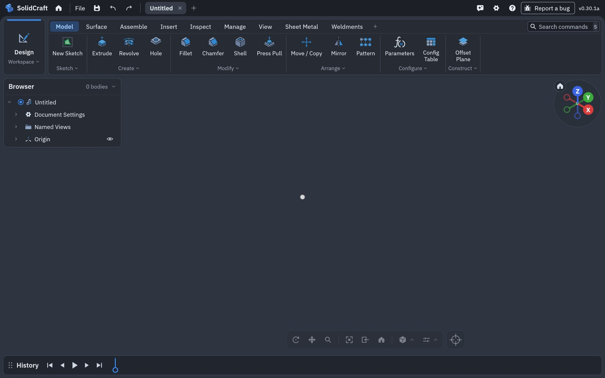
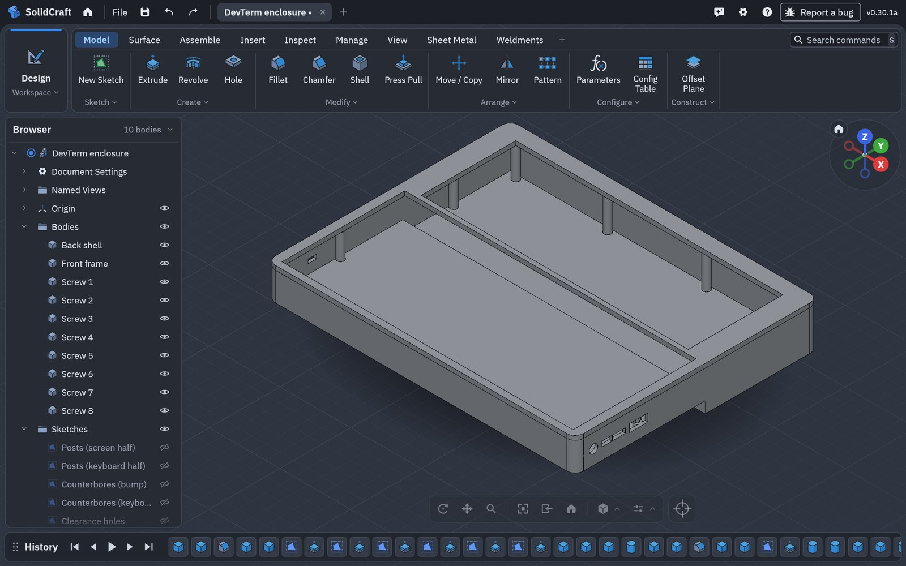
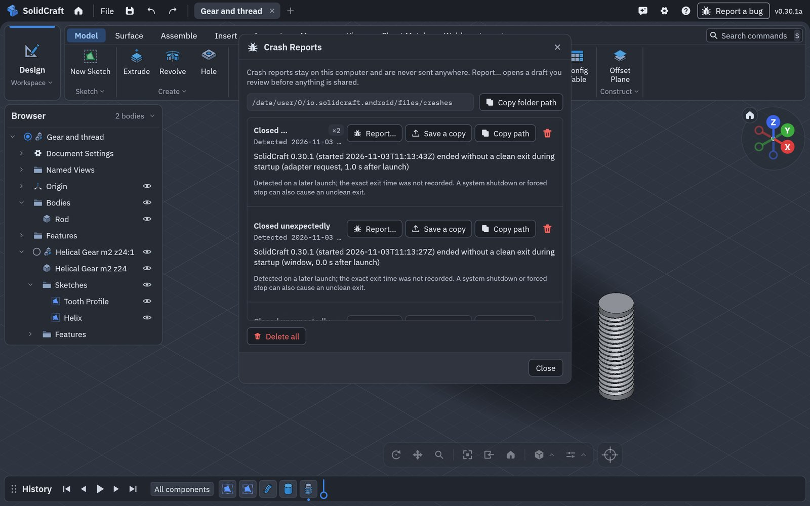
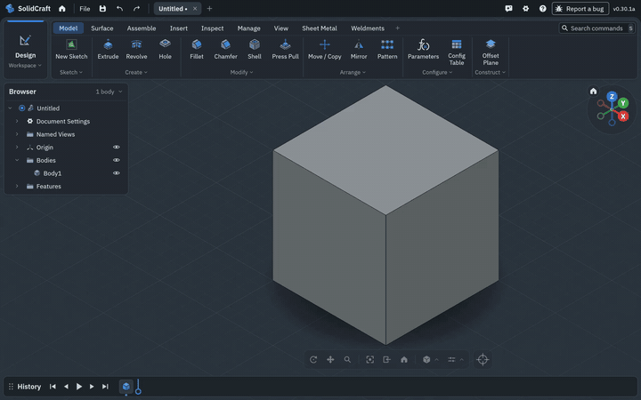
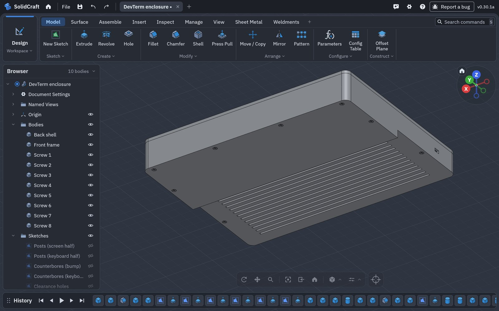
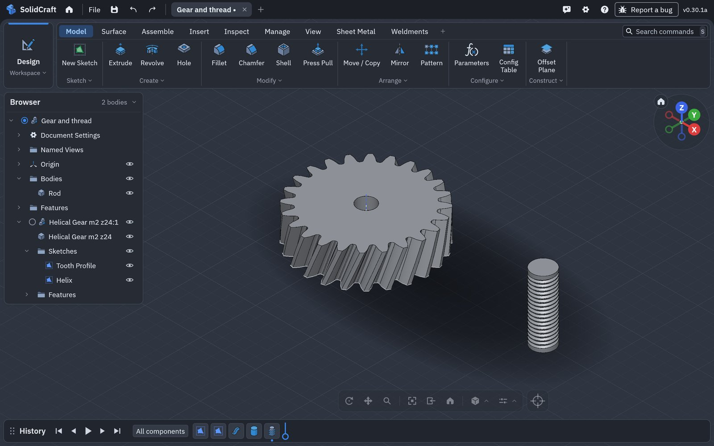
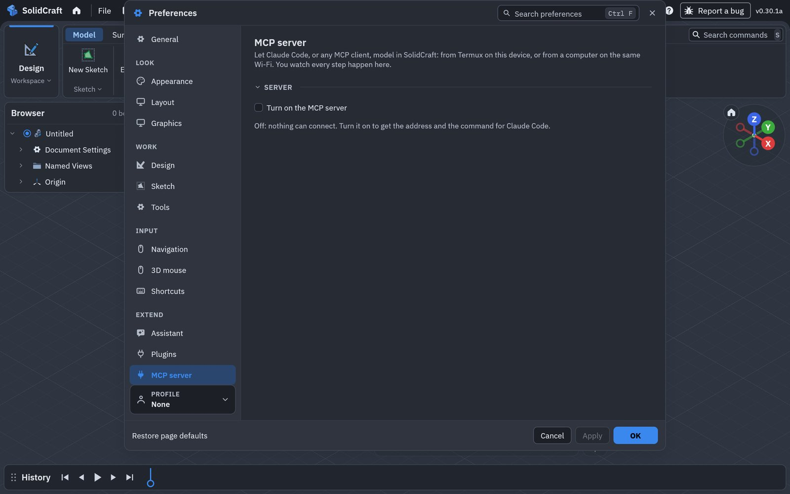

# 0.30.1a on Android: an OpenGL ES fallback, and the test run

What 0.30.1a changes for phones whose graphics don't start
([port issue #4](https://github.com/deveshrai/Solidcraft-Android-Port/issues/4)), what testing it found
in upstream 0.30.1 on OpenGL ES, and the run on a Pixel Tablet emulator (Android 16) on both graphics
backends. Every MCP call was timed.

- [In short](#in-short)
- [1. A launch that can't start its graphics](#1-a-launch-that-cant-start-its-graphics)
- [2. The empty 3D view on OpenGL ES](#2-the-empty-3d-view-on-opengl-es)
- [3. Crash reports you can save](#3-crash-reports-you-can-save)
- [4. The test run](#4-the-test-run)

## In short

| | |
|---|---|
| Galaxy A04 (issue #4) | aborted at every launch; now leaves cleanly, and the next launch starts on OpenGL ES |
| OpenGL ES | upstream 0.30.1's viewport shader didn't compile there, so the 3D view was empty on any GPU without working Vulkan; fixed in the port |
| Crash reports | announced at the next start, each one saved through Android's picker; Report a bug drafts the issue here, not upstream |
| Enclosure, 121 MCP calls | nothing failed on either backend: 64 s on OpenGL ES, 70 s on Vulkan (an emulator rendering on the Mac's CPU; the same build took 19.9 s on a Galaxy Tab in 0.28.0a) |
| Gear and M10 helical thread | 1.7 s and 0.5 s on OpenGL ES, 1.9 s and 0.7 s on Vulkan |

## 1. A launch that can't start its graphics

The log from issue #4 showed every launch on a Galaxy A04 (a PowerVR GE8320 GPU) ending about two
seconds in, with `pthread_mutex_lock called on a destroyed mutex` on Android's InsetsAnimation thread.
When the app couldn't start, it ended its process with `exit`, which runs the process's teardown while
Android's own threads still use what it frees, and Android aborted it. 0.30.1a:

- **leaves without that teardown** (`_exit`), after everything is saved;
- **falls back to OpenGL ES**: a launch that never draws a frame leaves a marker, and the next launch
  starts on OpenGL ES instead of Vulkan. A fallback that draws is kept; one that doesn't goes back to
  the default;
- **says why**: a launch that can't start writes `startup-error.txt` in the app's folder
  (`Android/data/io.solidcraft.android/files/`, reachable from a computer over USB), and the next
  launch's crash report names the step it stopped in.

Tested on the emulator by stopping a launch before its first frame: the next launch came up on
OpenGL ES (`graphics: Gl Android Emulator OpenGL ES Translator`), and one more stopped launch sent it
back to Vulkan.

## 2. The empty 3D view on OpenGL ES

The first OpenGL ES launch drew the app but not the model: no grid, planes or axes.

Upstream 0.30.1's ambient occlusion fix marks the viewport's position `@invariant`. wgpu's shader
translator (naga) then writes `invariant gl_FragCoord` into each fragment shader, which OpenGL ES
refuses (`'invariant' : Cannot be qualified as invariant`); naga leaves it out only for WebGL. Every
viewport pipeline failed, so any Android device without working Vulkan, and every device the fallback
above sends to OpenGL ES, would have had an empty view. The port compiles the viewport shader without
`@invariant` on OpenGL only (`viewport_source` in `crates/gpu/src/view.rs`); Vulkan is unchanged. A
test translates every fragment entry point to GLSL ES 3.0 and checks.

## 3. Crash reports you can save

Help › Crash Reports lists what happened since the app was installed. On Android there is no folder
to open, so each report has **Save a copy**, which saves it through Android's picker (Downloads, Drive,
anywhere), as `solidcraft-crash-<id>.json`. Reports carry the step a launch stopped in ("adapter
request, 1.0 s after launch") and the port's version. **Report…** and the title bar's **Report a bug**
now draft the issue on [this port's tracker](https://github.com/deveshrai/Solidcraft-Android-Port/issues),
not upstream's.

## 4. The test run

Pixel Tablet emulator, Android 16, 2560 × 1600, 0.30.1a installed over 0.24.0b. Over MCP from the Mac: the DevTerm enclosure with eight M2 screws
(`tools/mcp-cassette-test/devterm_enclosure.py`), then a helical gear and an M10 helical thread.

| | OpenGL ES | Vulkan |
|---|---|---|
| Enclosure, 121 calls | 64.2 s, none failed | 70.1 s, none failed |
| Its slowest call: interference, 10 bodies | 14.8 s | 20.2 s |
| Helical gear m2 z24 | 1.72 s | 1.86 s |
| M10 helical thread on a rod | 0.50 s | 0.69 s |
| Bodies | all closed, the same volumes on both | |

The emulator draws in software on the Mac's CPU (llvmpipe for Vulkan, SwiftShader under ANGLE for
OpenGL ES), so its times are several times a real device's. Interference is the slow call: the same
check takes 2.0 s on the Mac itself, and its code is unchanged since 0.28.0a apart from upstream's new
check for misspelled body names.

The OpenGL ES build, 6× speed:

Then the gear and thread, the rod's top face picked with the crosshair, and Crash Reports, 2× speed:

| Vulkan, from behind | Gear and thread on OpenGL ES |
|---|---|
|  |  |

Settings › MCP server in upstream 0.30's new Preferences layout, under Extend:

Seen once and not again: right after the first OpenGL ES start, three taps on Preferences' page list
didn't change the page. Later taps, finger and mouse, all did.
