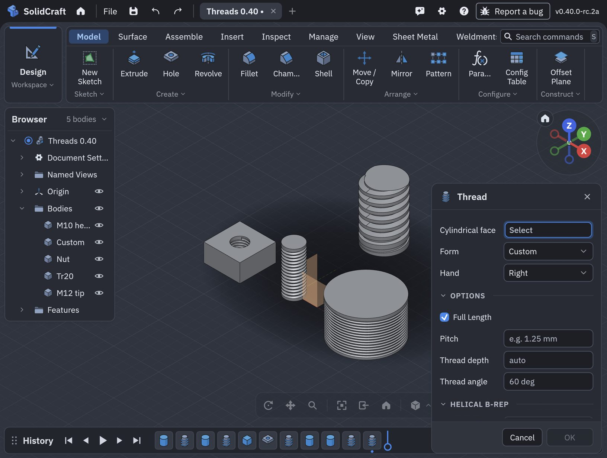
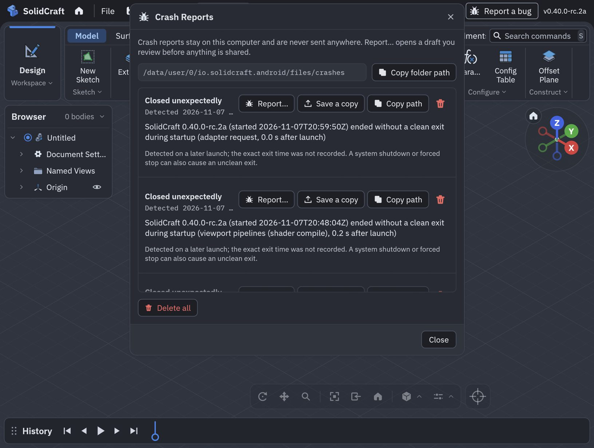
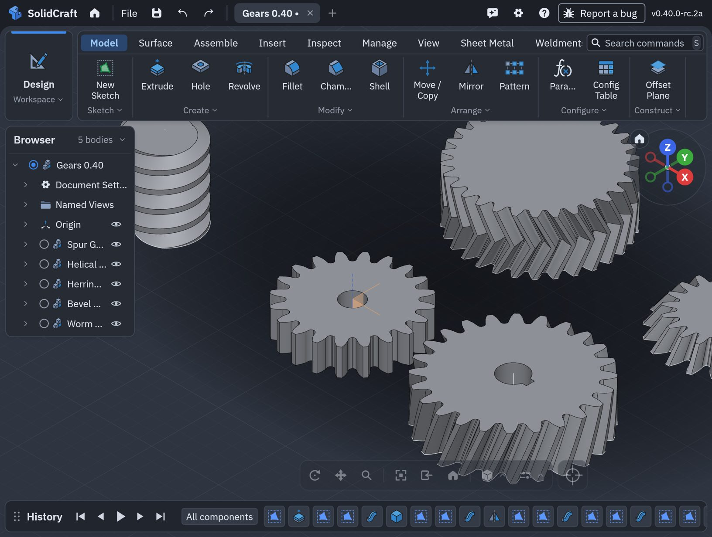
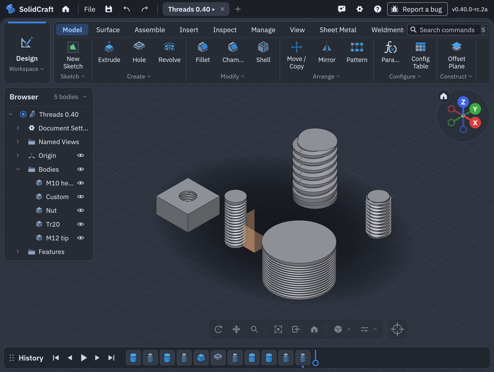

# 0.40.0-rc.2a on Android: upstream's new kernel, and the test run

Upstream's 0.40.0-rc.2 pre-release replaces SolidCraft's geometry kernel with
[solidcore](https://github.com/tangency-labs/solidcore). This page covers what that changed for the
port's own features, a crash the new release brought on Qualcomm GPUs, and a run on a Galaxy Z Fold
(Android 17, Adreno 840) over the MCP server. Every call was timed.

- [In short](#in-short)
- [1. The port's threads and gears on solidcore](#1-the-ports-threads-and-gears-on-solidcore)
- [2. A crash at every launch on Adreno](#2-a-crash-at-every-launch-on-adreno)
- [3. The test run](#3-the-test-run)
- [4. Not tested yet](#4-not-tested-yet)

## In short

| | |
|---|---|
| Kernel | upstream's solidcore replaces truck; the port's code on truck is gone with it |
| Helical threads | kept, now an exact screw sweep cut by one boolean, the way upstream's own modelled threads are built |
| Gears | unchanged: all five types tried build on solidcore |
| Galaxy Z Fold (Adreno 840) | the first build died 0.2 s into every launch, in Qualcomm's shader compiler; fixed: bodies are built on the CPU there |
| Designs from earlier port releases | open: the 0.21.0a to 0.30.1a test designs all still load (`design_corpus`) |
| Format | upstream writes 50; the port writes 51 (50 plus the helical threads) |

## 1. The port's threads and gears on solidcore

**Threads.** The port's helical thread was built face by face on truck, because truck's booleans
were too slow on helical surfaces. solidcore makes exact screw sweeps and cuts them quickly, and
upstream's own modelled threads now use that. The port's thread keeps what upstream's doesn't have
(any pitch on any face, depth, flank angle, clearance, start and end offsets, start angle) and is
now built the same way (`crates/doc/src/eval_helical.rs`). It has a few smooth faces a turn
instead of the old eight in all. Upstream's modelled M20 over 20 mm has 63, the port's 49.

Upstream's threads gained much in 0.40: trapezoidal, Acme, buttress and pipe forms, several starts,
a right- and left-handed groove at once, a faded runout, and a chamfered tip. In the Thread dialog
the port's **Custom** is now the last entry of upstream's **Form** list:

**Gears** didn't need changes beyond the new vector and mesh APIs; their tests pass, including "a
flank is one face".

## 2. A crash at every launch on Adreno

The first build installed on the Fold closed 0.2 s into every launch. The log showed a null read
in Qualcomm's shader compiler (`libllvm-qgl.so`) inside `vkCreateComputePipelines`, called from
SolidCraft's GPU tessellation, the compute shader that turns exact surfaces into triangles.
Upstream 0.40 grew that shader's basis arrays from 8 to 17 slots for solidcore's splines (degree
16), and Adreno 840's compiler crashes on it. A crash inside the driver can't be caught, so
upstream's own fallback to the CPU never ran.

Upstream's crash report, shown at the next start, named the step:

The port now builds bodies on the CPU on Adreno under Android, and writes a marker file around the
compile: a launch that dies there leaves it, and every later launch uses the CPU. So another GPU
whose driver dies the same way crashes once rather than at every launch.
(`crates/gpu/src/tess_guard.rs`). The startup guard from 0.30.1a also did its part: after the
crash, the next launch started on OpenGL ES.

## 3. The test run

Galaxy Z Fold, Android 17, Vulkan on Adreno 840 (bodies built on the CPU), 0.40.0-rc.2a installed
over 0.27.1a. Over MCP from a Mac on the same Wi-Fi:

| Gears | s |
|---|---|
| Spur m2 z20, bore 8 | 1.5 |
| Helical m2 z24, 20°, bore 10 with keyway | 3.5 |
| Bevel m2 z20/30 | 8.7 |
| Herringbone m1.5 z30, 25° | 16.8 |
| Worm m2, one start | 21.1 |

| Threads | s |
|---|---|
| Port: M10 helical, start angle 90° | 2.3 |
| Port: custom 1.25 mm on Ø33.25, clearance 0.1, left-handed | 2.5 |
| Port: custom 1.25 mm inside a Ø8 hole, clearance 0.15 | 1.1 |
| Upstream: Tr20x4 from the top, 20 mm, standard runout | 2.7 |
| Upstream: M12, both hands, both ends chamfered | 15.3 |

Every call succeeded. Interference over the five threaded bodies: 0.05 s.

## 4. Not tested yet

- The DevTerm enclosure and the cassette housing (the long MCP tests) on solidcore.
- Speed against 0.30.1a on the same device. Upstream makes no speed claim for solidcore either.
- GPU tessellation on other Android GPUs (Mali, PowerVR, Xclipse): they still try it, and the
  marker file covers a crash.
