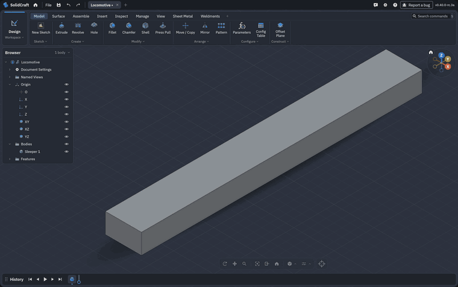
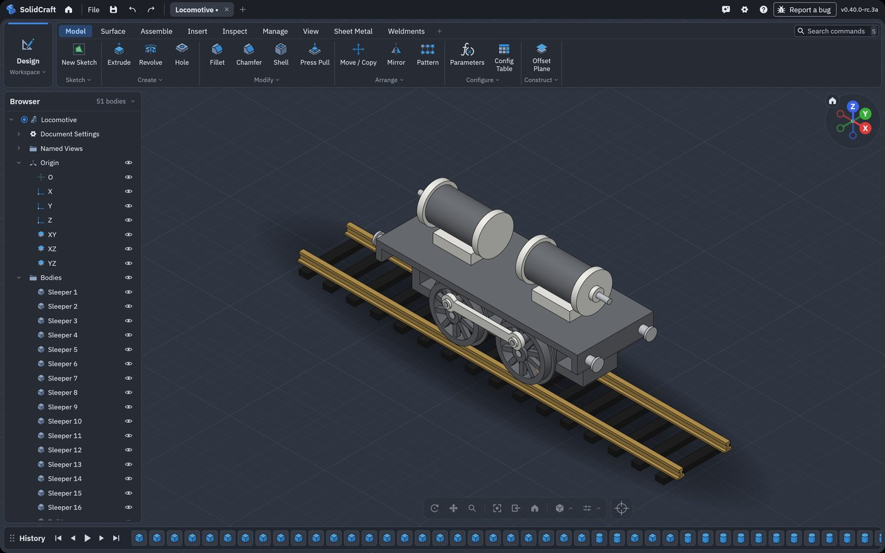
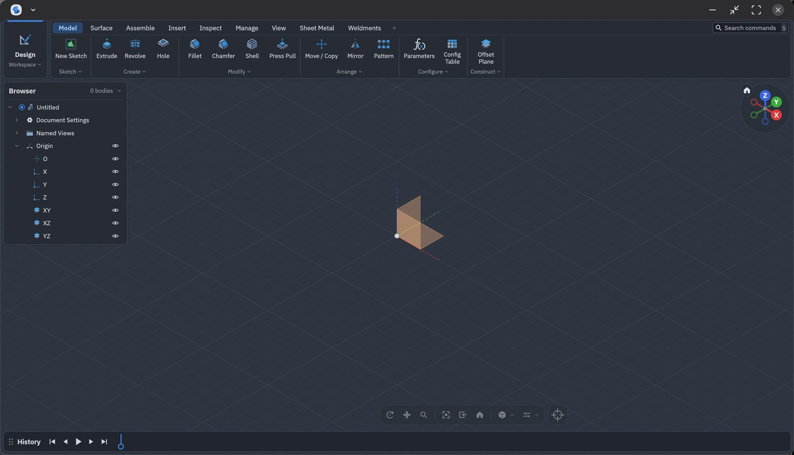
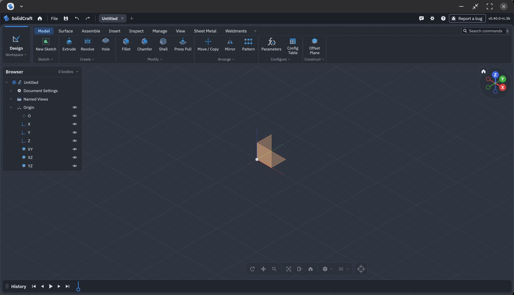

# 0.40.0-rc.3a on Android: a locomotive on its track, and upstream's threads since rc.2

Upstream's 0.40.0-rc.3 pre-release, merged into the port, tested on a Galaxy Tab (SM-X840, Android
17, Mali-G1-Ultra, in DeX) over the MCP server: an agent builds a 3D-printable model locomotive
mechanism and a section of track. Upstream's thread changes since rc.2 are measured on the same
scripts.

- [In short](#in-short)
- [1. The locomotive and its track](#1-the-locomotive-and-its-track)
- [2. Upstream's threads since rc.2](#2-upstreams-threads-since-rc2)
- [3. Not tested yet](#3-not-tested-yet)
- [4. 0.40.0-rc.3b: Settings in a DeX window](#4-0400-rc3b-settings-in-a-dex-window)

## In short

| | |
|---|---|
| Upstream | 0.40.0-rc.3 merged (395 commits); 13 conflicts, each keeping upstream's change and the port's hook |
| Locomotive and track | 51 bodies, 95 MCP calls, 9.0 s on the tablet; no two parts overlap (checked in 1.35 s) |
| Threads | upstream's modelled threads now run down to a shoulder, so a nut seats on a bolt's head; the port's helical threads are unchanged and as fast |
| GPU | the tablet's Mali-G1-Ultra tessellates on the GPU (Vulkan); the Adreno fallback from rc.2a only covers Adreno |
| Format | upstream writes 51; the port writes 52 (51 plus the helical threads) |

## 1. The locomotive and its track

A two-cylinder locomotive mechanism of the kind printed to learn how a steam engine's running gear
works, sized for **G-scale garden track** (45 mm gauge): a frame with lightening windows, a deck and
buffer beams; two cylinders on saddles, with covers, glands and piston rods; four ten-spoke wheels
(Ø52 mm on the tread, Ø58 mm over the flange, 41.3 mm back to back, so 0.7 mm of side play in the
gauge) on two steel axles 70 mm apart; crank pins, coupling rods and washers; and 400 mm of track,
brass rails 8.4 mm high (code 332) on sixteen sleepers. The colours are the filaments it would be
printed in: grey and white PLA, steel pins, brass rails, black sleepers.

The recipe is [`tools/mcp-cassette-test/loco.py`](../tools/mcp-cassette-test/loco.py). It builds one
wheel (its spokes are one circular pattern), copies it for the second axle, and mirrors the left
side's running gear to the right, so the slow step happens once.

The recording: the track, the frame, the running gear and the cylinders, the view reframed after each,
then a turn around the finished model
([MP4](screenshots/android/locomotive-mcp-tab-0400rc3a.mp4)).

| On the Galaxy Tab, over MCP from a Mac on USB | s |
|---|---|
| The whole build (95 calls) | 9.0 |
| Longest call (the first spoke, joined to its wheel) | 0.48 |
| The spokes' circular pattern | 0.25 |
| Interference between all 51 bodies | 1.35 |

The same script on this Mac's command-line app: 2.6 s on 0.40.0-rc.3a, 4.3 s on 0.40.0-rc.2a, 7.3 s
on 0.30.1 (truck), where each wheel's spokes alone took 5 to 13 s before the recipe built one wheel.

## 2. Upstream's threads since rc.2

The same scripts on this Mac's command-line app, 0.40.0-rc.2a against 0.40.0-rc.3a:

| | rc.2a | rc.3a |
|---|---|---|
| M12 modelled thread on a bolt, down to its head | 3.6 s; stops short of the head, up to a turn uncut | 5.2 s; runs down to the head and is trimmed at its face (15 mm³ more cut), so a nut seats ([#11782](https://github.com/tangency-labs/solidcraft/pull/11782)) |
| Faces on that bolt | 76 | 78, all exact (0.30.1's faceted thread: 6,176 flat faces) |
| M20 modelled thread, 60 mm | 4.0 s | 4.3 s |
| Port: 12 mm, 2.2 mm pitch bolt and nut with 0.15 mm clearance, run off both of the nut's faces | 3.9 s and 0.75 s; the nut clear of the bolt | 4.1 s and 0.78 s; the same |
| Modelled M6 threads in two holes 8 to 40 mm apart | both build | both build |

Upstream's modelled threads were already exact helical sweeps in rc.2 (no meshed or faceted thread
remains); rc.3 makes them reach a shoulder. Its other thread fix, a modelled thread on one hole
stopping the next hole from taking a thread ([#11367](https://github.com/tangency-labs/solidcraft/issues/11367)),
didn't show on rc.2a in these cases (it did on 0.30.1). The port's helical threads keep their own
build: a negative offset runs their groove off a free end, as in rc.2a, and they don't stop at a
shoulder yet.

## 3. Not tested yet

- Printing the locomotive: the parts are sized to print and fit (holes 0.1 to 0.3 mm over the
  pins and axles), but none has been printed.
- The DevTerm enclosure and the cassette housing (the long MCP tests) on solidcore.
- The Galaxy Z Fold (Adreno) on rc.3a.

## 4. 0.40.0-rc.3b: Settings in a DeX window

In a DeX window (not full screen) the window's title bar covered the app's own top bar, so File,
Settings, the design tabs and Report a bug couldn't be reached. Two causes: the app hid all system
bars, which in a window includes the title bar (DeX then draws it over the app and reports no
height for it), and egui's root `Ui` covers the whole window even when the app says part of it is
covered. The app now hides only the status and navigation bars, reads the title bar's height
(`captionTop` in `SolidCraftActivity.java`), gives it to egui as a safe-area inset, and lays itself
out in the rest (`apps/solidcraft-android/src/insets.rs`, `lib.rs`). Full screen has no title bar,
so it looks as before.

On the Galaxy Tab in a DeX window, 0.40.0-rc.3a (above) and 0.40.0-rc.3b (below), where the gear
opens Settings:

