# 0.41.0a: the test

Upstream's 0.41.0 merged into SolidCraft for Android and Googlebook OS, the port's gears and
helical threads retired, and what was checked before release. No phone or tablet was attached for
this release; the device run is the Android emulator (a Pixel Tablet image, Android 16, arm64,
which draws on the CPU), so its times are slow and only show that everything works. After release,
the cassette test ran on a Galaxy Tab, a Galaxy Z Fold, a Pixel 9 and the emulator in a
laptop-sized window ([section 4](#4-the-cassette-test-on-a-galaxy-tab)), and the app on HP and Dell
XPS Googlebooks.

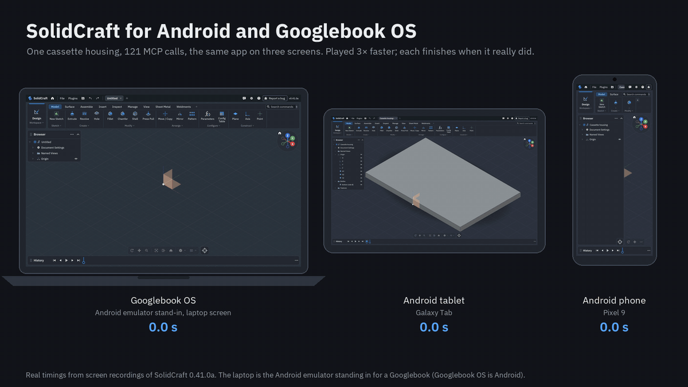

*The three recordings side by side, 3× faster, each finishing at its real time
([MP4](screenshots/android/hero-cassette-race-0410a.mp4); made by `scripts/android-hero-race.py`).*

- [In short](#in-short)
- [1. The locomotive on 0.41.0a](#1-the-locomotive-on-0410a)
- [2. Designs saved by earlier port releases](#2-designs-saved-by-earlier-port-releases)
- [3. The APKs](#3-the-apks)
- [4. The cassette test on a Galaxy Tab](#4-the-cassette-test-on-a-galaxy-tab)
- [5. Plugins on a Galaxy Z Fold](#5-plugins-on-a-galaxy-z-fold)
- [6. Not tested yet](#6-not-tested-yet)

## In short

| | |
|---|---|
| Upstream | 0.41.0 merged (a stable release); 13 conflicts, each keeping upstream's change and the port's hook, which moved with upstream's code into its new `ui-kit`, `viewport-gpu` and `control` crates |
| The port's checks | every area's tests pass (touch, the MCP server, crash reports, OpenGL ES, the Adreno guard, design files), and the Android, desktop and browser builds have no warnings |
| Locomotive and track | built over MCP on the emulator: 95 calls, 30.4 s, none failed; no two of the 51 parts overlap |
| Old port designs | all five corpus designs from earlier port releases open, evaluate and save again; their helical threads are upstream's modelled threads, their values kept in the design's metadata |
| Format | 55, upstream's own |

## 1. The locomotive on 0.41.0a

The G-scale locomotive mechanism and track from the [0.40.0-rc.3a test](android-0400rc3a-test.md),
built by the same recipe ([`tools/mcp-cassette-test/loco.py`](../tools/mcp-cassette-test/loco.py))
over the MCP server on 0.41.0a:

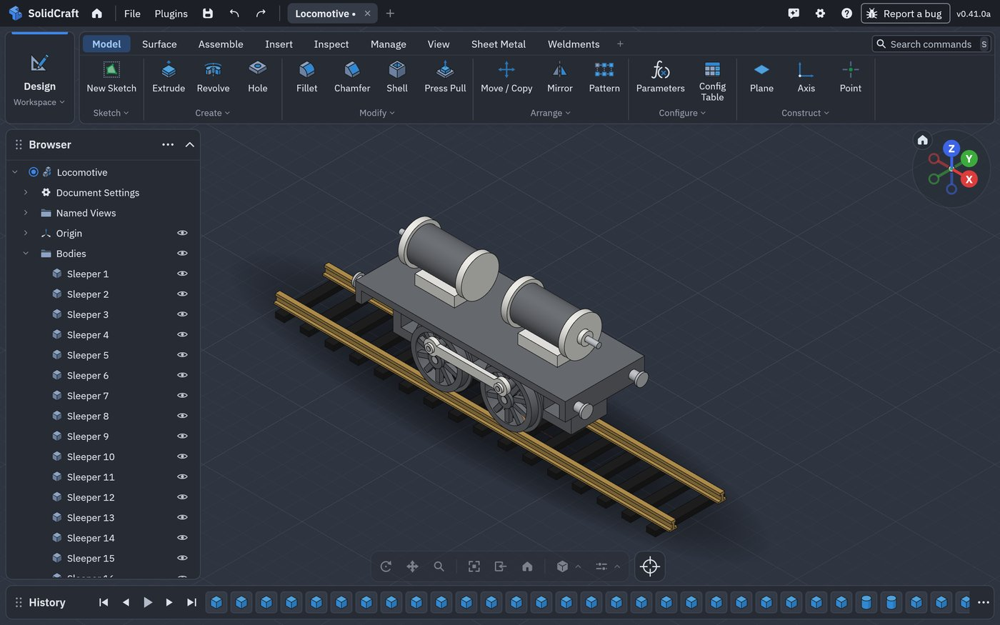

| On the emulator, over MCP | s |
|---|---|
| The whole build (95 calls) | 30.4 |
| Longest call (a box) | 2.0 |
| Interference between all 51 bodies (none) | 0.9 |

On a Galaxy Tab in DeX, 0.40.0-rc.3a built it in 9.0 s. The title bar shows upstream's new
**Plugins** menu; Settings lists upstream's **Plugins** page and the port's **MCP server** page.

## 2. Designs saved by earlier port releases

Port releases up to 0.40.0-rc.3b saved helical threads as pending design-format changes. 0.41.0a
knows those changes (`crates/doc/src/port_retired.rs`), so the designs open. The corpus test
(`apps/solidcraft-cli/tests/design_corpus.rs`) opens the five designs earlier port releases saved
(0.24.0b to 0.40.0-rc.2a) and checks that each evaluates without a failed feature and saves and
reads back the same; the four with helical threads have them as modelled threads, their values kept.

The 0.40.0-rc.2a design, opened by the 0.41.0 command-line app:

| Feature | Saved by 0.40.0-rc.2a | Opened by 0.41.0a |
|---|---|---|
| Thread on a Ø10 rod | helical M10, left-handed, start angle 90° | modelled M10, left-handed; `start_angle: 90 deg` kept in metadata |
| Thread in a nut's Ø10.2 bore | helical, custom 2.2 mm pitch, clearance 0.15 mm, run off both faces | modelled thread sized from the bore; pitch, clearance and offsets kept in metadata |
| Spur gear m2 z16 | the port's Gear | the same body, ordinary sketches and features |
| File | format 51 with three pending port changes | format 55, nothing pending: upstream's own |

## 3. The APKs

| APK | For | Size |
|---|---|---|
| `SolidCraft-0.41.0a-android-arm64.apk` | phones, tablets, foldables, Googlebooks with a Snapdragon chip | 200 MB |
| `SolidCraft-0.41.0a-android-x86_64.apk` | Googlebooks with an Intel chip | 239 MB |

The arm64 APK grew from 169 MB (0.40.0-rc.3b): the native library's code is about 139 MB and its
read-only data 32 MB, with no debug information, so the growth is upstream 0.41's own, much of it
the WebAssembly runtime (wasmtime and its compiler) that plugins run on.

## 4. The cassette test on a Galaxy Tab

The [cassette test](android-mcp-live-test.md) (a compact-cassette housing in two halves held by five
M2 screws) on a Galaxy Tab (SM-X840, full screen, not DeX), with the released arm64
APK, over the MCP server through `adb forward`. Its threads are now upstream's modelled threads
(`modeled: true`) in standard 1.6 mm tap drills; before 0.41.0a they were the port's helical threads
with a 0.05 mm print clearance.

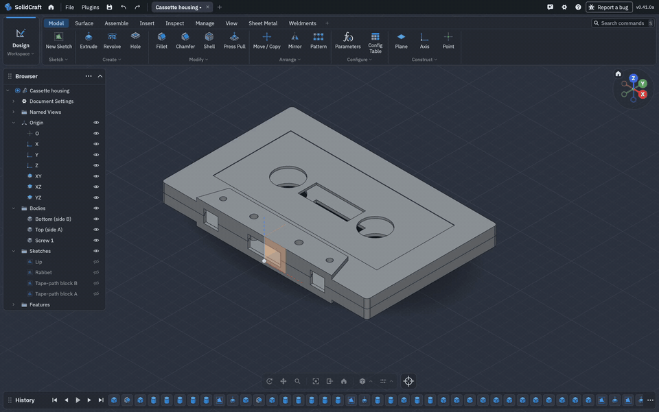

*The tablet's screen during the run, at its real speed ([MP4](screenshots/android/cassette-tab-0410a.mp4)).*

| | Galaxy Tab, 0.41.0a | Galaxy Z Fold, 0.24.0a |
|---|---|---|
| Operations | 121, **all succeeded** | 121, all succeeded |
| Time | **41.8 s** (37.1 s in calls), recording the screen | 105 s (99.7 s in calls) |
| Checks stage (interference, clearance, measure) | **10.1 s** | 78.3 s |
| Screws | exact B-rep threads, 23 faces each | helical threads |
| Screw against its tapped thread, exact | **no interference**; they touch (0 mm) | not checked: helical against helical wasn't intersected |
| Screw against its tapped thread, on meshes | −0.003 mm, the meshes' tolerance | +0.049 mm (the 0.05 mm clearance) |
| Halves, screw heads | no overlap; heads seated on their counterbores | the same |

| Stage | Calls | Time in calls |
|---|---:|---:|
| Bottom half (side B) | 14 | 1.2 s |
| Top half (side A) | 13 | 1.1 s |
| Reels, window, label, edge openings | 17 | 2.8 s |
| Tape-path block and its holes | 18 | 4.7 s |
| Screw holes and tapped threads | 15 | 11.2 s |
| The screw | 7 | 1.7 s |
| Fit: turn the screw into mesh | 7 | 1.8 s |
| Four more screws, components | 9 | 0.9 s |
| Checks | 18 | 10.1 s |
| Export and save | 3 | 1.7 s |

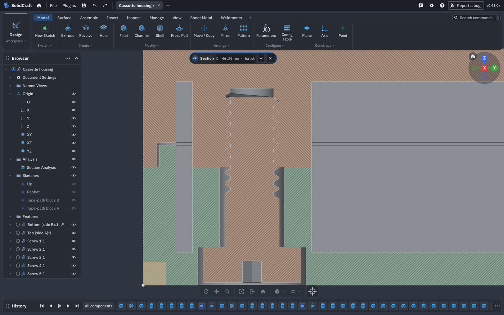

### On a Galaxy Z Fold

The same test on a phone: a Galaxy Z Fold (SM-F971B, Android 17, the inner screen), over Wi-Fi as an
agent on another computer would connect, with the released arm64 APK.

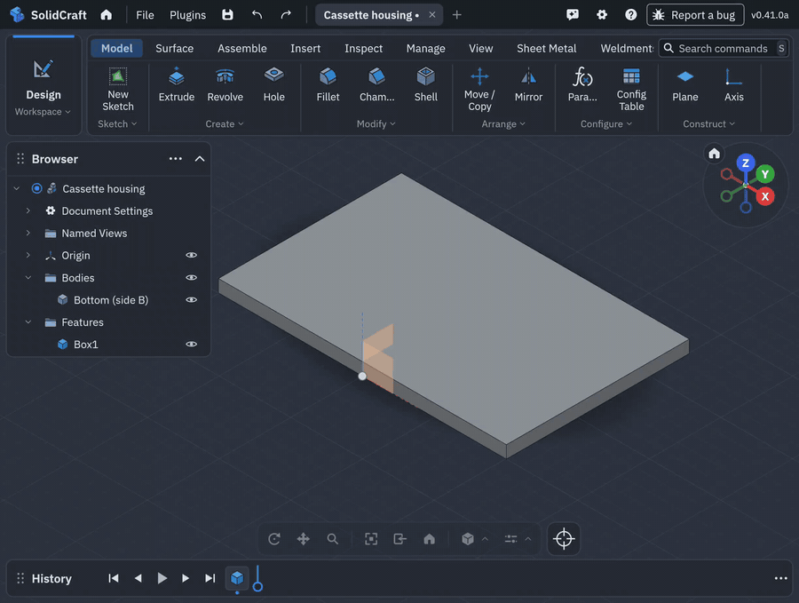

*The Fold's inner screen during the run, at its real speed ([MP4](screenshots/android/cassette-fold-0410a.mp4)).*

| | Galaxy Z Fold, 0.41.0a | Galaxy Tab, 0.41.0a |
|---|---|---|
| Operations | 121, **all succeeded** | 121, all succeeded |
| Time | **44.8 s** (40.2 s in calls), over Wi-Fi, recording the screen | 41.8 s (37.1 s in calls), over USB |
| Screw holes and tapped threads | 13.5 s | 11.2 s |
| Checks | 8.7 s | 10.1 s |
| Screw against its tapped thread, exact | no interference (4.6 s for the pair) | no interference (3.3 s) |
| Volumes, faces | identical: side B 9563.73 mm³, side A 8729.04 mm³, each screw 26.17 mm³ and 23 faces | |

### On a Pixel 9

And on a phone held upright: a Pixel 9 (Android 17, 1080 × 2424, portrait), over USB (`adb forward`),
with the released arm64 APK, upgraded in place from 0.23.0a.

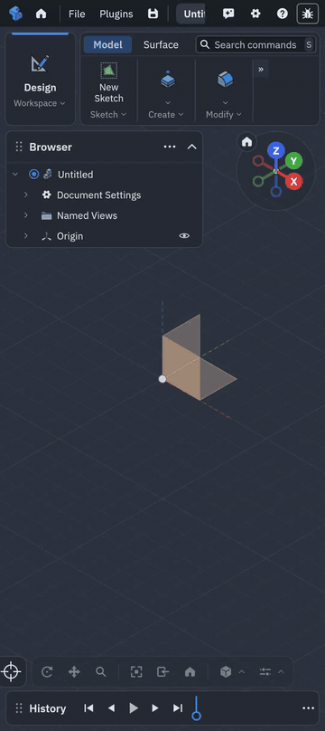

*The Pixel's screen during the run, at its real speed ([MP4](screenshots/android/cassette-pixel-0410a.mp4)).*

| | Pixel 9 | Galaxy Z Fold | Galaxy Tab |
|---|---|---|---|
| Operations | 121, **all succeeded** | 121, all succeeded | 121, all succeeded |
| Time | **66.5 s** (61.8 s in calls) | 44.8 s | 41.8 s |
| Screw holes and tapped threads | 21.1 s | 13.5 s | 11.2 s |
| Checks | 12.8 s | 8.7 s | 10.1 s |
| Screw against its tapped thread, exact | no interference (5.2 s) | no interference (4.6 s) | no interference (3.3 s) |

The same volumes and faces again. Two things a portrait phone shows that the tablet and the Fold don't:

- **The isometric view doesn't fit a wide part.** After `view.isometric` the 100 mm housing runs off
  both sides of the narrow view, so the fit seems to go by the view's height only:

  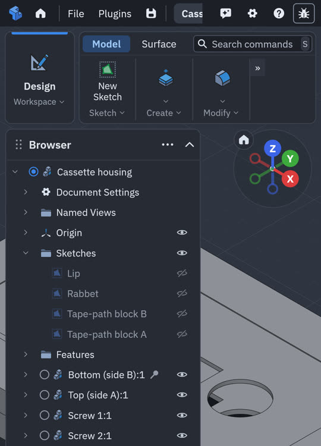

- **The crosshair button sits half off the left edge** of the view bar.

Both are in [known issues](android-known-issues.md).

### On the emulator, as a Googlebook stand-in

No Googlebook was connected for a recording, so for the hero above the emulator stands in for one:
the Pixel Tablet image (Android 16) in a 2560 × 1600 landscape window, the shape of a laptop screen,
drawing with the Mac's GPU (`-gpu host`) this time. Googlebook OS is Android, so the app is the same;
the times are the Mac's, not a Googlebook's.

| | Emulator, laptop window | Galaxy Tab | Galaxy Z Fold | Pixel 9 |
|---|---|---|---|---|
| Operations | 121, all succeeded | 121 | 121 | 121 |
| Time | **39.8 s** (36.3 s in calls) | 41.8 s | 44.8 s | 66.5 s |
| Screw holes and tapped threads | 13.1 s | 11.2 s | 13.5 s | 21.1 s |
| Checks | 8.7 s | 10.1 s | 8.7 s | 12.8 s |

The same volumes and faces as on the devices.

What it shows:

- **Upstream's threads are exact and fast to check.** The interference check now intersects a screw
  with its tapped thread (3.3 s for one pair) instead of listing the pair as unchecked, and the whole
  checks stage is about 8× faster than the Fold's with the port's helical threads.
- **Upstream's threads have no fit allowance.** Screw and tapped hole share the basic profile and
  touch: right for the model, too tight to print. A print needs a larger tap drill or a scaled
  screw until there is a clearance option (a candidate in the
  [pipeline](android-vs-upstream.md#pipeline)); the mesh check's −0.003 mm is that contact, within the
  meshes' tolerance, not an overlap.
- The tapped threads take 1.1 to 2.5 s each, growing with every thread already in the body.

## 5. Plugins on a Galaxy Z Fold

Upstream's first plugin, [SolidCraft Gears](https://github.com/bherbruck/solidcraft-gears) 0.1.1
(its release `.zip`, checksum as published), on a Galaxy Z Fold.

**On 0.41.0a plugins can't be installed on Android.** Preferences › Plugins says "Plugins are
available in the desktop app", and `plugin.install` answers "installing plugins needs the desktop
app". Upstream keeps installed plugins in a per-user folder under `$XDG_DATA_HOME` or `$HOME`, and an
Android app has neither. The fix, released in 0.41.0b, gives upstream's plugin code the app's own private
folder instead, the way the app already gives one for crash reports
(`solidcraft_engine::plugin::configure_process_plugins_dir`).

With the fix, on a test build of 0.41.0b, everything works as on the desktop:

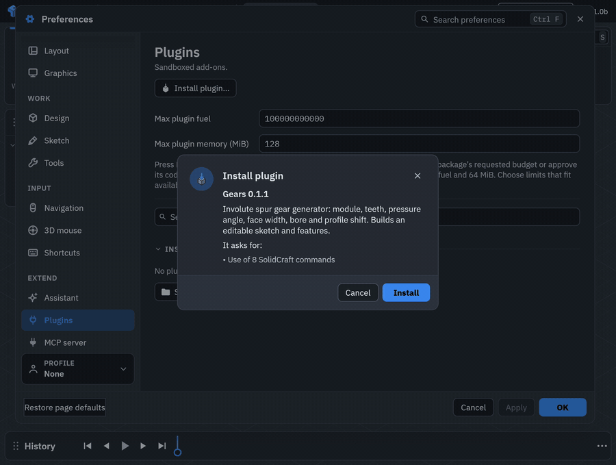

*Install plugin… on Preferences › Plugins, the plugin's summary and what it asks for, Install,
then Plugins › Plugins…, the plugin's form, Run (2× speed; [MP4](screenshots/android/gears-plugin-fold-0410b.mp4)).
Choosing the `.zip` in Android's file picker is cut from the recording.*

| | |
|---|---|
| Install | through Android's file picker, as a user would; the install dialog lists "Use of 8 SolidCraft commands" |
| Run | Plugins › Plugins… › Gears: module 2, 20 teeth, face width 10 mm, pressure angle 20°; "Plugins finished." |
| The gear | a closed solid, 44.0 mm across the tips (m (z + 2) = 2 × 22), 10.0 mm thick, 12,290 mm³, 162 faces |
| The timeline | Gear (a cylinder), Tooth profile (a sketch), Tooth (an extrude), CircularPattern1: ordinary, editable features |
| The plugin runtime | upstream's WebAssembly runtime compiles the plugin to machine code at run time; Android allows it, nothing extra needed |

An agent over MCP can't install a plugin: `plugin.install` refuses the plugins folder, which is
outside the folders an agent may use. That is upstream's rule on every platform; installing stays
with the person at the device.

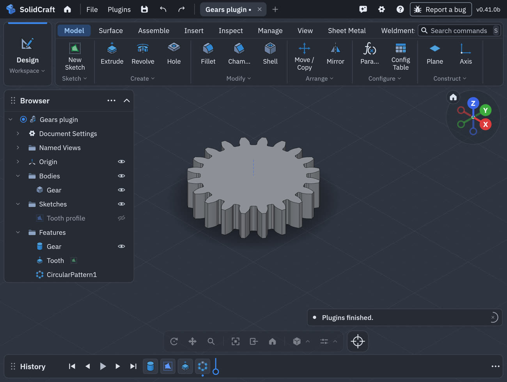

### A limited-slip differential, its gears from the plugin

Then a whole mechanism around the plugin's gears, built by an agent over MCP on the Fold
([`tools/mcp-cassette-test/lsd.py`](../tools/mcp-cassette-test/lsd.py)): a limited-slip spur-gear
differential with its mounting brackets and sleeved bushings.

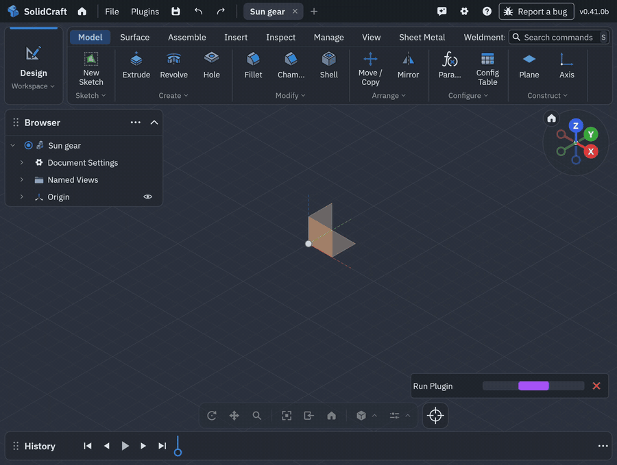

*The Fold's screen, at its real speed ([MP4](screenshots/android/lsd-gears-plugin-fold-0410b.mp4)).*

| Part | What it is |
|---|---|
| Sun gears (2) | the plugin's gear, module 1.5, 18 teeth, 10 mm wide, bore 10.2 mm: one per axle |
| Planet gears (6) | the plugin's gear, module 1.5, 10 teeth, 15.5 mm wide, bore 4.4 mm: three pairs at 120°, each planet meshing its partner and one sun |
| Clutch packs (2) | three friction discs (Ø26, 0.8 mm) and a preload spring behind each sun: the limited slip |
| Carrier | two end plates (Ø78), three posts, hubs (Ø16) and six planet pins (Ø4) |
| Axles (2) | Ø10, one into each sun |
| Sleeved bushings (2) | bronze sleeves, Ø22 outside and Ø16.2 inside, on the carrier's hubs |
| Mounting brackets (2) | pillow blocks with a Ø22 bore for the bushing and two bolt holes in the foot, on a 110 × 90 base plate |

| | |
|---|---|
| Calls | 100, **all succeeded**, in **18.7 s** |
| The plugin | `plugin.inspect` 0.1 s, the sun gear 1.5 s, the planet gear 0.9 s |
| Gears in mesh | each gear is its own plugin-made design, inserted as a linked component (two suns, six planets) and turned so a tooth meets a gap at every mesh, with 0.05 mm backlash. Both suns have 18 teeth, a multiple of 3, so all three pairs mesh alike |
| Interference | **none** among all 30 bodies (0.9 s), every pair checked, the gears' exact teeth included |
| Bodies | 30, all closed |

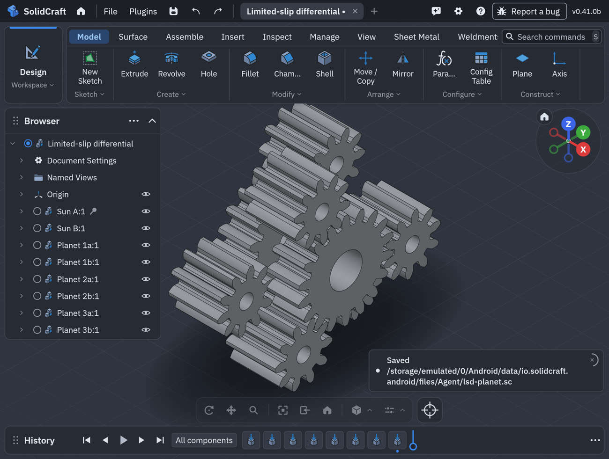

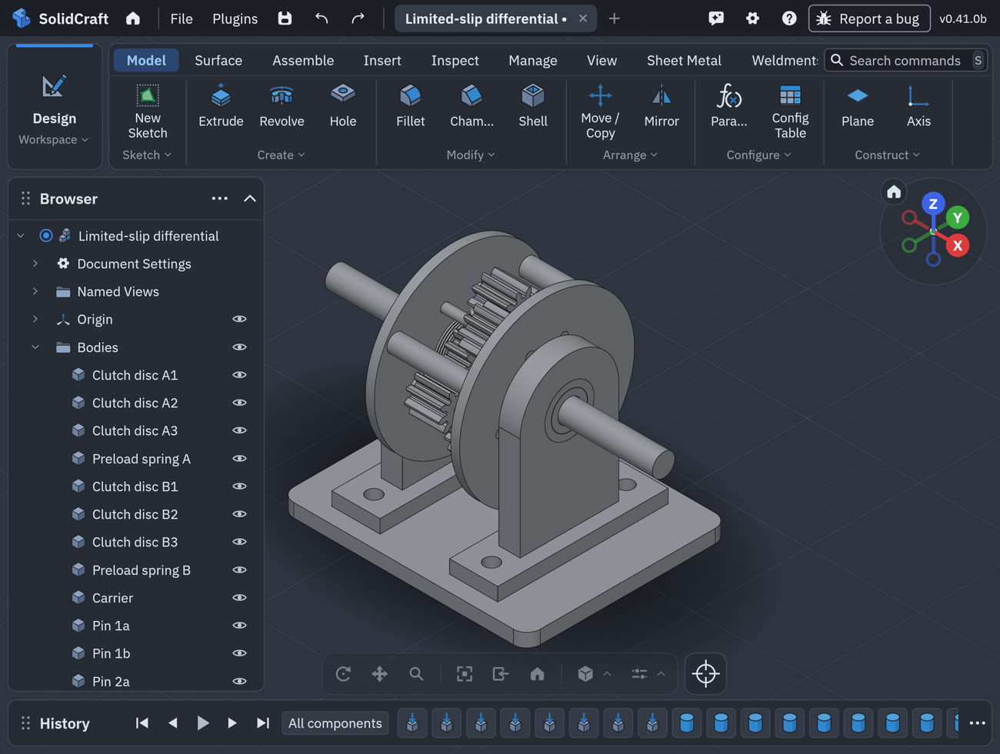

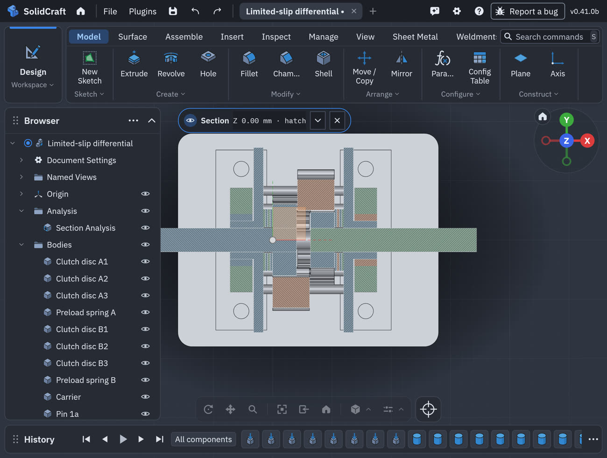

How the agent ran the plugin: an agent may run a plugin package in its own folder, not one installed
in the app's plugins folder, so the script runs an unpacked copy of the same 0.1.1 release
(`plugin.inspect` for its approval hash, then `plugin.run`). The plugin's features join whatever
body they meet and so expect a design of their own, hence one design per gear type.

## 6. Not tested yet

- Other phones: this release ran on the emulator and, after release, a Galaxy Tab, a Galaxy Z Fold
  and a Pixel 9 (section 4). The DeX
  window fix of 0.40.0-rc.3b was checked on a Galaxy Tab.
- Googlebooks other than an HP and a Dell XPS model. On those two, after release, it worked exactly
  as on other Android devices (the Android underneath is the same); other models have other
  resolutions and scaling.
- Plugins other than SolidCraft Gears, and plugins on a phone held upright, a Galaxy Tab or a
  Googlebook (section 5 is a Galaxy Z Fold).
