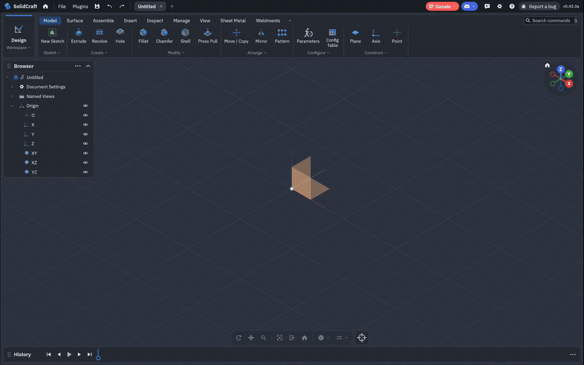
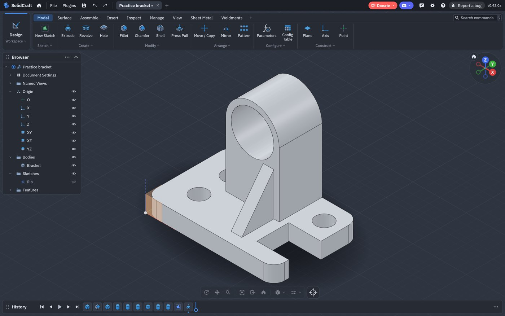

# 0.42.0a: the test

Upstream's 0.42.0 merged into SolidCraft for Android and Googlebook OS, the on-screen keyboard fix
for [#6](https://github.com/deveshrai/Solidcraft-Android-Port/issues/6), and a practice part built
by an agent over the MCP server on a Galaxy Tab.

## 1. The merge

Upstream 0.42.0 brought 351 commits; 21 of the files it changed carry port changes. Two
conflicted, and both kept both sides: Preferences gains upstream's **Security** page and keeps the
port's **MCP server** page after the others; the viewport shader keeps the port's OpenGL ES source
(no `@invariant` on GL) beside upstream's new lighting layout. Upstream moved to Rust 1.99.1, which
needs its Android targets installed once (`rustup target add aarch64-linux-android
x86_64-linux-android`).

Upstream now has pending design-format changes of its own, which every saved design lists; the
port's corpus test had expected that list to be empty and now checks only that the port's retired
helical-thread changes are gone. Designs saved by 0.42.0a are format 57 (upstream's 56 plus the
pending changes).

## 2. The on-screen keyboard (#6)

A window or tool that gives a field the focus by itself brought Android's on-screen keyboard up
over it. On a Galaxy Z Fold: **Parameters › Add parameter** put the keyboard over the whole
dialog, and the **Rectangle** tool's dimension boxes, focused as the first corner went down, put
it over the sketch, so the second corner's tap landed on the keyboard.

Now the keyboard comes up only when a finger taps a field. The field still has the focus, so a
hardware keyboard types into it at once. Checked on the Fold with a test build of the fix on 0.41.0:

| Step | Keyboard |
|---|---|
| Add parameter (the name field focused) | stays down; the new row is in view |
| Tap the name field, type `width` | up; typed into the field |
| Hide it with ⌄, tap the field again | up again (before, it stayed down until the field lost the focus) |
| Rectangle: first corner (width box focused) | stays down; the second corner lands on the sketch |
| Tap the width box, type, Tab | up, and stays up into the height box |

Its tests: `keyboard::tests` in `apps/solidcraft-android/src/keyboard.rs`.

## 3. A practice bracket over MCP on a Galaxy Tab

`tools/mcp-cassette-test/bracket.py` builds "Practice Model #03", a pillow bracket from a
practice drawing: a 120 × 80 × 15 base with R10 corners, an open slot 30 wide in its end and three
Ø16 through holes; an upright 50 wide and 40 thick with an R25 top and a Ø40 through bore 75 up; a
10 thick rib in front of it. The drawing leaves some sizes out (where the holes and slot sit, the
slot's depth, the rib's reach); the recipe estimates them from the sizes it gives and the part's
proportions, and says how in its header.

Galaxy Tab (SM-X840), 0.42.0a, over USB (`adb forward`): **26 calls, all OK, 8.0 s in
all**, 1.7 s of it modelling and checking (the rest is three screenshots). One closed body,
235 169 mm³; exported as STEP and saved.

| The bracket | The recording |
|---|---|
|  | [practice-bracket-tab-0420a.mp4](screenshots/android/practice-bracket-tab-0420a.mp4) (14 s, real time) |
