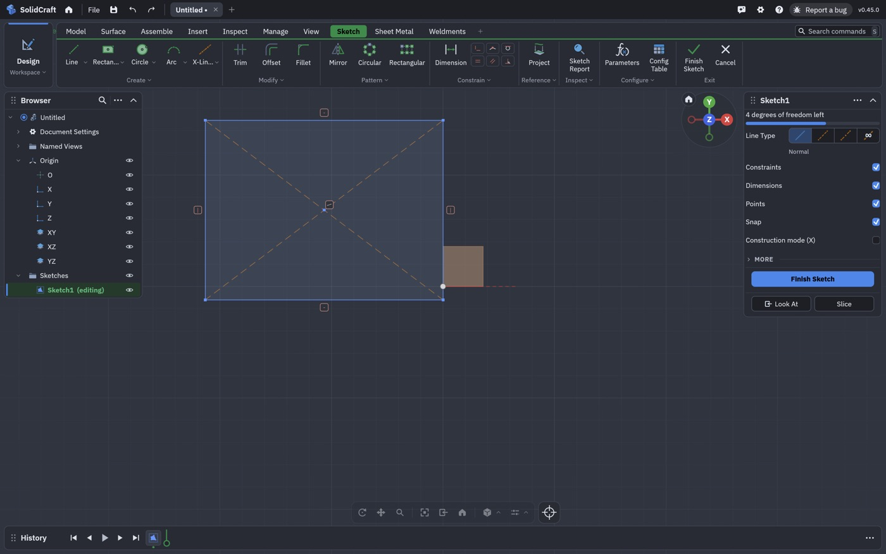
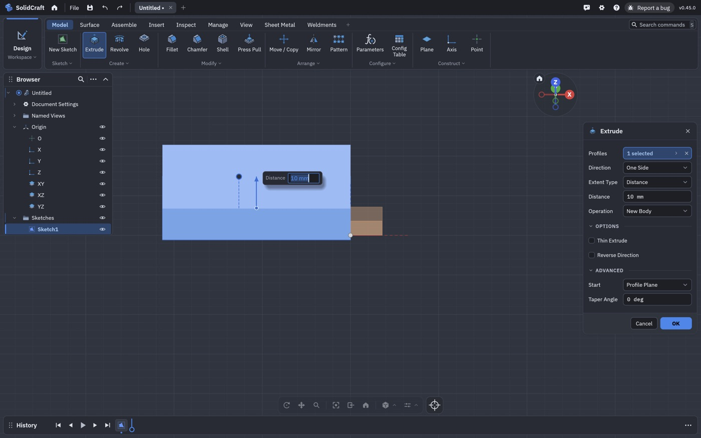
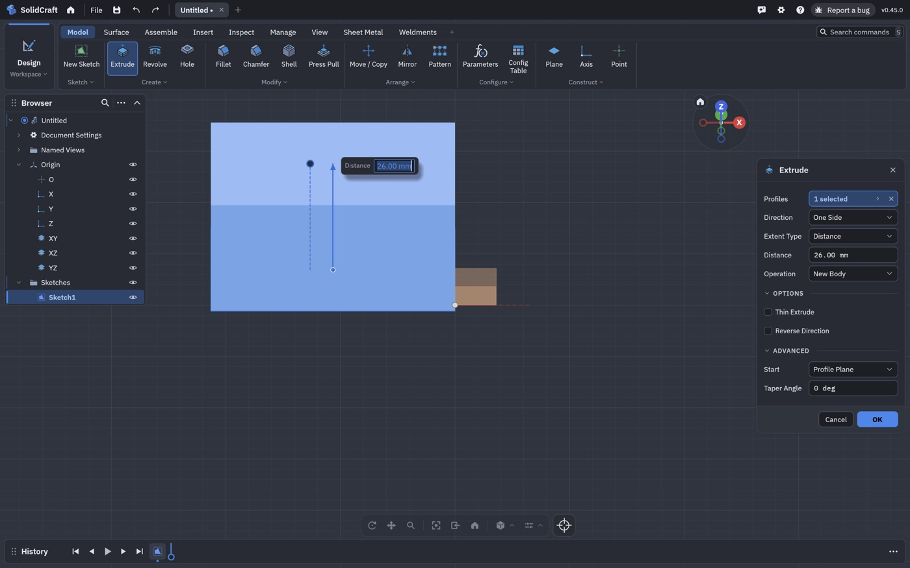

# 0.45.0a: the test

Upstream's 0.45.0 merged into SolidCraft for Android and Googlebook OS, with touch navigation now
upstream's, and the build tested by finger on a Galaxy Tab (SM-X840, its Book Cover keyboard
attached).

## 1. The merge

Upstream 0.43.0, 0.44.0, 0.44.1 and 0.45.0 brought 1,270 commits; 32 of the files they changed
carry port changes, and 8 conflicted. Each kept both sides:

- **Touch navigation.** Upstream now has its own (Preferences › Navigation › touchscreen
  navigation: one finger orbits, two pan, a pinch zooms), off by default. The port uses it,
  on by default on Android, in place of its own one-finger orbit and two-finger pan and pinch.
  The crosshair, finger-dragged dialog arrows and finger-scrolled drop-downs stay the port's.
- **Fonts.** Upstream moved the fallback font lists to `crates/sketch/src/fonts/fallback.rs`; the
  port's Android paths (Noto Sans CJK, Noto Sans Thai) moved with them.
- **Plugins.** Upstream's plugin state now names the plugins folder itself, through the port's
  hook for the app's own folder, so the port no longer changes `crates/ui-egui/src/plugins.rs`.
- **Skills.** Upstream moved its developer skills to `.agents/skills/`; the port's
  `solidcraft-android-port` skill moved there too.

Designs saved by 0.45.0a are format 63, upstream's.

## 2. Touch, on a Galaxy Tab

Upstream's touch navigation takes every finger on the view while no tool or dialog is open. On the
Tab that left two gaps the port's own touch code didn't have, and 0.45.0a closes both with a small
hook (a regression test, `a_finger_drags_sketch_geometry_and_orbits_with_a_dialog_open`, fails
without it):

| | Upstream's alone | 0.45.0a |
|---|---|---|
| A finger on a corner of the sketch being edited | Orbits the view; the corner stays | Drags the corner |
| A finger on empty space with Create Sketch or Extrude open | Nothing: the view can't turn | Orbits, so what the dialog picks can be reached; a tap still picks |

With Extrude open, a finger turned the view from straight down the arrow to the side (left), and
then dragged the arrow from 10 to 26 mm without turning it (right):

Also on the Tab: a one-finger drag on empty space orbits and draws no selection box; a tap
selects a face; with the crosshair button on, a finger aims the crosshair above it without
turning the view and lifting it selects; Create Sketch, Extrude and a rectangle's dimension
boxes open without the on-screen keyboard (#6), and typing into Distance then Enter built the
body.

Not tried on the device: two fingers (the Tab doesn't let adb inject a second finger; upstream's
and the port's tests for pan and pinch pass), and the on-screen keyboard coming up for a tapped
field (with the Book Cover keyboard attached, Android keeps it hidden; it was tried on a Galaxy Z
Fold for 0.42.0a).

## 3. The checks

`scripts/android-sync.sh --check-only`: formatting, clippy for Android and the desktop, the wasm
build, layers, assets, lists, skills, touchpoints, markers and every port area's tests pass. 39
touch tests pass, upstream's and the port's.
