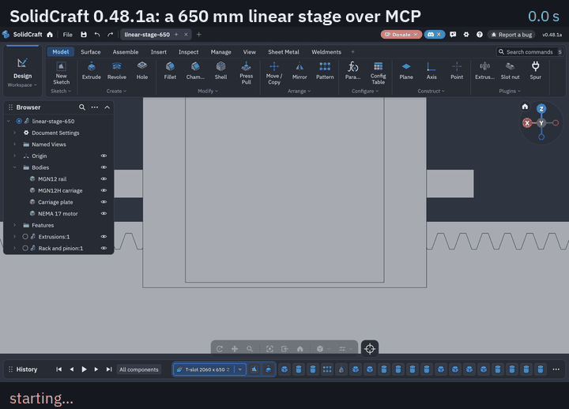
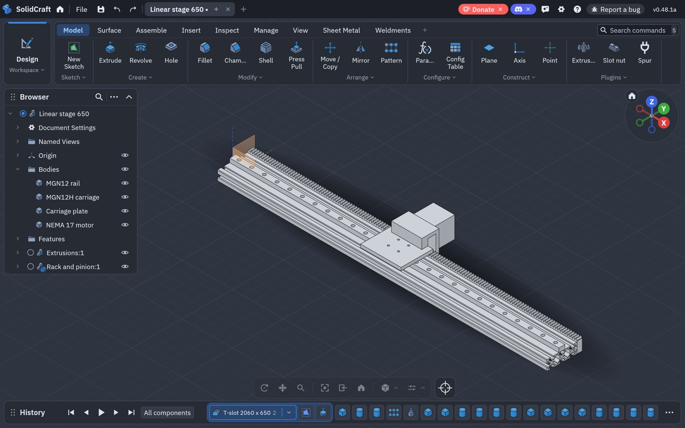
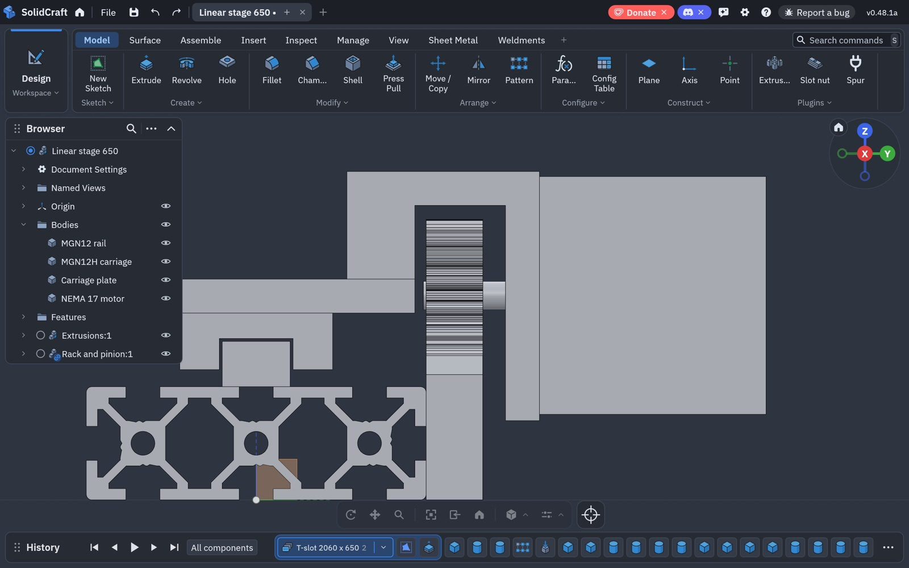
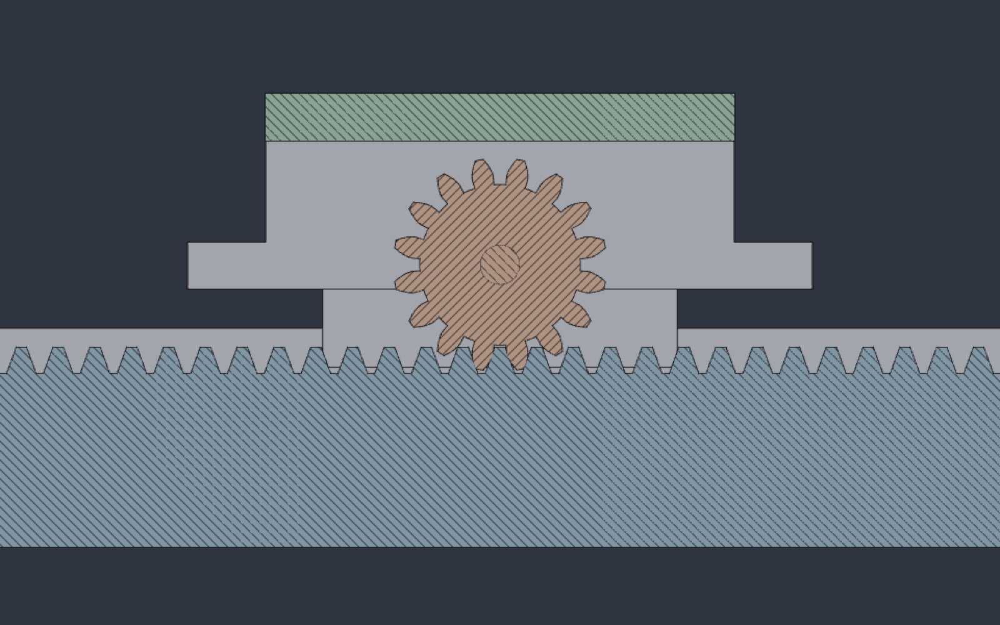

# 0.48.1a: the test

Upstream's 0.48.1 merged into SolidCraft for Android and Googlebook OS, and the build tested on the
Android emulator (a Pixel Tablet image, Android 16, arm64, which draws on the CPU, so its times
are slow and only show that everything works): by finger, then a 650 mm linear stage built over
the MCP server with two plugins from the
[SolidCraft plugin index](https://tharje.github.io/solidcraft-plugins/).

*The whole run, 4× faster, made by [`mkgif.py`](../tools/mcp-cassette-test/mkgif.py) from the
screen while [`stage.py`](../tools/mcp-cassette-test/stage.py) ran.*

- [In short](#in-short)
- [1. The merge](#1-the-merge)
- [2. By finger](#2-by-finger)
- [3. A linear stage over MCP, with plugins](#3-a-linear-stage-over-mcp-with-plugins)
- [4. Not tested yet](#4-not-tested-yet)

## In short

| | |
|---|---|
| Upstream | 0.46.0 to 0.48.1 merged: 855 commits; 30 of the files they changed carry port changes, 7 conflicted, each keeping both sides |
| The port's checks | every area's tests pass; the Android, desktop and browser builds have no warnings |
| By finger | a cone chamfered on its base edge (the 0.45.0a crash), its arrow dragged, the view turned; Settings › Privacy and MCP server both there |
| Linear stage | 60 calls, 76.8 s on the emulator while recording, none failed; 7 closed bodies, none overlapping |
| Format | 66, upstream's own |

## 1. The merge

Upstream 0.46.0, 0.46.1, 0.46.2, 0.47.0, 0.48.0 and 0.48.1 brought 855 commits. The conflicts:

- **Preferences.** Upstream split its preference table into one file per page
  (`crates/ui-egui/src/prefs/fields/`) and added a Privacy page. The port's MCP server page now
  comes after Privacy, and touch navigation's Android default moved to `fields/navigation.rs`.
- **Crash reports.** Upstream rewrote how long the GitHub issue link may be; the port's reports
  still go to the port's own tracker on Android.
- **The 3D view.** Upstream's view cards skip some overlays; the port's finger pick draws in the
  main view only. Upstream's new instanced edges build the viewport shader themselves, and now
  through the port's OpenGL ES fix too (they need a feature OpenGL ES lacks, so it guards a path
  that doesn't run there yet).
- **The OpenGL ES test.** Upstream's shader gained an `override` constant, so the port's test
  that the GL shader has no `invariant` fragment input found nothing to check; it now resolves
  the constants as wgpu does and fails if the shader can't be written as GLSL.
- `vendor/README.md`, `xtask/src/layers.rs`: both sides' entries kept.

Upstream now translates "Right" itself (the view's name), so the port's translation, for the
thread hand, went. Designs saved by 0.48.1a are format 66, upstream's.

## 2. By finger

On the emulator, by tapping and dragging: a cone from Create, then Chamfer on its base edge. The
edge picked with one tap, the preview showed (this is what closed 0.45.0a on a Galaxy Z Fold), the
arrow dragged by finger to 12 mm, 2 typed instead, and OK. One finger turned the view. Settings
lists upstream's new Privacy page and, after it, the port's MCP server page; each opens its own
page. No crash, and no "out of TLS keys" in the log.

## 3. A linear stage over MCP, with plugins

A 650 mm stage of the kind a 3D printer or a small router uses, built by
[`tools/mcp-cassette-test/stage.py`](../tools/mcp-cassette-test/stage.py) over the MCP server
from a Mac (`adb forward`), with two plugins run as an agent runs them, unpacked in the agent's
folder:

| Part | Made by |
|---|---|
| 2060 T-slot extrusion, 650 mm, its 60 mm face up | [Extrusions](https://github.com/TechSquidTV/SolidCraft-Plugins/tree/main/plugins/techsquid-extrusions) 0.3.0 (TechSquidTV), `make-extrusion` |
| Rack (module 1.5, 138 teeth, 650.3 mm) and 16-tooth pinion, in mesh, on the 20 mm side | [Gears](https://github.com/bbonsen/solidcraftGearsPlugin) 0.10.0 (bbonsen), `rack` |
| MGN12 rail (12 × 8, counterbored holes every 25 mm), MGN12H carriage | SolidCraft's own commands; no plugin makes linear rails |
| Carriage plate, a bridge over the pinion, the motor face, a NEMA 17 with its shaft through the pinion | SolidCraft's own commands |

Gears 0.10.0 was picked over [SolidCraft Gears](https://github.com/bherbruck/solidcraft-gears)
0.1.1, used in [the 0.41.0a test](android-0410a-test.md), because it makes racks: its `rack` entry
builds the rack and a pinion already turned to mesh, each its own body. Its 16-tooth pinion gets a
0.07 profile shift, as the plugin suggests, so a real cut gear wouldn't be undercut.

| Step | Time |
|---|---|
| Rack and pinion (Gears plugin) | 4.3 s |
| 2060 extrusion, 650 mm (Extrusions plugin) | 5.4 s |
| The rail's 26 screw holes (a pattern of two cuts) | 4.3 s |
| Interference, everything | 7.5 s: none |
| All 60 calls, with screenshots, STEP export and save | 76.8 s (36 s without the recording running) |

The end view shows the plugin's 2060 profile with the rail on its middle slot, the carriage, the
plate's bridge over the pinion, and the motor; a section through the rack and pinion shows the
mesh:

Two things a plugin user meets: Gears 0.10.0's zip unpacks to `gears-0.10.0`, and SolidCraft runs a
package only from a folder named after its id, so it has to be renamed `gears`; and the package
is in the plugin's repository rather than on a release, so it has no checksum to check against.
Extrusions 0.3.0 matched its published checksum.

## 4. Not tested yet

- On a phone or tablet: only the emulator was attached for this build.
- OpenGL ES: the emulator drew with Vulkan (llvmpipe). A release APK can't be switched to OpenGL
  ES from outside, so that needs a debug build or a device that falls back to it.
