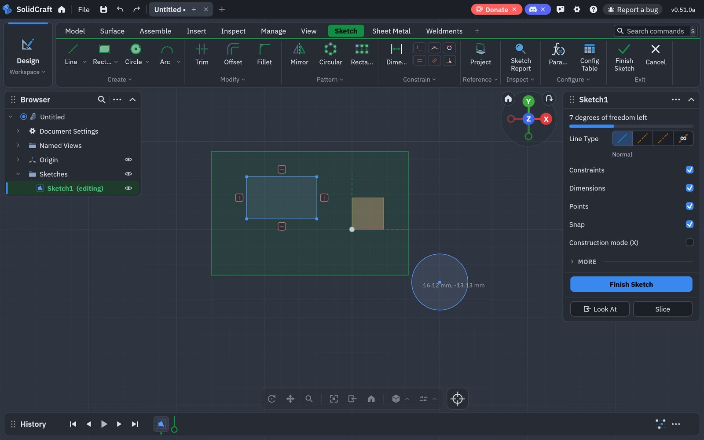
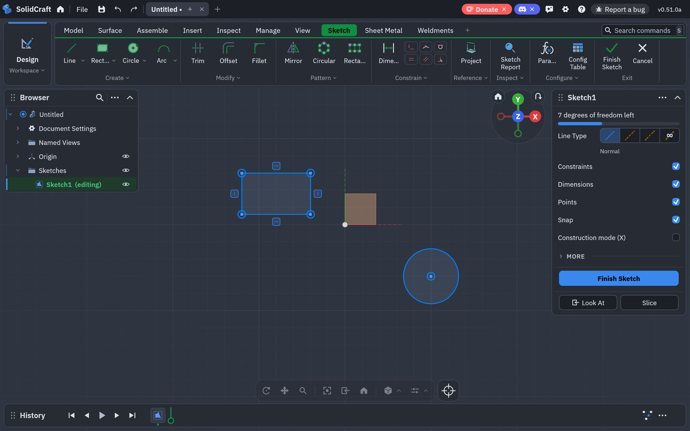
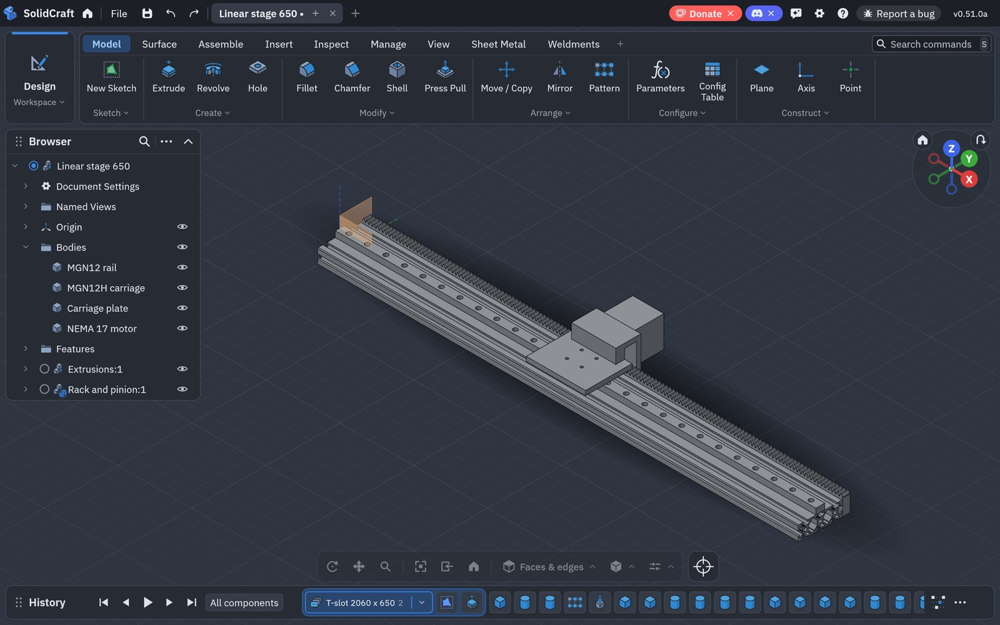

# 0.51.0a: the test

Upstream's 0.51.0 merged into SolidCraft for Android and Googlebook OS, with one port fix: in a
sketch, one finger draws the selection box instead of turning the view
([#8](https://github.com/deveshrai/Solidcraft-Android-Port/issues/8), asked for by Vealdvyn).
Tested on the Android emulator (a Pixel Tablet image, Android 16, arm64), drawing first in software
and then with the Mac's GPU (`-gpu host`: Vulkan on an Apple M2 through MoltenVK).

- [In short](#in-short)
- [1. The merge](#1-the-merge)
- [2. Box selection by finger (#8)](#2-box-selection-by-finger-8)
- [3. The linear stage over MCP](#3-the-linear-stage-over-mcp)
- [4. OpenGL ES and slow start-ups](#4-opengl-es-and-slow-start-ups)
- [5. Not tested yet](#5-not-tested-yet)

## In short

| | |
|---|---|
| Upstream | 0.48.1 to 0.51.0 merged: 5,944 commits; 33 of the files they changed carry port changes, 6 conflicted, each keeping both sides |
| The port's checks | every area's tests pass, 11 touch tests among them; the Android, desktop and browser builds have no warnings |
| #8 | in a sketch one finger from empty view draws the selection box and takes what it spans; the view stays put; outside a sketch one finger still turns the view |
| Linear stage | 60 calls, none failed, 7 closed bodies, none overlapping: 71 to 80 s on the emulator with the Mac's GPU |
| Against 0.48.1a | the same plugin-free steps on the same emulator: 10.4 s on 0.51.0a, 12.6 s on 0.48.1a |
| Upgrade | 0.48.1a installed over by 0.51.0a: its settings and MCP token kept |
| Format | 72, upstream's own |

## 1. The merge

Upstream 0.49.0, 0.49.1, 0.50.0 and 0.51.0 brought 5,944 commits. The conflicts:

- **The 3D view.** Upstream's click now accepts a dimension being edited when you click outside it,
  and a right click with the middle button held is a navigation chord; the port's crosshair still
  clicks where the finger lifts, and a held crosshair still opens no menu.
- **The agent chat's dependencies.** Upstream added a font database next to the PDF reader; the
  clipboard crate still stays out of the Android build, which it has no backend for.
- **The OpenGL ES test** keeps naga's GLSL writer next to upstream's new JSON dependency.
- **Tests:** upstream's plugin storage tests and ribbon separator test, next to the port's plugin
  folder and finger-scrolled drop-down tests.
- `AGENTS.md`: upstream's shorter router, with the port's skill row.

After the merge, one more change: 0.51's control server takes a wake-up handle (it serves a request
without waiting for a frame). The port's MCP server passes an empty one, so requests wake the app
with a repaint as before. German and Korean "GEAR" and "Groove" are upstream's own now, so the
port's copies went.

## 2. Box selection by finger (#8)

Before: with a sketch open, one finger on empty view turned the camera, so there was no way to
select several lines and points at once by finger. Now, while a sketch is edited:

- one finger dragged from empty view draws the selection box, as a mouse drag does, and lifting it
  selects what the box spans;
- a finger on the sketch's own geometry still drags it;
- two fingers still pan and pinch-zoom;
- with the view bar's orbit button on, one finger turns the view, as before;
- outside a sketch, one finger still turns the view.

On the emulator, by finger (`adb shell input`): New Sketch, the XY plane, a rectangle and a circle,
then one drag from above left of both to below right. The box showed while the finger moved (top);
lifting it selected the rectangle's four lines, the circle, their points and constraints, and the
view didn't move. Then Finish Sketch and the same drag turned the view.

The first build of the fix left a gap: with the view bar's orbit button on, a finger in a sketch
did nothing at all, neither box nor orbit. The button now wins, and the test covers it.

The change is `touch_pick::one_finger_selects` (`crates/ui-egui/src/touch_pick.rs`), which upstream's
touch navigation asks before a single finger turns the view: yes in a sketch, unless the view
bar's orbit, pan or zoom button is on. The test is
`a_finger_box_selects_in_a_sketch_and_two_fingers_still_pan`.

## 3. The linear stage over MCP

The same [`stage.py`](../tools/mcp-cassette-test/stage.py) as [0.48.1a's test](android-0481a-test.md):
a 650 mm stage from the Extrusions 0.3.0 and Gears 0.10.0 plugins, an MGN12 rail and carriage, a
carriage plate and a NEMA 17. 60 calls, none failed, no parts overlapping, 7 closed bodies.

| Step | 1st run | 2nd run |
|---|---|---|
| Rack and pinion (Gears plugin) | 18.5 s | 14.1 s |
| 2060 extrusion, 650 mm (Extrusions plugin) | 12.0 s | 9.9 s |
| The rail's 26 screw holes | 8.9 s | 7.9 s |
| Interference, everything | 7.8 s: none | 7.3 s: none |
| All 60 calls | 80.2 s | 71.4 s |

That is slower than 0.48.1a's 36 s in its test, so the same plugin-free steps (the rail, its 26
holes, a carriage, interference, measuring) ran on both releases on this same emulator: **0.51.0a
10.4 s, 0.48.1a 12.6 s** (the holes 5.9 s against 8.3 s). 0.51.0a isn't slower; this emulator
setup is.

Upstream's MCP server now adds a note after a tool's JSON reply (the current selection, for one),
so the test client [`mcp.py`](../tools/mcp-cassette-test/mcp.py) reads the JSON at the start of
the reply. An agent reading the text is unaffected.

## 4. OpenGL ES and slow start-ups

- **The first launch after the install was stopped by Android as not responding.** It started with
  the emulator's screen off, and compiling the view's shaders on its software Vulkan took longer
  than Android's 5 s. The start-up guard then did its job: the next launch used OpenGL ES and said
  so.
- **On OpenGL ES** (ANGLE over SwiftShader, both in software) 0.51.0a drew the model and its
  windows without errors, but each touch took about 2.7 s to answer, too slow to use. Clearing the
  app's data put it back on Vulkan.
- On a slow emulator a finger held still long enough before moving counts as a long press: the
  first drags showed "Nothing to select here" instead of a box. With the Mac's GPU
  (`-gpu host`) the drags drew the box every time.
- With the Mac's GPU the first frame took about 50 s on a fresh install (the shaders compiling),
  15 s after an upgrade.

## 5. Not tested yet

- A phone or tablet: the Galaxy Z Fold and Galaxy Tab weren't connected for this test.
- Two fingers on a device. The emulator's `adb shell input` sends one finger; the two-finger pan
  in a sketch is covered by the test above.
- OpenGL ES on a real GPU.
