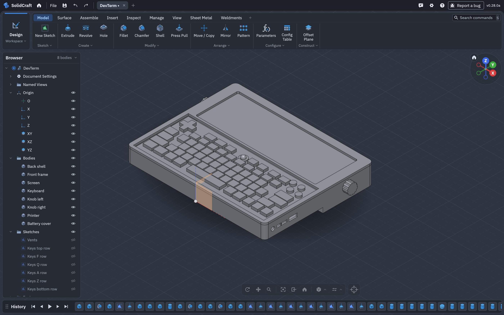
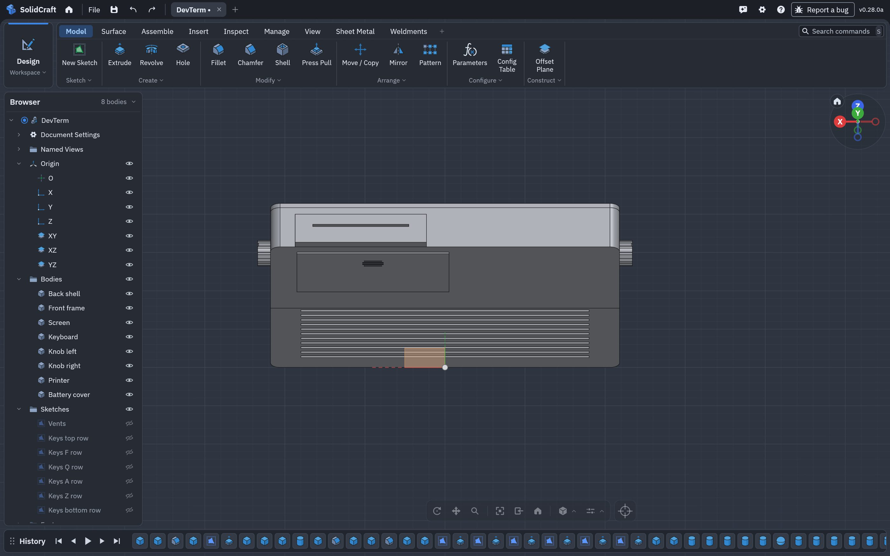
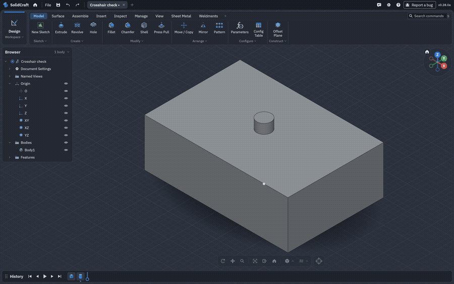
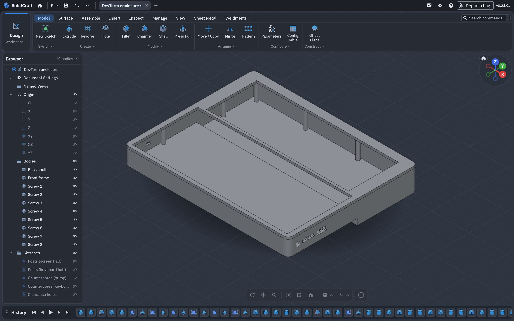
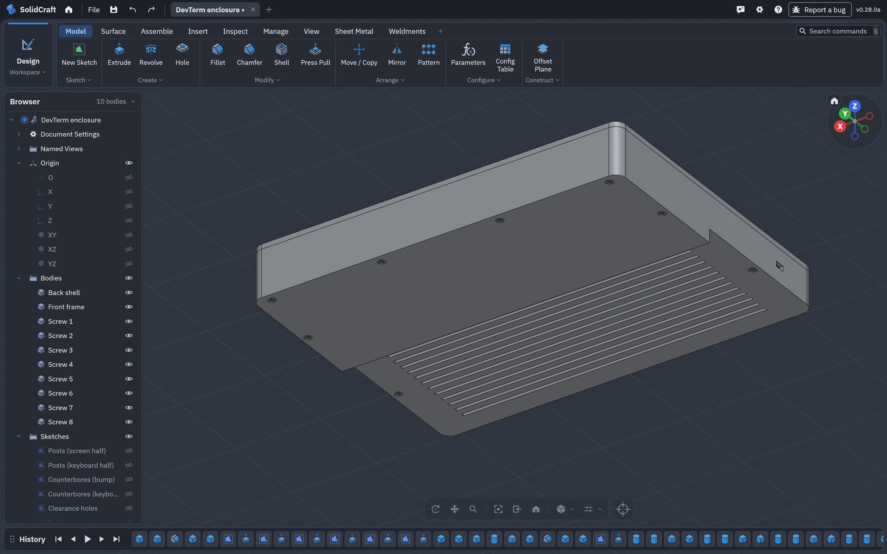
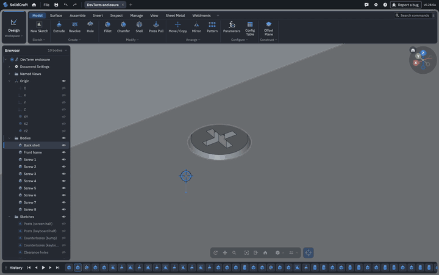
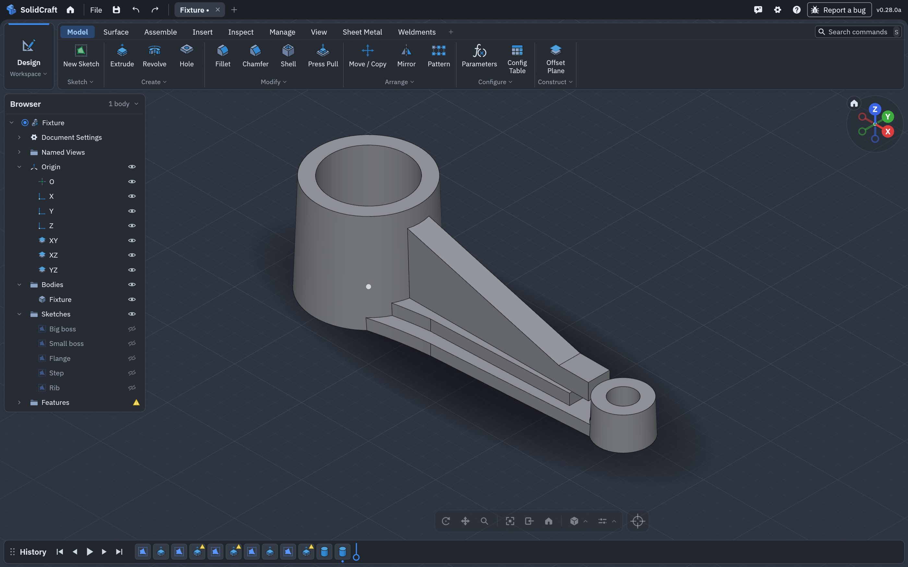
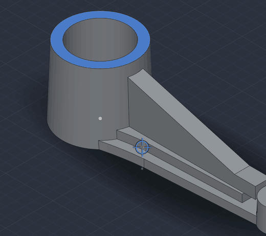

# A handheld terminal and a drafted fixture, built over MCP (0.28.0a)

The 0.28.0a tests on a Galaxy Tab (SM-X840): a Clockwork DevTerm-like handheld and its screwed enclosure modelled over MCP, the fixture from [port issue #2](https://github.com/deveshrai/Solidcraft-Android-Port/issues/2)
with its edge picked by the new crosshair, and what they showed about joins that fail or stall. Every
call was timed; the recipes are `tools/mcp-cassette-test/devterm.py` and `fixture.py`.

- [In short](#in-short)
- [1. The DevTerm](#1-the-devterm)
- [1b. The enclosure, picked and edited by finger](#1b-the-enclosure-picked-and-edited-by-finger)
- [2. The fixture and the crosshair](#2-the-fixture-and-the-crosshair)
- [3. Joins that fail first, or stall](#3-joins-that-fail-first-or-stall)
- [4. Is the port to blame?](#4-is-the-port-to-blame)
- [5. Built as separate bodies instead](#5-built-as-separate-bodies-instead)

## In short

| | |
|---|---|
| DevTerm, 11 parts, 201 calls | **31 s** on the tablet; nothing failed, no interferences |
| Its enclosure with 8 screws, 121 calls | **19.9 s**; then a screw head and an edge picked by crosshair, Press Pulled and Filleted |
| Fixture, 32 calls | **17 s**; one join took 11.9 s after its first attempt failed |
| Crosshair | a finger picked the fixture's bore edge; a mouse can't turn the button on |
| Joins into drafted (2°) faces | can fail on the first attempt and be saved by a retry (seconds), or stall for minutes: an upstream kernel limit, not the port's |
| The fixture as separate bodies, then combined | **2.4 s + 1.9 s** on the tablet (0.95 s on a Mac), against 17 s; see [section 5](#5-built-as-separate-bodies-instead) |

## 1. The DevTerm

Sizes estimated from product photos, scaled from the 6.86" 1280×480 screen (about 0.305 mm a pixel):
a body 218 × 172 mm, about 30 mm thick at the screen half. Eleven parts, each its own body: back shell (vents, side ports, board standoffs), front frame, screen, keyboard
(deck, six rows of keys, D-pad, ABXY, trackball), main board, two port plates, two knurled knobs,
printer and battery cover. Each key row is one sketch and one extrude, not a join per key.

| Galaxy Tab | |
|---|---|
| Whole build, start to saved | 24 s (first version), 31 s with the board and port plates |
| Slowest modelling calls | knob chamfers 0.9–1.1 s each; button and trackball joins 0.35–0.45 s |
| Interference, all 11 parts | 0.44 s, none |
| Screenshots | about 2 s each (the slowest calls in the run) |

The build at 2× speed: 

## 1b. The enclosure, picked and edited by finger

The enclosure alone (back shell and front frame, no keyboard or screen), with the eight M2 pan-head
screws that hold it together, estimated from the rear photo and the frame's borders: four along the
top behind the screen, two down each side. Each runs from a 1.6 mm counterbore in the back, through a
Ø2.2 clearance hole in a Ø5 post, into a Ø1.6 pilot hole in the frame (the 2 mm³ each screw shows in
interference is its thread biting there). `tools/mcp-cassette-test/devterm_enclosure.py`: 121 calls,
**19.9 s** on the tablet, nothing failed, the slowest modelling step 0.55 s.

| Front | Back: the eight screws |
|---|---|
|  |  |

Then by finger, with the crosshair button on: a screw head's face picked and **Press Pull**ed 1 mm, and
the screen window's edge on the frame's front face picked and **Fillet**ed (2 mm). At 2× speed:

On a head this small (Ø3.8) the cross recess's corners are within pick reach of most of it, so a pick
there can land on a vertex: zoom in until the head fills a good part of the view, as with a mouse.

## 2. The fixture and the crosshair

a2nr's fixture, estimated from their screenshot: a big boss with a Ø28 bore and a small boss, both
extruded with a 2° taper; an arm in **two steps** (a flange, and a narrower step on it that flares into
the big boss and stops short of the small one); and a **tapered rib** from the top of the big boss down
to the small one.

With the view bar's crosshair button on, a finger aimed at the bore's top edge (the edge a2nr marked)
and lifted: the edge is selected. See [android-touch.md](android-touch.md#picking-with-a-crosshair).

A fillet where the steps meet the drafted boss is refused ("only straight edges can be blended"
there); the steps flare into the boss in their sketches instead.

## 3. Joins that fail first, or stall

Every call succeeded, but the fixture's history shows the cost:

| Feature | Tablet | What happened |
|---|---|---|
| Rib (symmetric extrude into the drafted boss, flush on the step) | **11.9 s** | first attempt failed; saved by nudging the tool 0.27 µm |
| Flange (flush on the floor, into the drafted boss) | 0.95 s | first attempt failed; saved the same way |
| Every other join | under 0.25 s | |

A first draft of the fixture had the upper step run 0.8 mm into the small drafted boss. That single
4 mm join took **95 s** on a Mac (193 s with the step clear of the big boss only). Moving the step clear
of the small boss, or building the bosses without draft, brought it to **0.2 s**. Joining a flat-sided
prism into a cone (a drafted boss) while also sitting flush on another face is the slow, fragile case.
Over MCP a call that runs past 15 s is answered "still running", and a join whose retries all fail is
refused, which is what "boolean merges fail" looks like from outside.

Work-arounds until the kernel handles it: keep a feature that sits flush on a face clear of drafted
faces where it can; or add the draft after the joins (`solid.draft`).

## 4. Is the port to blame?

No. Measured three ways:

- **The slow join**: upstream 0.27.1 149.6 s, port 0.27.1a 75.2 s, port 0.28.0a 94.9 s on the same
  script (`v-as-is` of the fixture, Mac, the spread is load).
- **200 random designs** (`solidcraft-cli fuzz`, joins, cuts, fillets, shells, holes, patterns):
  upstream 0.27.1 and port 0.27.1a fail the same 22–24 designs; the extra timeouts in one run were seeds
  that take 230–300 s on either build.
- **Upstream's 96 recorded seeds** (`robustness_goldens`): 102 of 104 pass on 0.28.0a; seeds 36 and 71
  fail on clean upstream on this Mac too ([known issues](android-known-issues.md)).

So the fix belongs in upstream's kernel: a join with a drafted face should not need a retry, and a
slow first attempt should give up sooner.

## 5. Built as separate bodies instead

The owner's test-1 design builds a part like this a different way: draw the **side view** and extrude
it, cut it with the **plan view**, and make each boss and the rib **its own body**, extruded from a
sketch, so nothing is ever joined onto a drafted or curved face while modelling.
`tools/mcp-cassette-test/fixture_bodies.py` builds a2nr's fixture that way, in the proportions of
their screenshot (boss diameter to spacing about 1 : 3), with the arm dropping at 16° from the big boss
(106° to its wall) and running flat into the small one:

- each boss: one sketch (outline and bore) and one extrude with a 2° taper;
- each step of the arm: its side view (flat, down at 16°, flat) extruded wide, then intersected with
  its plan (the taper, and the flare into the big boss); the side view and the plan share no face;
- the rib: one side-view sketch, extruded 7 mm;
- then one solid, **a piece at a time and in order**: the arm's pieces together first (flat faces,
  milliseconds), then the arm into the small boss, then into the big one.

| | Mac | Galaxy Tab |
|---|---|---|
| Joined as built (section 2) | 8.3 s | 17.3 s (the rib 11.9 s) |
| Separate bodies | 0.18 s | 2.4 s (39 calls) |
| Combined into one solid, in the order above | 0.77 s | 1.9 s |
| Combined all at once (four tools into the big boss) | 36.7 s | (not run) |

The order is most of it: the same pieces fused in one call took 36.7 s on a Mac with retries, a piece
at a time 0.85 s, and the result is the same solid (43,888 mm³, a cleaner 39 faces against 43). Two
steps still take one quick retry (hundredths of a second).

So, over MCP or by hand: **model in silhouettes and separate bodies, and join last, a piece at a time,
flat pieces first.** The crosshair picked this fixture's bore edge on the first try.
