# Gears: the manual

The **Gear** command makes involute gears of every common kind as parametric components: spur,
helical, herringbone, internal (ring), rack, bevel, miter, worm, worm wheel and crossed helical
(screw) gears, with bores, DIN 6885 keyways and hubs. A gear can be edited later from the values
it was made from. It is a feature of the Android port, like the helical threads
([android-threads.md](android-threads.md)), and works the same in every build made from this
repository (desktop, browser, CLI, scripts).

This manual has three parts:

- **[Part 1: Using gears](#part-1-using-gears)**: the dialog, every field, every type, pairs that
  mesh, editing, the tablet.
- **[Part 2: Reference](#part-2-reference)**: the commands and every parameter, the readouts,
  every warning and refusal, the geometry each type gets.
- **[Part 3: How it is made](#part-3-how-it-is-made)**: the code this feature adds and changes,
  file by file, the tooth mathematics, the build, the tests, and how to extend it.

Screenshots are from a Samsung Galaxy Tab (SM-X840, Android 17, 2800 × 1752, Mali-G1-Ultra) and
the Pixel Tablet emulator (Android 16, 2560 × 1600), both running SolidCraft 0.22.0 with this
feature. General use of the app on Android: [android-touch.md](android-touch.md).


## Contents

**Part 1: Using gears**
1. [The gear types](#1-the-gear-types)
2. [Opening Gear](#2-opening-gear)
3. [A first gear, step by step](#3-a-first-gear-step-by-step)
4. [The dialog's fields](#4-the-dialogs-fields)
5. [Tooth form](#5-tooth-form)
6. [Bore, keyway and hub](#6-bore-keyway-and-hub)
7. [Dimensions and warnings](#7-dimensions-and-warnings)
8. [Every type in detail](#8-every-type-in-detail)
9. [Making pairs that mesh](#9-making-pairs-that-mesh)
10. [Editing a gear](#10-editing-a-gear)
11. [On a real tablet](#11-on-a-real-tablet)
12. [Tips](#12-tips)
13. [Limits](#13-limits)

**Part 2: Reference**
14. [The commands](#14-the-commands)
15. [`gear.create` parameters](#15-gearcreate-parameters)
16. [`gear.info` readouts](#16-gearinfo-readouts)
17. [Warnings and refusals](#17-warnings-and-refusals)
18. [Where each type sits, and what it is built from](#18-where-each-type-sits-and-what-it-is-built-from)
19. [Standards and formulas](#19-standards-and-formulas)

**Part 3: How it is made**
20. [Overview](#20-overview)
21. [Files added and changed](#21-files-added-and-changed)
22. [The tooth geometry: `gear_profile.rs`](#22-the-tooth-geometry-gear_profilers)
23. [The commands: `cmd/gears.rs`](#23-the-commands-cmdgearsrs)
24. [The kernel change: smooth straight sweeps](#24-the-kernel-change-smooth-straight-sweeps)
25. [The dialog: `dialogs_gears.rs` and its wiring](#25-the-dialog-dialogs_gearsrs-and-its-wiring)
26. [The Android changes](#26-the-android-changes)
27. [Icon, labels and translations](#27-icon-labels-and-translations)
28. [Storage and compatibility](#28-storage-and-compatibility)
29. [Performance: why so few booleans](#29-performance-why-so-few-booleans)
30. [Tests](#30-tests)
31. [Extending: adding a gear type](#31-extending-adding-a-gear-type)

---

# Part 1: Using gears

## 1. The gear types

| Type | What it is | Typical use |
|---|---|---|
| **Spur** | Straight teeth parallel to the axis | General drives between parallel shafts |
| **Helical** | Teeth along a helix | Quieter, smoother, stronger drives; parallel shafts (opposite hands) |
| **Herringbone** | Two opposite helices side by side | Helical smoothness without end thrust |
| **Internal (ring)** | Teeth inside a ring | Planetary (epicyclic) gearboxes, compact reductions |
| **Rack** | A straight toothed bar, straight or helical | Rack and pinion: rotation to straight-line motion |
| **Bevel** | Teeth on a cone | Shafts that meet at an angle (90° by default), any ratio |
| **Miter** | A bevel gear at 1:1, 90° | Turning a drive through a right angle |
| **Worm** | A screw-like gear of 1 to 12 starts | High reductions in one step; self-locking drives |
| **Worm wheel** | The wheel a worm drives | The other half of a worm drive |
| **Crossed helical** | Helical (screw) gears on crossed shafts | Light drives between shafts that neither meet nor are parallel |

## 2. Opening Gear

**Model › Create ▾ › Gear**, or **Search commands** and type *gear*. Like any command it can be
pinned to the ribbon from the menu.

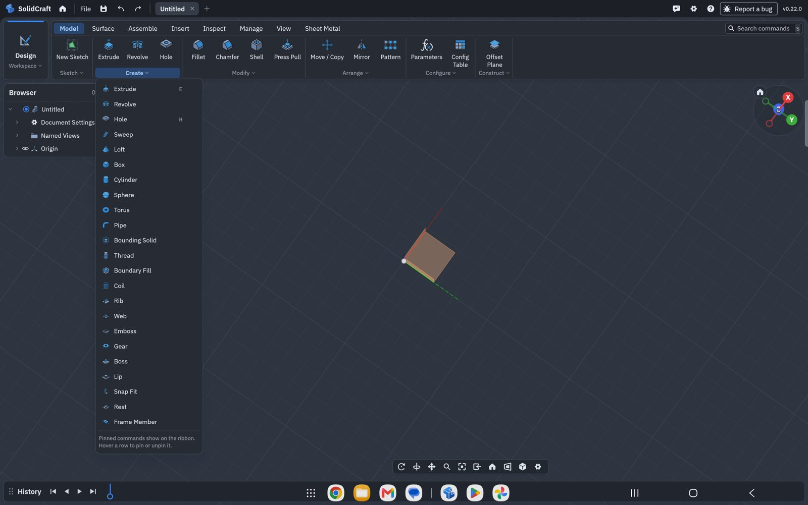

The dialog opens on a spur gear of module 1 with 20 teeth, and the viewport shows it at once in the
preview colour. Every change previews. The spinner at the dialog's bottom left turns while a
preview is computing; a spur gear previews at once, a helical one in a few seconds on a tablet.
**OK** inserts the gear as a new component named after it (*Spur Gear m1 z20*), at the origin with
its axis up Z.


**Type** lists the ten kinds. The rows below it change with the type: helical gears gain **Helix
angle** and **Hand**, bevels **Spiral angle**, **Mate teeth** and **Shaft angle**, worms
**Starts** and **Worm diameter**, and so on.

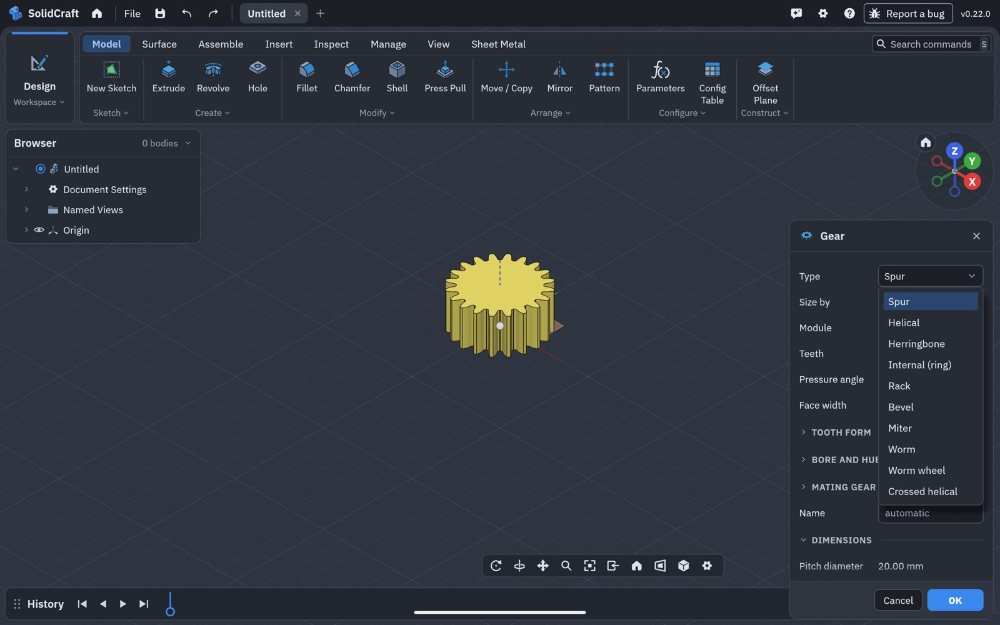

## 3. A first gear, step by step

A helical gear of module 2 with 24 teeth, a Ø10 bore with its keyway, and a Ø22 × 8 hub:

1. **Type › Helical.** The helix angle defaults to 20°, right hand. The face width follows the
   size (10 module): the grey hint shows *auto 20.00 mm* once the module is 2.
2. **Module** 2, **Teeth** 24. The preview turns into the new size.

   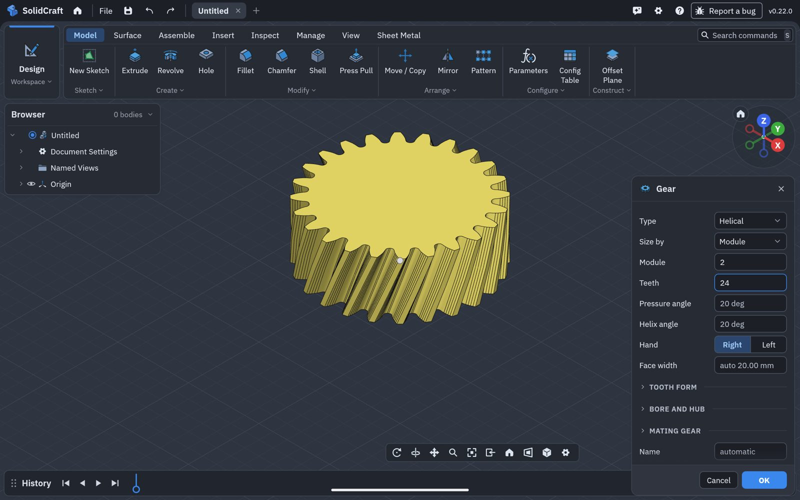

3. Open **Bore and hub**. **Bore** 10, **Hub diameter** 22, **Hub length** 8, and tick **Keyway
   (DIN 6885)**. The bore and its 3 × 1.4 keyway show in the preview; the hub is below the gear.

   

4. **OK.** The gear is one component, with its own body, sketches and features in the browser and
   a few steps in the History bar. OK reuses the preview's result, so it takes a second or two.

   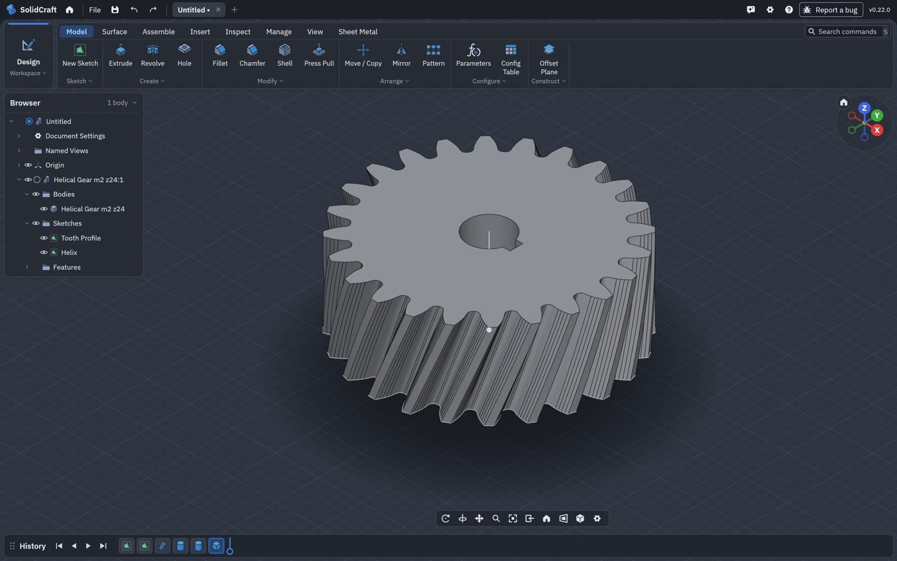

## 4. The dialog's fields

Empty fields take the defaults shown in grey. Every field takes expressions with units, like the
rest of the app: `2 mm`, `0.1 in`, `m * 10` (with a design parameter `m`), `30 deg`. A number
without a unit is in the design's length unit, or in degrees for an angle.

| Field | Shown for | Meaning | Default |
|---|---|---|---|
| **Type** | All | One of the ten types | Spur |
| **Size by** | All | **Module** (mm of pitch diameter per tooth) or **Diametral pitch** (teeth per inch of pitch diameter; module = 25.4 / DP) | Module |
| **Module** / **Diametral pitch** | All | The tooth size | 1 mm |
| **Teeth** | All but worms | Number of teeth (a rack's length in teeth) | 20 (internal 60, rack 10, worm wheel 30) |
| **Starts** | Worm | Number of thread starts | 1 |
| **Pressure angle** | All | Angle of the flanks at the pitch circle | 20° |
| **Helix angle** | Helical, herringbone, crossed, internal, rack | Angle of the teeth to the axis. For helical teeth the module and pressure angle are *normal* (square to the teeth), as cutters are specified | 20° (crossed 45°, internal and rack 0°) |
| **Spiral angle** | Bevel | Curved teeth (approximate, see [Limits](#13-limits)) | 0° (straight) |
| **Hand** | Helical types, bevel, worms | Right or left: which way the teeth wind | Right |
| **Face width** | All but worms | Tooth width along the axis | 10 module (herringbone 16 module, bevel ⅓ of the cone distance at most, worm wheel ¾ of the worm diameter) |
| **Length** | Worm | The worm's length | 12.8 module |
| **Rim** | Internal | Ring material outside the tooth roots | 3 module |
| **Back height** | Rack | Material below the tooth roots | 2 module |
| **Mate teeth** | Bevel | The mating gear's teeth (sets the cone) | Same as teeth |
| **Shaft angle** | Bevel | Angle between the two shafts | 90° |
| **Worm diameter** | Worm, worm wheel | The worm's pitch diameter | 10 module |
| **Worm starts** | Worm wheel | The worm's starts | 1 |
| **Tooth form** section | All | Profile shift, backlash, addendum, root clearance, root fillet ([5](#5-tooth-form)) | ISO 53 |
| **Bore and hub** section | Round gears | Bore, hub diameter and length, keyway ([6](#6-bore-keyway-and-hub)) | None |
| **Mating gear** section | Spur, helical, herringbone | Mate teeth, for the pair's readouts ([9](#9-making-pairs-that-mesh)) | None |
| **Name** | All | The component's name | Automatic (*Helical Gear m2 z24*) |
| **Dimensions** section | All | What the gear comes to ([7](#7-dimensions-and-warnings)) | Open |

## 5. Tooth form

The teeth are generated the way a hob cuts them: the basic rack of ISO 53 rolls around the pitch
circle, and the tooth is what it leaves. So the flanks are true involutes, the root is the smooth
curve (a trochoid) the rounded cutter tip traces, and gears with few teeth come out undercut, as
real ones do. The **Tooth form** section, closed at first, changes that rack:

| Field | Meaning | Default | Range |
|---|---|---|---|
| **Profile shift** | Moves the cutter out (+) or in (−), in modules. A positive shift thickens the tooth root and avoids undercut on small pinions | 0 | −1 to 1.5 |
| **Backlash** | Play between the teeth of a pair, measured along the pitch circle. Each gear's teeth are thinned by half of it, so give both gears of a pair the same value | 0 mm | 0 to 10 module |
| **Addendum** | Tooth height above the pitch circle, in modules (0.8 for stub teeth) | 1 | 0.3 to 1.5 |
| **Root clearance** | Depth below the mate's tips, in modules | 0.25 | 0 to 0.6 |
| **Root fillet** | The cutter's tip radius, which rounds the root, in modules | 0.38 | 0 to 0.6 |

For 3D printing, a backlash of 0.1–0.3 mm, and a profile shift of +0.3 to +0.5 on pinions of fewer
than 17 teeth, usually mesh well.

## 6. Bore, keyway and hub

Round gears (all but racks and internal gears) can have:

- **Bore**: a hole through the axis, through the hub too.
- **Keyway (DIN 6885)**: the parallel-key slot for that bore from DIN 6885-1, towards +X. It is
  defined for bores of 6 to 130 mm; its width × depth shows in the Dimensions (*6 x 2.8* for a
  Ø20 bore).
- **Hub**: a cylinder of **Hub diameter** and **Hub length** below the gear (z < 0).

A bore larger than the root circle, or a keyway that would cut through it, is refused with the
reason. Outside DIN 6885's range the gear gets its bore but no keyway, with a warning.

## 7. Dimensions and warnings

The **Dimensions** section works the gear out as you type:

- **All round gears:** pitch, tip, root and base diameters, circular pitch, tooth thickness.
- **Helical teeth:** transverse module and pressure angle, the twist across the face, the lead.
- **Worms:** lead, lead angle, turns, axial pitch.
- **Bevel and miter:** pitch, face and root cone angles, cone distance, virtual (Tredgold) tooth
  count, ratio.
- **Worm wheels:** centre distance to the worm, lead angle, ratio.
- **With a mate:** ratio, centre distance, contact ratio, and the overlap ratio for helical teeth.

The full list is in [16](#16-gearinfo-readouts). Warnings show in orange under the readouts. Here
a 10-tooth pinion is undercut:


When the gear can't be made, the whole reason shows in orange instead and **OK** is greyed out.
Here the bore is larger than the root circle:

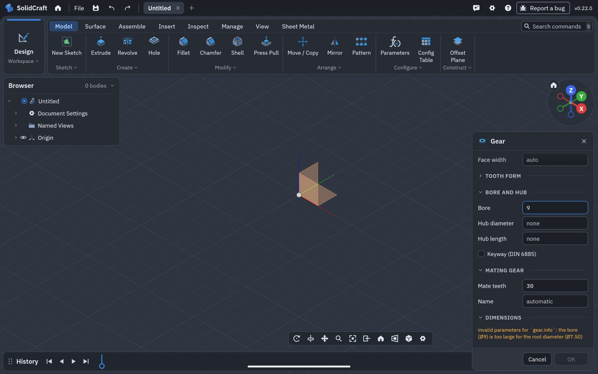

Every warning and refusal is listed in [17](#17-warnings-and-refusals).

## 8. Every type in detail

### Spur

Straight teeth, extruded from the tooth outline. The simplest and fastest to build.

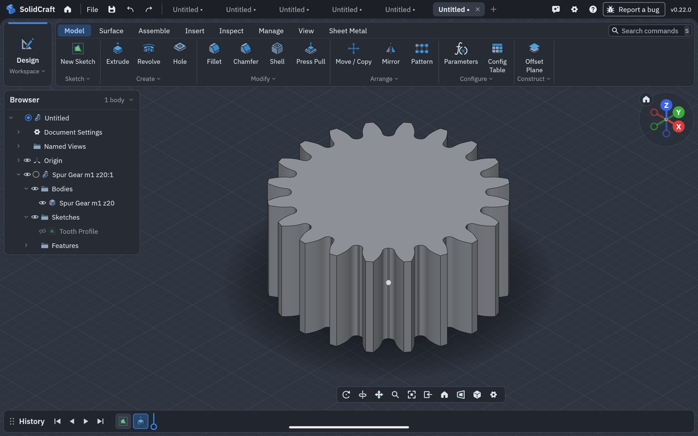

*Fields:* the common ones. *Built from:* one sketch (*Tooth Profile*) and one extrude.

### Helical

The transverse tooth outline swept up the axis while it turns: a right-hand gear turns
counter-clockwise going up +Z. The twist over the face is F · tan β / r (F face width, β helix
angle, r transverse pitch radius) and shows in the Dimensions.

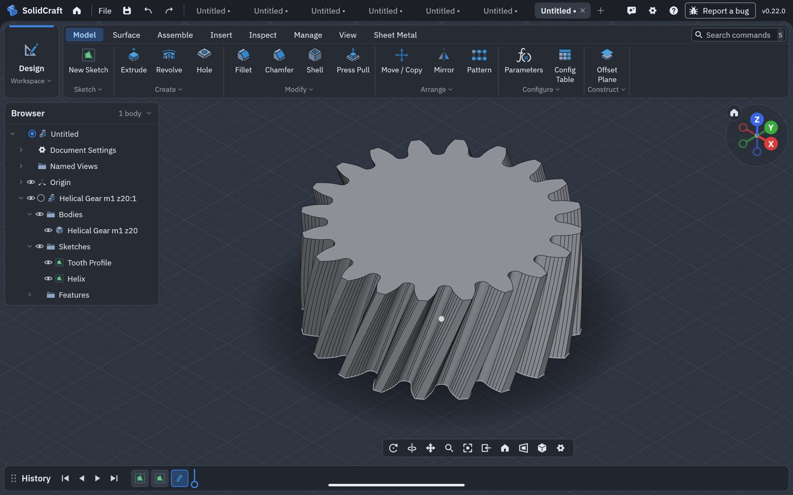

*Fields:* Helix angle, Hand. *Built from:* *Tooth Profile*, a *Helix* path, a twisted sweep.

### Herringbone

A helical half (half the face width), mirrored onto itself across the mid-plane, so the two halves
wind opposite ways and their end thrusts cancel.

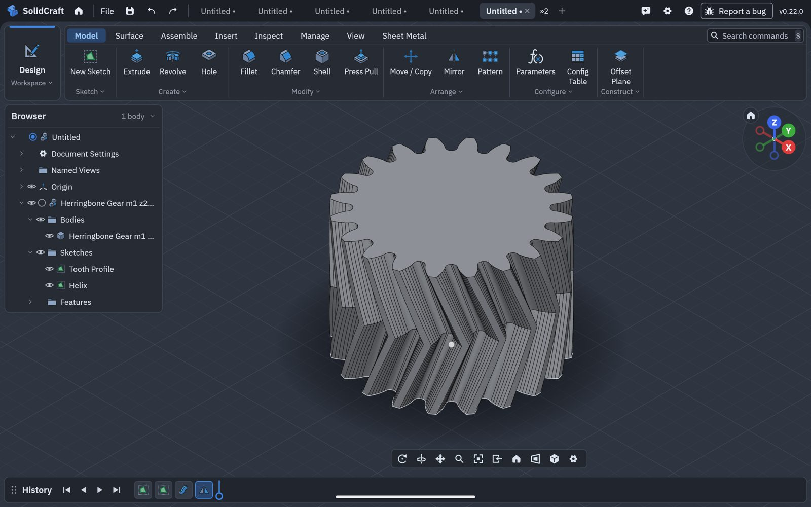

*Fields:* Helix angle, Hand (of the lower half). *Built from:* a twisted sweep and a mirror
joined to it.

### Internal (ring)

A ring whose hole is toothed: the space between two internal teeth is shaped like an external
tooth. Straight, or helical with a helix angle. **Rim** sets the ring material outside the tooth
roots.

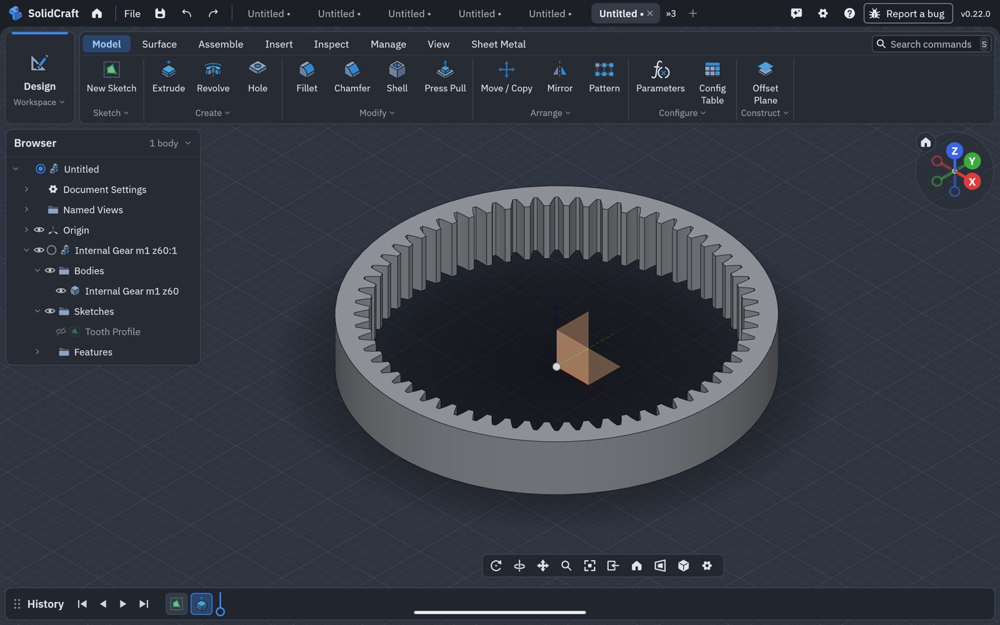

*Fields:* Rim, Helix angle, Hand. No bore or hub. *Built from:* one sketch (outer circle and
toothed hole) and an extrude or a twisted sweep.

### Rack

Straight teeth along a bar, the pitch line on y = 0. **Teeth** sets the length (teeth × π m),
**Back height** the material below the roots. With a helix angle the teeth lean, swept along an
oblique path without turning: a helical rack, for a helical pinion of the same helix angle.

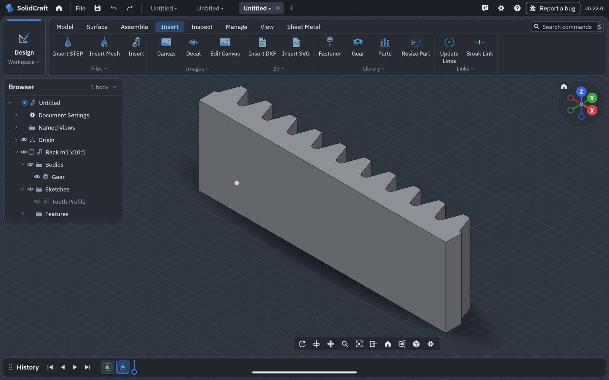

*Fields:* Teeth, Back height, Helix angle, Hand. *Built from:* *Tooth Profile* and an extrude, or
a sweep along a slanted *Helix* path.

### Bevel

Teeth on a cone that shrink towards the pitch apex on the axis. **Mate teeth** and **Shaft angle**
set the pitch cone angle δ (26.565° for 20 teeth against 40 at 90°). The heel outline is
Tredgold's virtual spur gear on the back cone, projected from the apex onto the heel plane, and
swept towards the apex while it shrinks, so every tooth line passes through the apex. A **Spiral
angle** adds a twist (approximate spiral teeth).

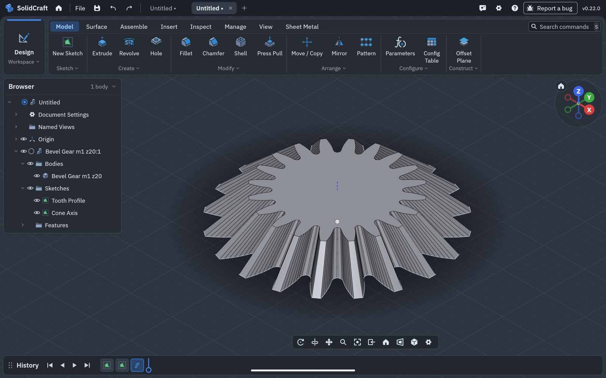

*Fields:* Spiral angle, Hand, Mate teeth, Shaft angle. *Built from:* *Tooth Profile*, a *Cone
Axis* path, a sweep with an end scale (and a twist when spiral). A bore and keyway are cut
afterwards.

### Miter

A bevel gear whose mate has the same number of teeth, on shafts at 90° (δ = 45°). Two identical
miter gears make a right-angle drive.

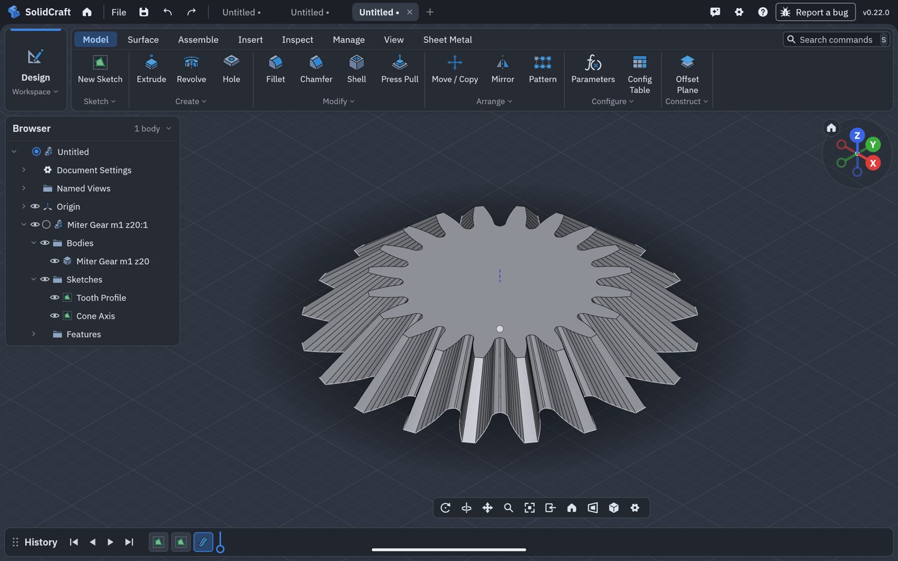

*Fields:* as bevel, without Mate teeth and Shaft angle. *Built from:* as bevel.

### Worm

A screw-like gear: its section square to the axis (one lobe per start, with Archimedean flanks:
a ZA worm, straight-sided in the axial section) swept up the axis while it turns once per lead
(lead = starts × π m). A worm over four turns long is built in pieces of up to four turns each,
joined (two pieces for the default 12.8 mm).

| One start | Two starts (after Edit Gear) |
|---|---|
| 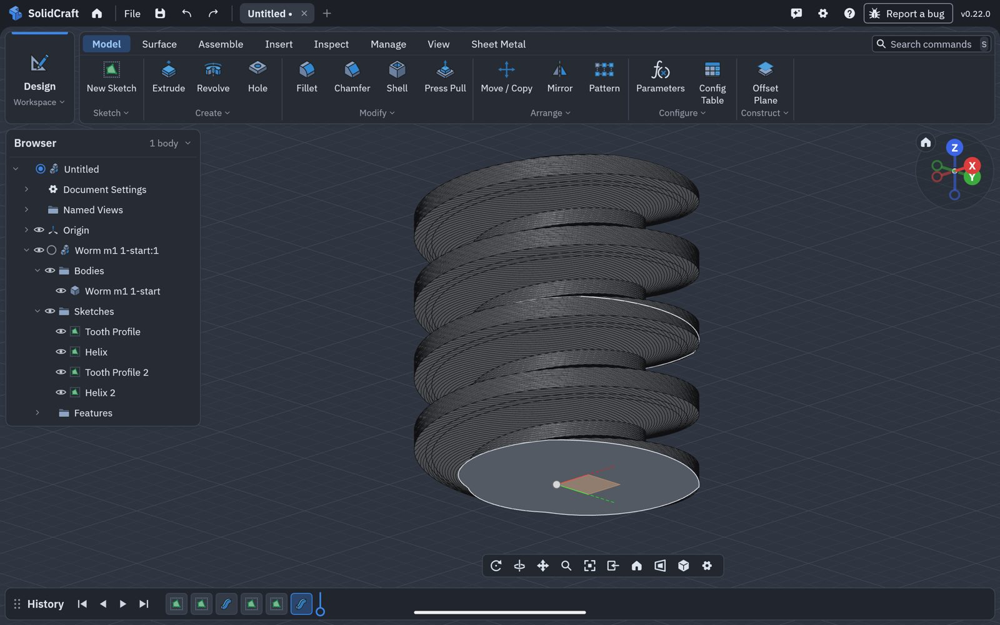 | 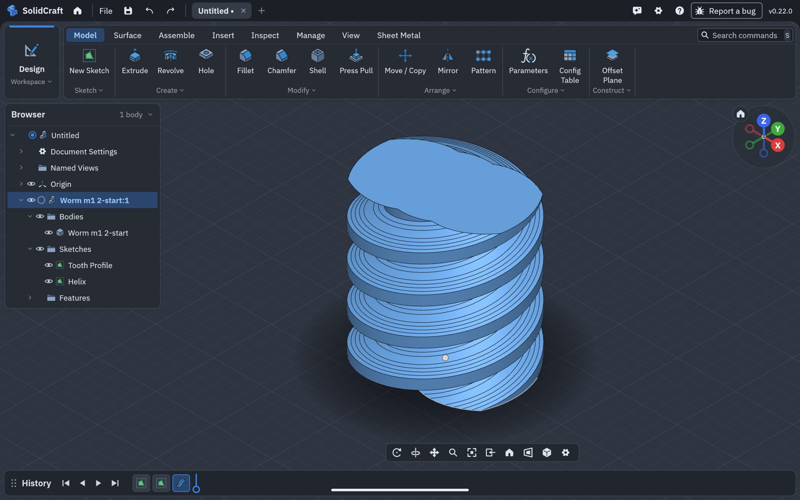 |

*Fields:* Starts, Length, Worm diameter, Hand. *Built from:* *Tooth Profile* and *Helix* per
piece, one twisted sweep per piece.

### Worm wheel

The wheel a worm drives: a helical gear whose helix angle is the worm's lead angle
γ = atan(lead / (π d₁)). The Dimensions show the centre distance to the worm and the ratio
(teeth / starts).

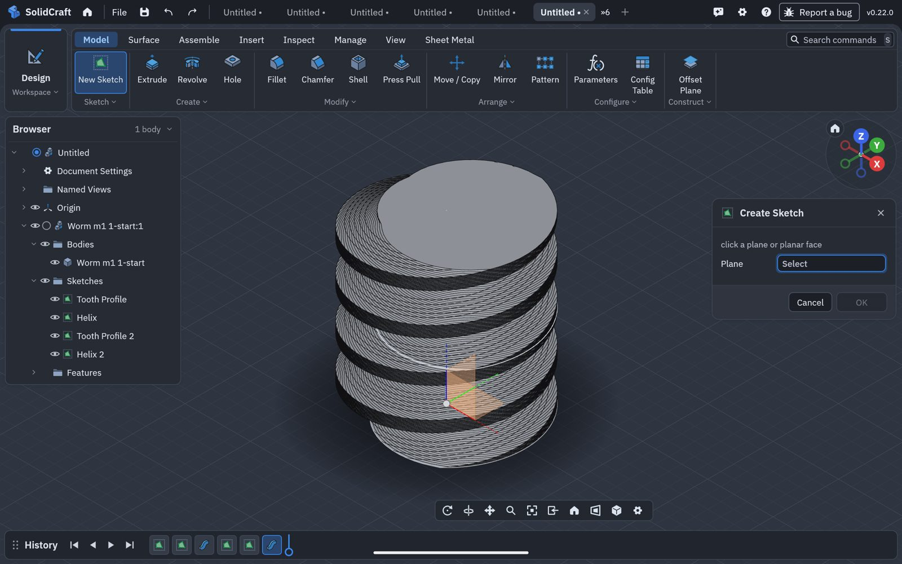

*Fields:* Worm starts, Worm diameter, Hand. *Built from:* as helical.

### Crossed helical

Helical gears for crossed shafts, also called screw gears. The default 45° helix suits shafts at
90° (the two helix angles add up to the shaft angle), with the **same** hand on both gears.

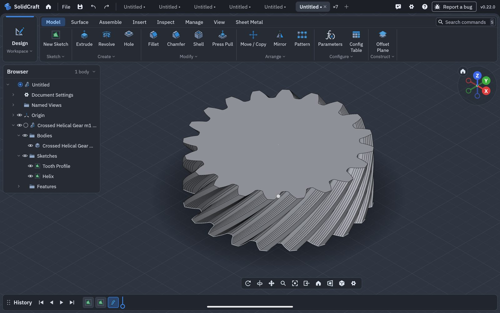

*Fields:* as helical. *Built from:* as helical.

## 9. Making pairs that mesh

Two gears mesh when they have the same **module** and **pressure angle**. Besides that:

| Pair | Also needed |
|---|---|
| Spur + spur | Nothing more |
| Helical + helical, parallel shafts | The same helix angle, **opposite** hands |
| Herringbone + herringbone | The same helix angle, opposite hands |
| Crossed helical, shafts at 90° | Helix angles adding up to 90°, the **same** hand |
| Spur / helical pinion + internal gear | The same helix angle; for helical, the **same** hand (an internal mate turns the same way) |
| Rack + pinion | The same helix angle; for helical, opposite hands |
| Bevel + bevel | Each made with the other's teeth as **Mate teeth**, the same shaft angle |
| Miter + miter | Nothing more |
| Worm + worm wheel | The same module, starts and worm diameter, the **same** hand |

**Spur and helical pairs.** Open **Mating gear** and type the mate's teeth. The Dimensions add the
pair's **ratio**, **centre distance** and **contact ratio** (above 1.2 runs smoothly), and for
helical gears the **overlap ratio**. With profile shift the centre distance is the working one.

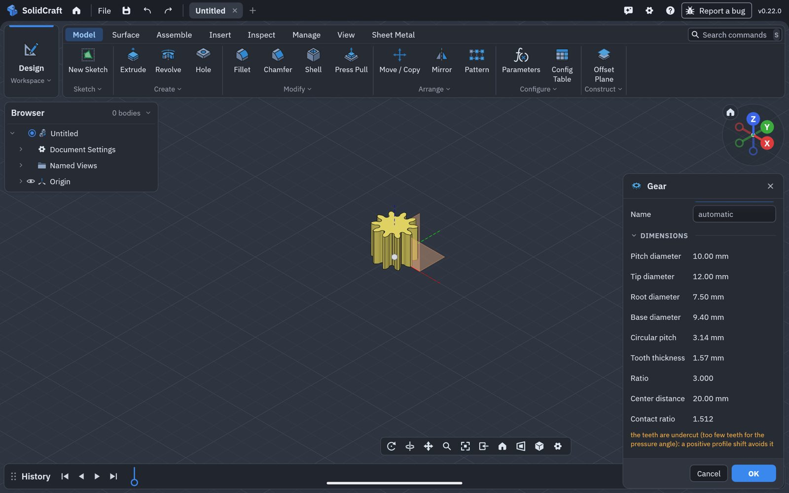

**Placing gears.** Tooth 0 of every round gear is centred on +X. To mesh a mate at the centre
distance along X, insert it, then **Move/Copy** it by the centre distance along X and turn it about
its own axis by 180° + 180° / its teeth, so that one of its spaces faces the first gear's tooth 0.

**Rack and pinion.** The rack's pitch line is y = 0. Put the pinion's axis at y = its pitch radius
(half its pitch diameter).

**Bevel and miter.** Their pitch apexes meet. Each one's pitch cone angle is in its Dimensions:

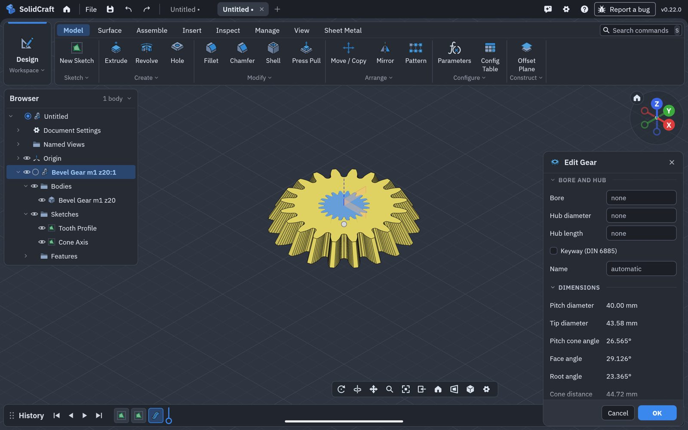

**Worm and wheel.** The wheel shows the centre distance. The worm's axis is square to the wheel's
at that distance, on the wheel's mid-plane (z = face width / 2).

**Motion.** The Assemble tab's **Gear**, **Rack and Pinion** and **Screw** motion links then drive
the parts together; the ratio is one gear's teeth over the other's.

## 10. Editing a gear

Double-tap the gear in the browser, or long-press it (right-click with a mouse; a body or face of
the gear works too) and choose **Edit Gear**.

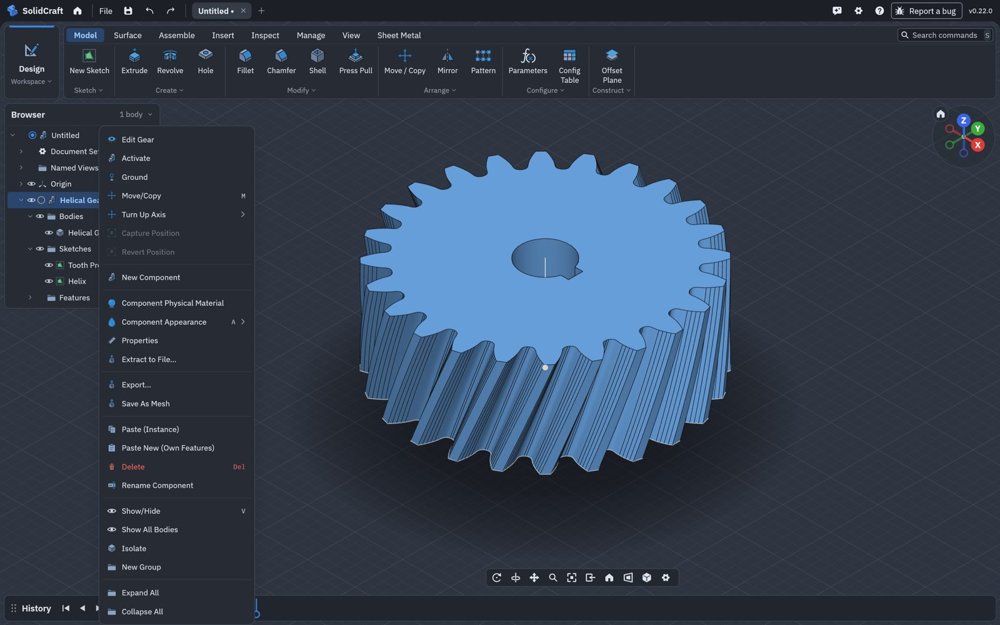

The dialog opens filled in with what the gear was made from, and previews every change. Here the
helical gear goes from 24 to 30 teeth and from right to left hand:

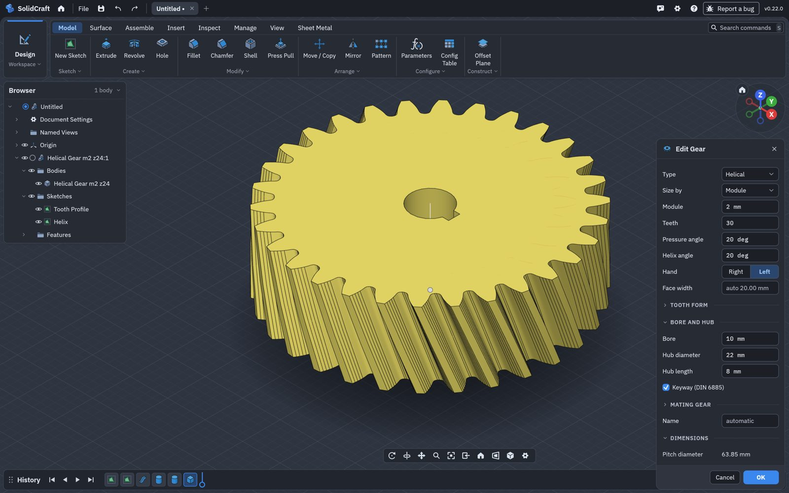

**OK** rebuilds the gear in place, in one undo step, keeping its position and joints:

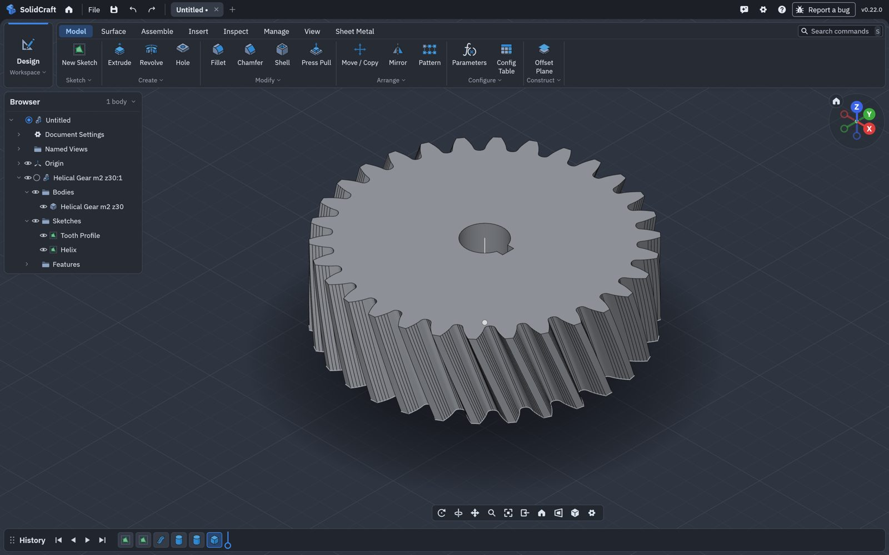

- **The name** follows the new size if it was automatic (component, placement and body:
  *Helical Gear m2 z30:1*); a name you gave stays.
- **An automatic face width** stays automatic, so a new module or tooth count gets its own.
- **The type can change too**: a spur gear can become a bevel gear.
- **The values are saved** with the component in the design file, so Edit Gear works after the
  design is saved and opened again.

## 11. On a real tablet

Tested on the Samsung Galaxy Tab: every type, a helical gear with bore, keyway and hub, and Edit
Gear from the long-press menu. The larger screen shows the whole dialog, Dimensions included,
without scrolling. A helical preview takes about ten seconds; OK then applies in a second or two.
There were no crashes or not-responding events.

**The taskbar.** Samsung tablets and other large screens show a taskbar along the bottom, and it
took the touches there, including a tall dialog's **OK** and **Cancel**. The app now hides the
system bars while it is in front, as its fullscreen theme intends. Swipe up from the bottom edge to
bring the taskbar or navigation buttons back for a moment.

## 12. Tips

- **Move between fields with Tab** on a keyboard, or tap the next field. **Enter in a field is
  OK**, as in every SolidCraft dialog, so Enter after the first value applies the gear with the
  rest at their defaults (Edit Gear fixes that afterwards).
- **Scroll the dialog** by dragging over its labels; a drag that ends on a field opens the
  on-screen keyboard.
- **The spinner** at the dialog's bottom left means a preview is computing; the app stays
  responsive meanwhile, and **OK** says *Computing…* while it finishes.
- **The sections** (Tooth form, Bore and hub, Mating gear, Dimensions) remember whether they were
  open the next time the dialog opens.
- **Back** closes the keyboard first, then the dialog. With nothing open it sends the app to the
  background, keeping the designs.

## 13. Limits

- **Spiral bevel teeth** are approximate: a twisted taper rather than a generated spiral. Fine for
  looks and light duty.
- **Internal teeth** are analytic involutes with a sharp root corner (no cutter fillet). No
  interference check against the pinion is made.
- **Worms** are ZA worms. The **worm wheel** is a helical gear at the worm's lead angle,
  cylindrical rather than throated: the usual approximation for printed and light-duty sets. It
  touches the worm along a line rather than over an area, so it carries less load than a hobbed,
  throated wheel. A throat would need a boolean against the helical teeth, which takes the kernel
  minutes.
- **Undercut** is shown as the generating rack cuts it, seen radially: where the true undercut
  curve doubles back on itself, the outline follows its outer edge.
- **Swept teeth** (helical, herringbone, bevel, worm) take a few seconds to preview and build on a
  tablet; a worm with a hub, or a design with many such gears, longer. STEP export of swept gears
  is slow: about a minute for a helical gear, several for a long worm.

---

# Part 2: Reference

## 14. The commands

| Command | Label | Where | What it does |
|---|---|---|---|
| `gear.create` | Gear | Model › Create ▾ | Makes a gear as a new component; one undo step |
| `gear.edit` | Edit Gear | Context menu, browser double-tap | Rebuilds a gear component with changed parameters; one undo step |
| `gear.info` | Gear Dimensions | (no undo; the dialog's readouts) | Returns the dimensions, warnings and stored parameters without making anything |

The dialog runs the same commands that scripts, the CLI, the MCP server and the agent use.

```json
{"command": "gear.create", "params": {"type": "helical", "module": 2, "teeth": 24, "helix_angle": 20,
 "hand": "left", "face_width": 16, "bore": 10, "keyway": true, "backlash": 0.15}}
{"command": "gear.info", "params": {"type": "spur", "module": 2, "teeth": 20, "mate_teeth": 40}}
{"command": "gear.edit", "params": {"component": "Helical Gear m2 z24", "teeth": 30}}
```

`gear.create` replies `{component, occurrence, name, info, warnings}`; `gear.edit` replies
`{component, name, info, warnings}`. `solidcraft-cli commands` lists every parameter.

## 15. `gear.create` parameters

Numbers may be given as numbers or as expressions (strings) over the design's parameters. Lengths
are in mm (an expression may name its unit), angles in degrees.

| Parameter | Type | Range | Default | Notes |
|---|---|---|---|---|
| `type` | text | `spur`, `helical`, `herringbone`, `internal`, `rack`, `bevel`, `miter`, `worm`, `worm_wheel`, `crossed_helical` | `spur` | Also accepted: `straight`, `double_helical`, `ring`, `mitre`, `wormwheel`, `worm_gear`, `crossed`, `screw` |
| `module` | length | 0.01–200 mm | 1 | Normal module for helical teeth; a worm's axial module |
| `diametral_pitch` | number | 0.1–2540 | — | Instead of `module`: module = 25.4 / DP |
| `teeth` | whole | 1–1000 (3+ for gears, 6+ internal) | 20; internal 60, rack 10, worm wheel 30 | A rack's length in teeth |
| `pressure_angle` | angle | 10–35° | 20° | Normal pressure angle for helical teeth |
| `helix_angle` | angle | 0–60° | 20° helical/herringbone, 45° crossed, else 0 | A bevel gear's spiral angle |
| `hand` | text | `right`, `left` | `right` | |
| `face_width` | length | 0.01–10000 mm | See [4](#4-the-dialogs-fields) | A worm's length; stored as automatic when not given |
| `profile_shift` | number | −1 to 1.5 | 0 | |
| `backlash` | length | 0–10 module | 0 | Shared by the pair: each gear thins its teeth by half |
| `addendum` | number | 0.3–1.5 | 1 | Coefficient of the module |
| `clearance` | number | 0–0.6 | 0.25 | Coefficient of the module |
| `root_fillet` | number | 0–0.6 | 0.38 | Coefficient of the module |
| `bore` | length | 0–10000 mm | 0 (none) | Round gears |
| `keyway` | bool | | false | DIN 6885-1, bores of 6–130 mm |
| `hub_diameter`, `hub_length` | length | 0–10000 mm | 0 (none) | Round gears; below z = 0 |
| `rim` | length | 0.01–10000 mm | 3 module | Internal gears |
| `height` | length | 0.01–10000 mm | 2 module | Racks: back height below the roots |
| `mate_teeth` | whole | 3–1000 | `teeth` | Bevel: the mate (sets the cone). `gear.info` on spur/helical/herringbone: the pair's readouts |
| `mate_profile_shift` | number | | 0 | `gear.info` only: the mate's shift for the working centre distance |
| `shaft_angle` | angle | 10–170° | 90° | Bevel (miter is always 90°) |
| `starts` | whole | 1–12 | 1 | Worm, worm wheel |
| `worm_diameter` | length | 0.1–10000 mm | 10 module | Worm, worm wheel: the worm's pitch diameter |
| `name` | text | | Automatic | |
| `point`, `direction` | [x, y, z] | | Origin, +Z | Where the gear's axis goes (`gear.create` only) |

`gear.edit` takes `component` (id or name) and any of these; the others keep their stored values.
Changing `type` lets `face_width`, `helix_angle` and `teeth` start from the new type's defaults
unless they are given too.

## 16. `gear.info` readouts

All lengths in mm, angles in degrees, rounded to 1e-6.

| Key | Types | Meaning |
|---|---|---|
| `pitch_diameter` | Round | d = m z (helical: z mₙ / cos β; bevel: at the heel) |
| `tip_diameter` | Round | Outside diameter of the teeth (internal: the teeth's inner circle) |
| `root_diameter` | Round | Diameter at the tooth roots |
| `base_diameter` | Spur, helical types, internal | d cos αₜ, where the involutes start |
| `outside_diameter` | Internal | The ring's outside |
| `circular_pitch` | Round, rack | π m |
| `tooth_thickness` | Round | At the pitch circle: π m / 2 + 2 x m tan α − backlash / 2 |
| `transverse_module`, `transverse_pressure_angle` | Helical types | mₜ = mₙ / cos β, αₜ = atan(tan αₙ / cos β) |
| `twist` | Helical types, spiral bevel, worm | Turn of the teeth across the face |
| `lead` | Helical types, worm | Axial advance per turn |
| `lead_angle`, `worm_lead` | Worm, worm wheel | γ = atan(lead / π d₁) |
| `turns`, `length`, `axial_pitch` | Worm | |
| `pitch_cone_angle`, `face_angle`, `root_angle` | Bevel, miter | δ, δ + θₐ, δ − θ_f |
| `cone_distance` | Bevel, miter | Aₑ = r / sin δ |
| `virtual_teeth` | Bevel, miter | z / cos δ (Tredgold) |
| `length`, `tooth_height`, `total_height`, `pitch_line_height` | Rack | |
| `keyway` | Round, with a bore | Key width × depth, e.g. *6 x 2.8 (DIN 6885)* |
| `ratio` | Bevel, worm wheel, with a mate | Teeth over teeth (worm wheel: teeth over starts) |
| `centre_distance` | Worm wheel, with a mate | Worm wheel: r₂ + d₁ / 2 + x m. A pair: the working centre distance |
| `working_pressure_angle` | With a mate | αw from inv αw = inv α + 2 tan α (x₁ + x₂) / (z₁ + z₂) |
| `contact_ratio` | With a mate | Transverse contact ratio εα |
| `overlap_ratio` | Helical pair | εβ = F sin β / (π mₙ) |
| `face_width` | All | The face width used (the automatic one when not given) |
| `warnings` | All | List of warnings ([17](#17-warnings-and-refusals)) |
| `parameters` | All | The parameters as they would be stored |
| `types` | All | The type ids and names |

## 17. Warnings and refusals

**Warnings** (the gear is made, the dialog shows them in orange):

| Warning | When |
|---|---|
| *the teeth are undercut (too few teeth for the pressure angle): a positive profile shift avoids it* | z sin²α / 2 < hₐ − x (fewer than 17 teeth at 20° without shift) |
| *the teeth come to a point; their tips are cut back* | Too much profile shift for the tooth count: the tips are cut back to a land of 0.05 m |
| *the face width is more than a third of the cone distance (…)* | Bevel and miter |
| *spiral teeth are approximate (a twisted taper), for looks and light duty* | Bevel with a spiral angle |
| *a lead angle over 25° is steep for a worm: …* | Worm |
| *DIN 6885 has no key for this bore (6–130 mm): no keyway* | Keyway on a bore outside the table |
| *an internal gear has no bore* | Bore given on an internal gear |

**Refusals** (nothing is made, OK is greyed out, the reason shows in orange). Besides values out of
range or of the wrong kind (*`teeth` must be a whole number from 1 to 1000*, *unknown gear type*…):

| Refusal | Why |
|---|---|
| *the bore (Ø…) is too large for the root diameter (Ø…)* | Less than half a module (at most 0.5 mm) of wall left |
| *the keyway would cut through the root* | Key depth reaches the root circle |
| *the face width must be well under the cone distance (…)* | Bevel face width of 0.8 Aₑ or more |
| *the root circle is at the centre: use more teeth or less profile shift* | |
| *the cutter's tip comes to a point: lower the pressure angle or the root clearance* | The basic rack can't be made |
| *the teeth are cut away entirely: …* | The teeth come to a point at once |
| *the teeth leave no root between them: …* | |
| *the internal teeth reach the centre / come to a point / leave no space between them* | Internal gears |
| *the rack's teeth come to a point / leave no root between them* | Racks |
| *the worm's root reaches its axis / thread comes to a point / threads leave no root between them* | Worms |
| *the gear could not be built: …* | The kernel refused a feature (reported, nothing is changed) |

## 18. Where each type sits, and what it is built from

| Type | Frame | Features in its component |
|---|---|---|
| Spur | Axis +Z from z = 0, tooth 0 on +X | Tooth Profile (sketch), Extrude |
| Helical, crossed helical, worm wheel | As spur | Tooth Profile, Helix (path sketch), Sweep with twist |
| Herringbone | As spur | Tooth Profile, Helix, Sweep (half face), Mirror (joined) |
| Internal | As spur, a tooth on +X | Tooth Profile (circle + toothed hole), Extrude or twisted Sweep |
| Rack | Along +X from x = 0, pitch line y = 0, teeth towards +Y, width along +Z | Tooth Profile, Extrude (helical: slanted Helix, parallel Sweep) |
| Bevel, miter | Heel on z = 0, pitch apex up the axis | Tooth Profile, Cone Axis, Sweep with end scale (and twist) |
| Worm | Axis +Z, length from z = 0 | Tooth Profile n and Helix n per piece of up to four turns, one twisted Sweep each, joined |
| + bore | | Straight teeth and swept teeth without a hub: the bore (and on straight teeth the keyway) is a hole in Tooth Profile. Bevel, or swept teeth with a hub: a Cylinder cut |
| + keyway | | Straight teeth: in the profile. Otherwise a Box cut |
| + hub | Below z = 0 | Straight teeth: a Hub sketch (ring) extruded down, joined. Swept teeth: a Cylinder joined, reaching a little into the teeth |

Every body is named after the gear (*Helical Gear m2 z24*; a second identical gear in the design
gets *… 2*).

## 19. Standards and formulas

- **ISO 53** basic rack: α = 20°, hₐ = 1 m, c = 0.25 m, ρ_f = 0.38 m.
- **Involute**: inv α = tan α − α. Tooth half-angle at radius r ≥ r_b:
  s / 2r_p + inv α − inv α_r, with α_r = acos(r_b / r).
- **Helical**: mₜ = mₙ / cos β, tan αₜ = tan αₙ / cos β; the transverse rack has
  hₐ, c, ρ and x scaled by cos β.
- **Bevel**: δ₁ = atan(sin Σ / (z₂/z₁ + cos Σ)), Aₑ = r / sin δ, z_v = z / cos δ (Tredgold);
  θₐ = atan(m (hₐ + x) / Aₑ), θ_f = atan(m (hₐ + c − x) / Aₑ).
- **Worm**: lead = starts × π m, γ = atan(lead / π d₁), wheel helix angle = γ,
  centre distance a = (d₂ + d₁) / 2 + x m.
- **Undercut limit**: z_min = 2 (hₐ − x) / sin²α.
- **Working pressure angle**: inv αw = inv α + 2 tan α (x₁ + x₂) / (z₁ + z₂),
  a = a₀ cos α / cos αw.
- **Contact ratio**: εα = (√(rₐ₁² − r_b₁²) + √(rₐ₂² − r_b₂²) − a sin αw) / (π m cos α).
- **DIN 6885-1** parallel keys: shaft diameter range → key width b and hub depth t₂ (6–8 mm:
  2 × 1.0 … 110–130 mm: 32 × 7.4).

---

# Part 3: How it is made

## 20. Overview

```
 Gear dialog (ui-egui)             scripts, CLI, MCP, agent
 dialogs_gears.rs                          │
   │ fields → JSON params                  │
   ├── gear.info  (readouts, each change) ─┤
   └── gear.create / gear.edit (preview, OK)
                    │
      engine: cmd/gears.rs
        Spec::parse   → checked parameters (expressions evaluated)
        plan          → tooth outline + readouts + warnings (gear_profile.rs)
        build         → ordinary features in a new component:
                         sketch.create + add_to_active (the outline)
                         solid.extrude | solid.sweep (twist / scale) | solid.mirror
                         solid.cylinder / solid.box (bore, keyway, hub when needed)
        store         → parameters in the component's metadata (io.solidcraft.gear)
                    │
      kernel: sweep_path.rs straight_walls (smooth twisted / tapered walls)
```

A gear is not a new kind of feature: it is a component built from the ordinary commands, so it
evaluates, saves, exports and undoes like any other model, and older builds open it. What makes
it a gear is its stored parameters, which `gear.edit` rebuilds it from.

## 21. Files added and changed

**Added**

| File | Lines (approx.) | What |
|---|---|---|
| `crates/engine/src/gear_profile.rs` | 560 | The tooth geometry, pure mathematics (no document) |
| `crates/engine/src/cmd/gears.rs` | 1050 | The three commands, parameters, build, storage |
| `crates/engine/src/cmd/gears_tests.rs` | 330 | The command tests |
| `crates/ui-egui/src/dialogs_gears.rs` | 430 | The Gear / Edit Gear dialog |
| `assets/icons/ui/design/svg/model/spur_gear.svg` | | The command icon |
| `docs/android-gears.md` | | This manual |
| `docs/screenshots/android/gears-*.jpg` | | 25 screenshots (17 emulator, 8 tablet) |

**Changed**

| File | Change |
|---|---|
| `crates/engine/src/lib.rs` | `pub mod gear_profile`; re-exports `GEAR_KEY`, `GEAR_TYPES`, `stored_gear` |
| `crates/engine/src/cmd/mod.rs` | `mod gears`, its commands in the registry, the re-exports |
| `crates/engine/src/cmd/sketch_import.rs` | `add_to_active`: computed curves into the active sketch, ends joined |
| `crates/kernel/src/sweep_path.rs` | `straight`, `straight_walls`: smooth walls for straight sweeps that twist or scale; a regression test |
| `crates/ui-egui/src/lib.rs` | `mod dialogs_gears` |
| `crates/ui-egui/src/dialogs.rs` | `Kind::Gear`, its start, title (*GEAR* / *EDIT GEAR*), preview policy, commands |
| `crates/ui-egui/src/dialogs_dense.rs` | The dialog's command id and rows |
| `crates/ui-egui/src/browser.rs` | Double-tap a gear component or placement opens Edit Gear |
| `crates/ui-egui/src/context_menu.rs` | *Edit Gear* on a gear's component, placement, body or face selection |
| `crates/ui-egui/src/workspace.rs` | Short ribbon names (*Gear*, *Edit Gear*) |
| `apps/solidcraft-android/src/lib.rs` | `apply_off_thread`, as the desktop app sets it |
| `apps/solidcraft-android/android/app/src/main/java/io/solidcraft/android/SolidCraftActivity.java` | `hideSystemBars`, `onWindowFocusChanged` |
| `assets/locales/en, en-GB, ja, zh, de, ko .json` | The gear labels, the Thread dialog's missing labels |
| `assets/icons/ui/design/requested_icons.txt` | `spur_gear` |
| `ATTRIBUTION.md` | The icon and the screenshots |
| `docs/android.md` | Status, the port's changes to upstream files |

## 22. The tooth geometry: `gear_profile.rs`

Pure geometry in millimetres and radians, returning `Geom2` curves (lines, arcs, splines) for a
sketch. No document, no kernel.

| Item | What |
|---|---|
| `Rack { m, alpha, ha, c, rho, x, thin }` | The basic rack and how the teeth are cut from it: module, pressure angle, addendum, clearance and tip-radius coefficients, profile shift, tooth thinning (half the backlash). `Rack::iso(m, α)` is ISO 53 |
| `Tooth { z, rf, ra, flank, pointed, undercut }` | One tooth: the tooth's half-angle at radii from root to tip (`flank`), and whether it was cut back or is undercut. `z` may be fractional (a bevel's virtual gear) |
| `inv(a)` | The involute function |
| `generate(z, rack, ra)` | **External teeth by rack generation** (below) |
| `cross(p, q, radii, best)` | Where a segment crosses each target radius, keeping the largest angle |
| `internal(z, rack)` | Internal teeth, analytic: the *space* half-angle at radii from the tip circle out to the root |
| `outline(tooth, count, angle_scale, map)` | The closed outline of `count` teeth: per tooth a spline up one flank, the tip arc, a spline down the other flank, the root arc. `map` places points (a bevel's projection) |
| `resample(points, n)` | About n points spaced by length along a dense flank, for its spline |
| `rack(rack, teeth, back)` | A rack: lines and root-fillet arcs, closed by the back |
| `worm_section(rack, r1, starts, lead)` | A worm's section square to its axis: `starts` lobes, flank angle linear in the radius (Archimedean) |
| `bevel_outline(tooth, z, δ, R)` | The bevel heel: the virtual gear on the back cone, projected from the pitch apex onto z = 0 |

**How `generate` works.** In the rack's frame (u along the pitch line, η out from the pitch
circle) the cutter tooth is a trapezoid with flanks at the pressure angle, its tip at
η = x m − (hₐ + c) m, its tip corners rounded with radius ρ (clamped to fit). Its outline is
sampled densely. The cutter then rolls over the gear without slipping: at roll angle φ, a rack
point (u, η) is at (u − r φ, r + η) in the world, which is that point turned by φ in the gear's
frame. For a few thousand roll positions the outline is moved into the gear's frame, and for
each of 240 target radii (packed towards the root, where the root curve runs nearly along the
circle) the largest angle at which the cutter crosses that radius is kept (`cross`, which also
handles a segment that dips to its nearest point mid-way). That angle is the edge of the tooth
space, so the tooth's half-angle is π / z minus it.

The result is the exact envelope of the cutter: involute flanks above the form circle, the
trochoid root below, undercut when the cutter dips below the interference point. A tooth that
comes to a point before the tip circle is cut back to a 0.05 m land (`pointed`). The flanks are
then resampled to 8 points each and become cubic fit splines; the test
`generated_flanks_are_involutes` checks them against the analytic involute to 1e-3 mm.

## 23. The commands: `cmd/gears.rs`

| Item | What |
|---|---|
| `COMMANDS` | `gear.create`, `gear.info`, `gear.edit` (`CommandSpec`, at SOLID › CREATE, icon `spur_gear`) |
| `TYPES`, `Type` | The ten types: ids, names, aliases (`Type::parse`), which are helical, which round |
| `Spec` and `Spec::parse` | Checked parameters: every value read with `value` / `opt` / `count`, which evaluate expressions through the document (`Document::eval`), check ranges and wholeness, and refuse anything else |
| `Spec::rack` | The basic rack in the transverse plane (helical teeth scale it by cos β) |
| `Spec::cone`, `lead`, `twist`, `pitch_radius`, `default_face` | Bevel cone angle and distance, worm lead and lead angle, the signed twist, the automatic face width |
| `Spec::to_json`, `name` | What is stored (an automatic face width as null) and the automatic name |
| `KEYS`, `key_for` | DIN 6885-1 keys by bore |
| `Plan`, `plan` | The outline to sketch, the solid radius (for the bore check), a point in the material (to pick the profile), the readouts and warnings, or the refusal. Everything is checked here before anything is built |
| `profile`, `path`, `pick`, `sweep`, `rotate` | Building blocks: a sketch holding computed curves on z = z₀ (refreshed, so the next feature can pick its profile by a point), a one-line path sketch, a profile pick, a sweep, a turned outline |
| `bore_loop` | The bore as a profile hole: a circle, or a circle with the keyway notch |
| `build` | Per type: extrude, twisted sweep (in pieces of under four turns for long worms), scaled sweep (bevel), sweep + mirror (herringbone), slanted parallel sweep (helical rack); then hub, bore and keyway (see [29](#29-performance-why-so-few-booleans)) |
| `unique_body` | A body name no body in the design has, so two gears never share one |
| `info` | `gear.info`: plan's readouts, plus the pair's centre distance, working pressure angle (Newton's method on the involute function), contact and overlap ratios |
| `Built`, `LAST`, `built` | The last build, kept with the design (by identity and revision), command and parameters it came from. The dialog's preview and OK's evaluation ahead build the gear off the window thread; OK's run on the window thread then takes that result instead of building it again |
| `create_atomic`, `edit_atomic` | Build on a scratch session and accept it as one undo step |
| `store`, `stored` | Parameters into, and out of, the component's metadata; part number and description set too |
| `create` | Refuse early (plan), make the component, build, store, place (`point`, `direction`), check every feature evaluated |
| `edit` | Merge new parameters over the stored ones, refuse early, delete the component's features, rebuild, rename (component, placements and body) when the name was automatic |

## 24. The kernel change: smooth straight sweeps

`crates/kernel/src/sweep_path.rs`. A sweep with a twist or an end scale went through
`smooth_walls`, which takes at most 64 profile segments and no holes; anything else fell back to
ruled walls through up to a thousand stations. A gear profile has hundreds of segments and often a
bore, so a 24-tooth helical gear became over 16,000 flat strips: slow to show, and too many faces
for any later boolean (the kernel's planar-source budget refused it).

`straight_walls` handles the common case of a **straight** path with a twist or scale (helical,
herringbone, bevel and worm teeth; any twisted or tapered prism): one B-spline wall per segment of
every loop, holes included, through the stations `controlled_stations` already computes, closed
by planar caps through `cap_and_close`, accepted only if its volume is within 5% of the swept
volume. `sweep_path_with` tries it before the old paths, which are unchanged for every other
sweep. Up to 20,000 segments are taken. The test
`straight_sweeps_of_many_segments_and_holes_stay_smooth` checks a 160-segment profile with a hole:
one face per segment plus two caps, and the volume of a twist (area × length) and of a taper (the
frustum).

## 25. The dialog: `dialogs_gears.rs` and its wiring

| Item | What |
|---|---|
| `Gr` | The dialog's state: type, size by module or DP, every field as typed (`fields`), hand, keyway, name, the component when editing, the last `gear.info` answer |
| `Gr::params` | The command's parameters: only fields the type uses, empty ones left to the engine's defaults |
| `Gr::uses` | Which parameter each type shows |
| `Gr::restore` | Edit Gear's fields from the stored parameters (units added, zero bore and hub left empty, null face width left automatic) |
| `Gr::info` | `gear.info`, run again only when the parameters change |
| `TOOTH`, `HUB`, `READOUTS` | The optional rows and the readouts, in order, with their units |
| `start`, `open`, `selected_gear`, `is_gear` | Opening Gear and Edit Gear, finding the gear under the selection, the browser or the context menu |
| `rows` | The rows: Type, Size by, the type's fields, the sections, Name, Dimensions with warnings or the refusal, all with `ui_kit` rows (`choice_row`, `hint_row`, `segmented`, `section`, `checkbox_grid`, `text_row`) like the Thread and Insert Part dialogs |
| `commands` | OK's command: `gear.create`, or `gear.edit` with the component; a refused gear gives its reason (OK greyed out) |

Wiring: `Kind::Gear` in `dialogs.rs` (start order, title, preview off on the web, OK's commands),
`dialogs_dense.rs` (command id for the dialog header, rows), `browser.rs` (double-tap),
`context_menu.rs` (*Edit Gear* on components, placements, bodies and selections; `run_item`),
`workspace.rs` (short names). The command itself reaches **Create ▾** through its
`at("SOLID", "CREATE")`.

## 26. The Android changes

- **OK off the window thread** (`apps/solidcraft-android/src/lib.rs`): `app.apply_off_thread =
  Some(APPLY_AT_ONCE)`, as the desktop app sets. Without it, a feature taking over five seconds
  (a worm, a swept gear with a hub, a helical thread) held the window thread, and Android offered
  to close the app as not responding.
- **System bars hidden** (`SolidCraftActivity.java`): `hideSystemBars()` from `onCreate` and
  `onWindowFocusChanged`; on Android 11+ through `WindowInsetsController` with
  `BEHAVIOR_SHOW_TRANSIENT_BARS_BY_SWIPE`, before that with the immersive-sticky flags. Android 15+
  lays the app out edge to edge, and a tablet's taskbar covered the bottom of the app and took its
  touches.

## 27. Icon, labels and translations

- **Icon**: `spur_gear.svg`, a new master drawn with the icon tools' isometric `Iso.extrude` (ten
  teeth and a bore, in the active blue ramp), left open for the owner's review. The existing
  accepted `gear` icon belongs to the motion gear coupling and is unchanged.
- **Labels**: every new label (commands, dialog rows, sections, types, readouts, warnings' context)
  is in `en.json` with its translations in `ja`, `zh`, `de` and `ko`, and *Centre distance* in
  `en-GB`. The Thread dialog's labels that had no catalogue entry (Helical B-rep, Thread depth,
  Start offset…) were added too, which the catalogue test now requires.

## 28. Storage and compatibility

A gear's parameters are stored in its component's metadata under `io.solidcraft.gear`, a
namespaced key that the design format keeps as it is. So designs with gears need **no format
change**: builds without this feature open them, and the gears are ordinary components with their
sketches and features (only Edit Gear is missing there). STEP, mesh and the other exports see an
ordinary body.

## 29. Performance: why so few booleans

The kernel's B-rep booleans are slow against swept B-spline teeth: a torus cut to throat a worm
wheel ran for over ten minutes, and a hub joined flush to helical teeth hung. So:

- The **bore**, and on straight teeth the **keyway**, are holes in the tooth profile: no boolean.
- A **hub on straight teeth** is a ring sketched on the same plane and extruded down: a join of two
  extrusions along a face, quick.
- A **hub on swept teeth** is a cylinder reaching a module into the teeth's solid core, then the
  bore (and keyway) cut through both: about 9 s on a desktop.
- **Bevel** bores and keyways, and keyways in twisted teeth, are cut afterwards.
- **OK reuses the preview's build** (`built` in `gears.rs`), and it runs off the window thread on
  Android ([26](#26-the-android-changes)).

## 30. Tests

Run them with `cargo test --release -p solidcraft-engine --lib -- gears:: gear_profile`,
`cargo test --release -p solidcraft-kernel --lib -- straight_sweeps` and
`cargo test --release -p solidcraft-ui-egui --lib -- dialogs_gears`.

| Test | Checks |
|---|---|
| `gear_profile::generated_flanks_are_involutes` | Generated flanks match the analytic involute (several tooth counts and shifts) |
| `gear_profile::undercut_shows_below_seventeen_teeth` | Undercut below 17 teeth, not with enough shift |
| `gear_profile::pointed_teeth_are_cut_back` | Over-shifted teeth cut back |
| `gear_profile::outlines_close` | Gear, rack, worm and internal outlines are closed chains |
| `gear_profile::bad_input_is_refused` | NaN, too few teeth, zero module, huge pressure angle… |
| `a_spur_gear_has_its_standard_dimensions` | Tip Ø44 for m2 z20, face, volume, one undo, stored parameters |
| `helical_teeth_turn_with_their_hand` | Twist formula and direction for both hands; the same section all the way up |
| `every_type_builds` | All ten types (and helical rack, spiral bevel) give one body |
| `bevel_teeth_taper_to_the_apex` | 45° cone, cone distance, toe/heel ratio (Aₑ − F) / Aₑ |
| `a_long_worm_is_built_in_pieces` | 6.4 turns in two sweeps; tip Ø12 |
| `a_worm_wheel_follows_its_worm` | Centre distance, lead angle, twist |
| `swept_gears_take_a_bore_quickly` | Helical, bevel, herringbone, worm wheel with bore, keyway and hub: Ø12 bore, hub depth, time |
| `bore_keyway_and_hub` | DIN 6885 key for Ø20, volume with hub, bore and keyway |
| `editing_a_gear_rebuilds_it` | Rebuild, name and placement follow, one undo, bad value refused, undo, saved and reopened, automatic face follows the module |
| `pair_readouts` | Centre distance 60, contact ratio, working pressure angle with shift |
| `bad_gears_are_refused` | Hostile and impossible values leave the design unchanged |
| `two_gears_keep_their_own_bodies` | A second gear's bore and hub go to it alone; unique body names |
| `building_again_takes_the_last_build` | The kept build: same result, five times faster at least, one undo |
| `sweep_path::straight_sweeps_of_many_segments_and_holes_stay_smooth` | The kernel change ([24](#24-the-kernel-change-smooth-straight-sweeps)) |
| `dialogs_gears::params_follow_the_type` | Only the type's fields, empty ones left out, DP instead of module |
| `dialogs_gears::edit_restores_the_stored_parameters` | Edit Gear's fields, OK runs `gear.edit` and gives the same gear |

The repository's gates pass with this feature: `cargo fmt`, clippy (`-D warnings`) on the kernel,
engine and UI crates, `cargo xtask layers`, `ui-containers`, `assets`, `icons`, `lists`, and the
catalogue and icon-audit tests.

## 31. Extending: adding a gear type

1. **Geometry**: if the type needs a new outline, add a function to `gear_profile.rs` returning
   `Vec<Geom2>` (closed, ends meeting within 1e-6 mm) and a case in `outlines_close`.
2. **Type**: add it to `Type`, `Type::parse`, `Type::id` and `TYPES` in `cmd/gears.rs`, with its
   defaults in `Spec::parse` and `default_face`, and its name in `Spec::name`.
3. **Plan**: a branch in `plan` giving the outline, the solid radius, a point in the material, the
   readouts and warnings; refuse there what can't be built.
4. **Build**: a branch in `build` using `profile`, `path` and `sweep` (keep to extrudes and sweeps;
   avoid booleans against swept teeth, see [29](#29-performance-why-so-few-booleans)).
5. **Dialog**: its fields in `Gr::uses` and `rows`, its readouts in `READOUTS`.
6. **Labels**: every new label in `en.json` and the complete catalogues (`ja`, `zh`), plus `de`
   and `ko` (`cargo xtask lists --fix` sorts them).
7. **Tests**: a case in `every_type_builds` and a test of its defining dimension.
