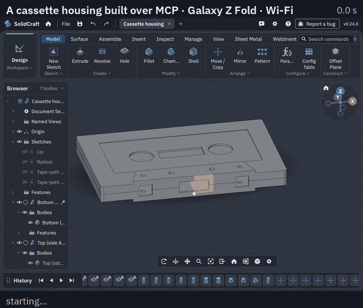
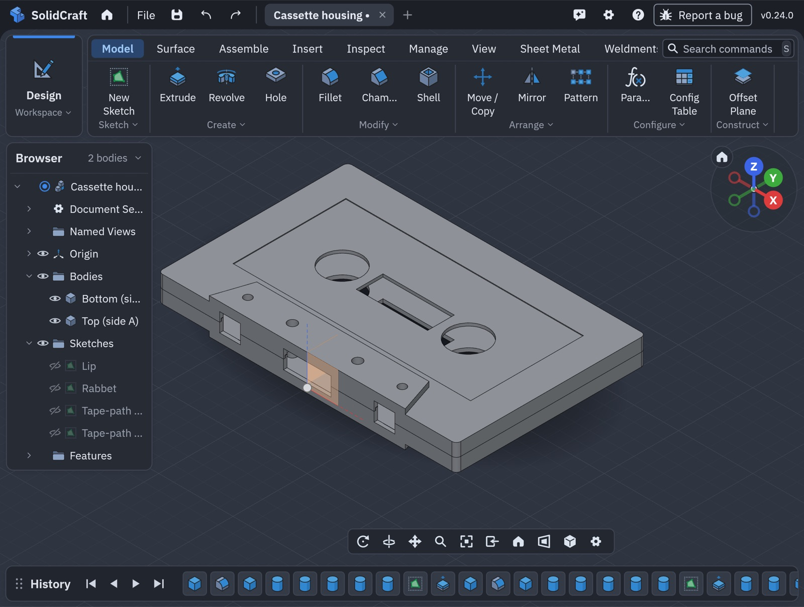
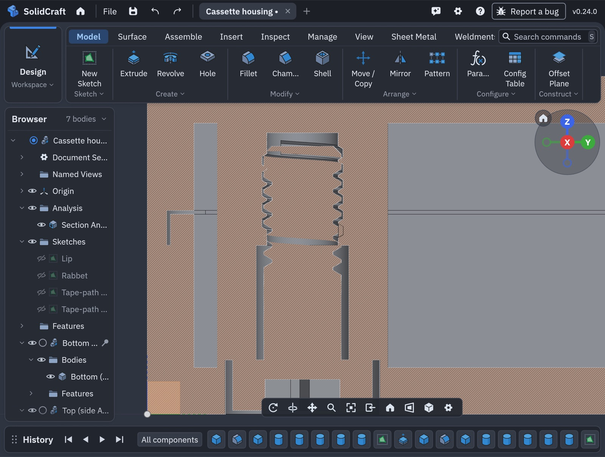
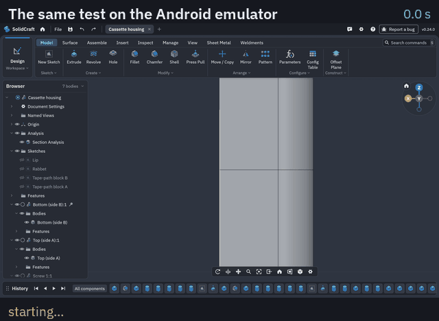

# Live design test: a cassette housing, built over the MCP server

A real part, built from nothing by an agent driving SolidCraft on Android only through
[Settings › MCP server](android-mcp.md): a compact-cassette housing in two halves, held together by five
M2 screws with real (helical B-rep) threads, checked to fit. Run on a **Galaxy Z Fold over Wi-Fi** and on
the **Android emulator**, twice each, with port 0.24.0a.



*The Fold's screen during the run (sped up about 4×; the long checks shortened). The caption is the
operation running at that moment and how long it took.*

- [The part](#the-part)
- [Result](#result)
- [How the fit was checked](#how-the-fit-was-checked)
- [What the test found](#what-the-test-found)
- [Time per operation](#time-per-operation)
- [Running it yourself](#running-it-yourself)

## The part

| Part | What was built |
|---|---|
| Shell | 100.4 × 63.8 × 8.7 mm in two halves split at 4.35 mm; 1.2 mm walls; R1.5 corners |
| Tape-path block | The raised trapezoid on the front edge of both halves, 66/58 × 12 mm, 1.65 mm proud each side (12.0 mm thick there); Ø2.6 capstan holes and Ø3.0 locating holes through it |
| Joint | A 0.6 mm lip on side B into a rabbet on side A, 0.1 mm clear outside and above |
| Reels, window, label | Two Ø13 hub holes 42.5 mm apart, a 24 × 9 tape window, a 0.25 mm label recess on side A |
| Edge openings | The head opening and two pinch-roller openings in the front wall, two write-protect notches in the back wall |
| Screws (×5) | M2 × 0.4 pan head Ø3.6 × 1.3 with a cross recess and a 0.2 mm tip chamfer, threaded 3.5 mm with a helical B-rep thread; four corners and one centre |
| Screw holes | Side B: Ø2.4 clearance holes, counterbored Ø4.0 × 1.4. Side A: Ø1.85 tap drills with helical B-rep M2 internal threads, 0.05 mm clearance |

The proportions follow the compact cassette; the tape-path block and hole positions are close
approximations, not taken from the standard's drawing.

| The halves, as built on the Fold | Cut through a screw: the M2 thread in its tapped boss, the head in its counterbore |
|---|---|
|  |  |

## Result

| | Galaxy Z Fold (Wi-Fi) | Emulator |
|---|---|---|
| Operations | 121, **all succeeded** (twice) | 121, **all succeeded** (twice) |
| Crashes, hangs, "not responding" | **None** | **None** |
| Time | **105 s** (99.7 s in calls); 121 s while recording the screen | 359–371 s on a heavily loaded Mac† |
| Thread fit, all five screws | **+0.049 mm** smallest radial gap | the same |
| Screw heads | seated on their counterbores (0 mm) | the same |
| Halves | no overlap; they meet at the split face, the lip clears its rabbet | the same |
| Volumes | side B 9563.76 mm³, side A 8719.52 mm³, each screw 26.94 mm³ | identical |
| Files | STEP 2.2 MB (seven parts), 3MF 0.8 MB, design 2.5 MB | the same |

The 0.049 mm gap is the 0.05 mm clearance asked for, less the meshes' tolerance. As first placed,
screw 1 overlapped its tapped thread by 0.076 mm; turned 165° about its axis, as a real screw finds its
phase when it is driven in, it sits clear. The four copies, in holes made the same way, fit as copied.

† The emulator ran while the Mac was busy with test builds (load average about 50), about three times
slower than an idle one: compare its stages, not its single calls.

## How the fit was checked

SolidCraft's own checks covered what they can: interference and clearance between the halves, and between
the screws and side B (the heads on their counterbores). The kernel can't intersect one helical B-rep thread
with another yet, so it lists those pairs as *not checked* rather than calling them clear.

So the threads were checked independently: the screw and side A were exported as the finest STL meshes,
both threads were unwound along the M2 × 0.4 helix into one axial section, and the screw's outer profile was
compared with the hole's inner profile for every degree of turn (`tools/mcp-cassette-test/fit.py`).

## What the test found

Two bugs in the port's helical threads, both fixed in 0.24.0a, with regression tests:

1. **A thread tapped into a boss under a hollow shell was refused** ("the groove removes −18.3 mm³, not
   1.21"). Its check measured the body before the thread one way and after it another; on a large hollow
   body the two differ by more than a small groove. Both are now measured alike.
2. **An internal ISO thread with a clearance came out too shallow for the bolt.** An M2 with 0.05 mm
   clearance in the standard 1.6 mm tap drill was 0.127 mm deep instead of reaching the bolt's 0.2 mm
   crests, so no M2 screw could go in, and nothing said so. It is now refused with the drill that works:
   *"drill 1.85 mm, or make the clearance smaller"*, as a tap drill is opened up for a printed part.

And these limits, with their work-arounds ([known issues](android-known-issues.md)):

- **The halves' checks are slow**: interference and clearance between the two halves take about 38 s and
  35 s on the Fold, three quarters of the run (about 1 s each before the tape-path blocks were added).
- **A thread can't name its body**: a screw already in its tapped hole can't be threaded, because the
  picked point is on both parts. Make the screw aside, thread it, then move it in.
- **Helical against helical threads aren't intersected**: listed as not checked; check the fit on meshes.
- **Split Body tilts its plane by a hair** (2.5 µm, 2·10⁻⁶ rad) to succeed, and later cuts across the
  seam failed. Build each half as its own solid instead.
- **MCP's `export` tool has no mesh quality**; the `file.export` command does.

## Time per operation

By stage:

| Stage | Calls | Galaxy Z Fold | Fold, recording | Emulator† |
|---|---:|---:|---:|---:|
| Bottom half (side B) | 14 | 2.1 s | 1.5 s | 7.0 s |
| Top half (side A) | 13 | 1.5 s | 1.4 s | 4.5 s |
| Reels, window, label, edge openings | 17 | 2.2 s | 2.0 s | 9.3 s |
| Tape-path block and its holes | 18 | 3.6 s | 3.2 s | 12.5 s |
| Screw holes and tapped threads | 15 | 5.1 s | 4.9 s | 23.7 s |
| The screw | 7 | 1.1 s | 1.3 s | 5.5 s |
| Fit: turn the screw into mesh | 7 | 0.9 s | 1.6 s | 3.9 s |
| Four more screws, components | 9 | 0.8 s | 1.0 s | 2.2 s |
| Checks | 18 | 78.3 s | 92.9 s | 275.5 s |
| Export and save | 3 | 4.1 s | 4.4 s | 12.9 s |
| **Total in calls** | **121** | **99.7 s** | **114.1 s** | **357.1 s** |

Every operation:

<details><summary>All 121 operations, Fold and emulator</summary>

| # | Operation | Fold | Emulator† |
|---:|---|---:|---:|
| | **Bottom half (side B)** | | |
| 1 | new design | 0.06 s | 0.34 s |
| 2 | B: block 100.4x63.8x4.35 | 0.08 s | 0.69 s |
| 3 | B: R1.5 corners | 0.09 s | 0.53 s |
| 4 | B: cavity, 1.2 walls | 0.14 s | 0.30 s |
| 5 | B: screw boss 1 | 0.10 s | 0.31 s |
| 6 | B: screw boss 2 | 0.13 s | 0.71 s |
| 7 | B: screw boss 3 | 0.15 s | 0.71 s |
| 8 | B: screw boss 4 | 0.21 s | 0.91 s |
| 9 | B: screw boss 5 | 0.43 s | 0.81 s |
| 10 | B: sketch lip | 0.19 s | 0.27 s |
| 11 | B: lip outer | 0.06 s | 0.18 s |
| 12 | B: lip inner | 0.07 s | 0.11 s |
| 13 | B: finish sketch | 0.07 s | 0.12 s |
| 14 | B: extrude lip 0.8 | 0.29 s | 0.98 s |
| | **Top half (side A)** | | |
| 15 | A: block 100.4x63.8x4.35 | 0.05 s | 0.15 s |
| 16 | A: R1.5 corners | 0.10 s | 0.48 s |
| 17 | A: cavity, 1.2 walls | 0.07 s | 0.24 s |
| 18 | A: screw boss 1 | 0.13 s | 0.32 s |
| 19 | A: screw boss 2 | 0.14 s | 0.55 s |
| 20 | A: screw boss 3 | 0.13 s | 0.55 s |
| 21 | A: screw boss 4 | 0.25 s | 0.68 s |
| 22 | A: screw boss 5 | 0.22 s | 0.79 s |
| 23 | A: sketch rabbet | 0.04 s | 0.14 s |
| 24 | A: rabbet outer | 0.06 s | 0.10 s |
| 25 | A: rabbet inner | 0.06 s | 0.05 s |
| 26 | A: finish sketch | 0.05 s | 0.08 s |
| 27 | A: cut rabbet 0.9 | 0.22 s | 0.40 s |
| | **Reels, window, label, edge openings** | | |
| 28 | B: hub hole x=-21.25 | 0.13 s | 0.50 s |
| 29 | B: hub hole x=21.25 | 0.11 s | 0.37 s |
| 30 | B: tape window | 0.16 s | 0.55 s |
| 31 | A: hub hole x=-21.25 | 0.13 s | 0.66 s |
| 32 | A: hub hole x=21.25 | 0.11 s | 0.44 s |
| 33 | A: tape window | 0.10 s | 0.54 s |
| 34 | A: label recess 0.25 | 0.18 s | 0.49 s |
| 35 | B: edge opening x=0 | 0.14 s | 0.53 s |
| 36 | B: edge opening x=-26 | 0.11 s | 0.43 s |
| 37 | B: edge opening x=26 | 0.13 s | 0.65 s |
| 38 | B: edge opening x=-40 back | 0.14 s | 0.54 s |
| 39 | B: edge opening x=40 back | 0.10 s | 0.61 s |
| 40 | A: edge opening x=0 | 0.13 s | 0.63 s |
| 41 | A: edge opening x=-26 | 0.12 s | 0.53 s |
| 42 | A: edge opening x=26 | 0.18 s | 0.70 s |
| 43 | A: edge opening x=-40 back | 0.12 s | 0.57 s |
| 44 | A: edge opening x=40 back | 0.12 s | 0.55 s |
| | **Tape-path block and its holes** | | |
| 45 | B: sketch tape-path block | 0.05 s | 0.16 s |
| 46 | B: trapezoid 66/58 x 12 | 0.05 s | 0.08 s |
| 47 | B: finish sketch | 0.05 s | 0.13 s |
| 48 | B: extrude block 1.65 outward | 0.67 s | 2.70 s |
| 49 | A: sketch tape-path block | 0.06 s | 0.22 s |
| 50 | A: trapezoid 66/58 x 12 | 0.05 s | 0.13 s |
| 51 | A: finish sketch | 0.05 s | 0.15 s |
| 52 | A: extrude block 1.65 outward | 0.51 s | 2.94 s |
| 53 | B: capstan hole x=-26 | 0.12 s | 0.79 s |
| 54 | B: capstan hole x=26 | 0.24 s | 0.57 s |
| 55 | B: locating hole x=-11 | 0.16 s | 0.53 s |
| 56 | B: locating hole x=11 | 0.16 s | 0.72 s |
| 57 | A: capstan hole x=-26 | 0.21 s | 0.71 s |
| 58 | A: capstan hole x=26 | 0.16 s | 0.56 s |
| 59 | A: locating hole x=-11 | 0.16 s | 0.57 s |
| 60 | A: locating hole x=11 | 0.21 s | 0.60 s |
| 61 | view iso | 0.07 s | 0.13 s |
| 62 | screenshot 1-halves | 0.60 s | 0.84 s |
| | **Screw holes and tapped threads** | | |
| 63 | B: counterbored hole 1 | 0.26 s | 1.24 s |
| 64 | B: counterbored hole 2 | 0.33 s | 1.48 s |
| 65 | B: counterbored hole 3 | 0.29 s | 1.42 s |
| 66 | B: counterbored hole 4 | 0.53 s | 1.73 s |
| 67 | B: counterbored hole 5 | 0.33 s | 1.68 s |
| 68 | A: M2 tap drill 1 (1.85 for 0.05 clearance) | 0.19 s | 0.85 s |
| 69 | A: M2 tap drill 2 (1.85 for 0.05 clearance) | 0.13 s | 0.75 s |
| 70 | A: M2 tap drill 3 (1.85 for 0.05 clearance) | 0.18 s | 0.90 s |
| 71 | A: M2 tap drill 4 (1.85 for 0.05 clearance) | 0.21 s | 1.03 s |
| 72 | A: M2 tap drill 5 (1.85 for 0.05 clearance) | 0.15 s | 0.78 s |
| 73 | A: helical M2 internal thread 1 | 0.58 s | 1.47 s |
| 74 | A: helical M2 internal thread 2 | 0.31 s | 1.90 s |
| 75 | A: helical M2 internal thread 3 | 0.70 s | 2.20 s |
| 76 | A: helical M2 internal thread 4 | 0.43 s | 3.01 s |
| 77 | A: helical M2 internal thread 5 | 0.45 s | 3.22 s |
| | **The screw** | | |
| 78 | screw: pan head 3.6x1.3 | 0.05 s | 0.87 s |
| 79 | screw: shank 2.0x5.5 | 0.11 s | 0.42 s |
| 80 | screw: cross recess 1 | 0.06 s | 0.19 s |
| 81 | screw: cross recess 2 | 0.07 s | 0.19 s |
| 82 | screw: tip chamfer 0.2 | 0.30 s | 1.43 s |
| 83 | screw: helical M2 thread 3.5 long | 0.45 s | 1.92 s |
| 84 | screw: into hole 1 | 0.05 s | 0.45 s |
| | **Fit: turn the screw into mesh** | | |
| 85 | export Screw 1 STL for fit check | 0.10 s | 0.75 s |
| 86 | export Top (side A) STL for fit check | 0.14 s | 0.76 s |
| 87 | Screw 1: to origin | 0.28 s | 0.10 s |
| 88 | Screw 1: turn -165 deg | 0.07 s | 0.40 s |
| 89 | Screw 1: back into its hole | 0.07 s | 0.48 s |
| 90 | export Screw 1 STL for fit check | 0.14 s | 0.66 s |
| 91 | export Top (side A) STL for fit check | 0.14 s | 0.77 s |
| | **Four more screws, components** | | |
| 92 | copy screw to position 2 | 0.24 s | 0.09 s |
| 93 | rename screw 2 | 0.06 s | 0.39 s |
| 94 | copy screw to position 3 | 0.05 s | 0.18 s |
| 95 | rename screw 3 | 0.08 s | 0.39 s |
| 96 | copy screw to position 4 | 0.07 s | 0.16 s |
| 97 | rename screw 4 | 0.05 s | 0.37 s |
| 98 | copy screw to position 5 | 0.05 s | 0.09 s |
| 99 | rename screw 5 | 0.15 s | 0.45 s |
| 100 | components from 7 bodies | 0.05 s | 0.10 s |
| | **Checks** | | |
| 101 | export Screw 2 STL for fit check | 0.49 s | 3.18 s |
| 102 | export Top (side A) STL for fit check | 0.17 s | 1.00 s |
| 103 | export Screw 3 STL for fit check | 0.21 s | 0.33 s |
| 104 | export Top (side A) STL for fit check | 0.15 s | 0.76 s |
| 105 | export Screw 4 STL for fit check | 0.28 s | 0.25 s |
| 106 | export Top (side A) STL for fit check | 0.16 s | 0.72 s |
| 107 | export Screw 5 STL for fit check | 0.15 s | 0.38 s |
| 108 | export Top (side A) STL for fit check | 0.17 s | 0.74 s |
| 109 | interference: bottom vs top half | 37.79 s | 145.29 s |
| 110 | clearance: bottom vs top (lip/rabbet) | 34.73 s | 105.83 s |
| 111 | clearance: 5 screws vs bottom half (heads seated) | 1.04 s | 5.15 s |
| 112 | inspect + measure design | 1.24 s | 9.28 s |
| 113 | section through screw 1 (YZ) | 0.03 s | 0.09 s |
| 114 | camera close on screw 1 | 0.05 s | 0.13 s |
| 115 | screenshot 2-section-screw | 0.59 s | 1.15 s |
| 116 | clear section | 0.05 s | 0.19 s |
| 117 | view iso | 0.16 s | 0.08 s |
| 118 | screenshot 3-assembly | 0.82 s | 0.99 s |
| | **Export and save** | | |
| 119 | export STEP (7 parts) | 3.30 s | 9.73 s |
| 120 | export 3MF | 0.42 s | 2.10 s |
| 121 | save design | 0.42 s | 1.10 s |

</details>

The emulator recording, for comparison (sped up about 10×):



## Running it yourself

The test is in [`tools/mcp-cassette-test`](../tools/mcp-cassette-test/README.md): turn on the MCP server
on the device, then

```sh
MCP_URL=http://PHONE:27880/mcp MCP_TOKEN=<the token from the page> ADB_SERIAL=<adb serial> \
    python3 tools/mcp-cassette-test/cassette.py mydevice
```

The fit check needs numpy, and adb to copy the exported meshes from the device.
