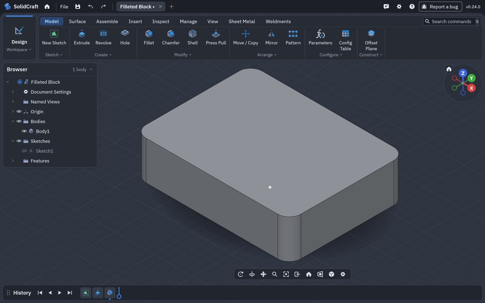
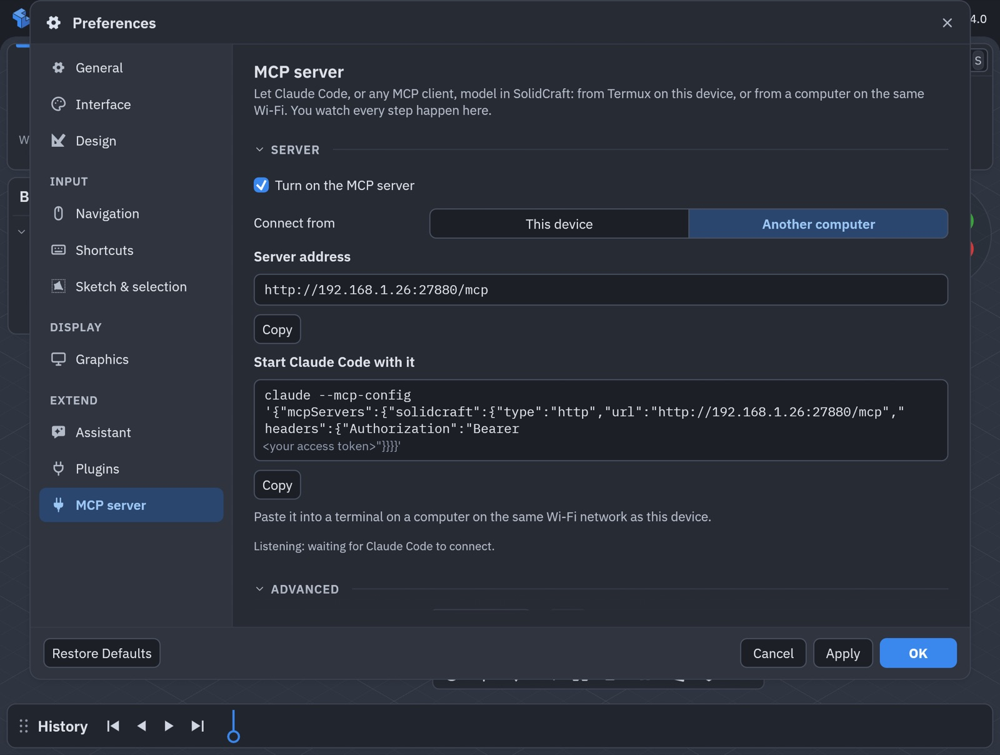
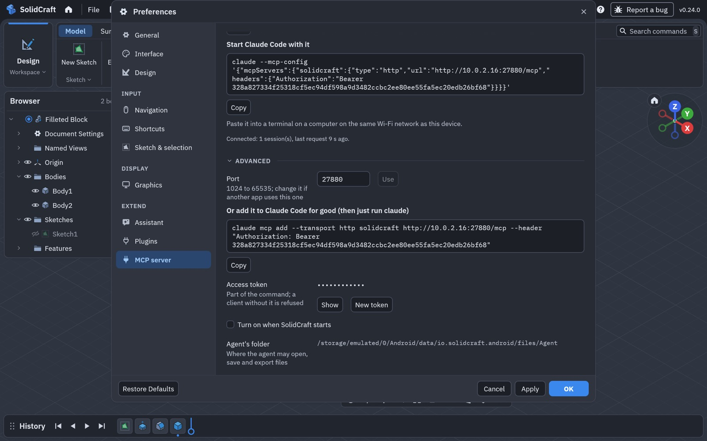

# Claude Code on Android: the MCP server

SolidCraft on Android can be driven by an AI agent such as [Claude Code](https://claude.com/claude-code):
the agent models, measures, exports and takes screenshots, and you watch every step happen in the
app. The agent can run:

- in **[Termux](https://termux.dev) on the same phone or tablet**, or
- on **a computer on the same Wi-Fi** (Mac, Windows, Linux).

This is an Android port feature (port 0.24.0a and later). Desktop SolidCraft has the same tools
over stdio (`solidcraft-cli mcp`, [mcp.md](mcp.md)); the port puts them on the network, so
something outside the phone's app sandbox can reach them.

- [Quick start](#quick-start)
- [The settings page](#the-settings-page)
- [What the agent can do](#what-the-agent-can-do)
- [Files](#files)
- [Keep SolidCraft on screen](#keep-solidcraft-on-screen)
- [Security](#security)
- [Troubleshooting](#troubleshooting)
- [How it works](#how-it-works)

## Quick start

1. In SolidCraft, open **Settings** (the gear at the top right) › **MCP server**.
2. Tick **Turn on the MCP server**.
3. Under **Connect from**, choose where Claude Code runs: **This device** (Termux) or **Another
   computer**.
4. Tap **Copy** under **Start Claude Code with it** and paste the command into the terminal:
   Termux on this device, or a terminal on the computer.
5. Ask for a part: *"Make a 40 × 30 × 10 mm block with 3 mm fillets on its vertical edges."*


The command starts Claude Code with SolidCraft's server for that session only. It looks like this,
with your device's address and token:

```sh
claude --mcp-config '{"mcpServers":{"solidcraft":{"type":"http","url":"http://127.0.0.1:27880/mcp","headers":{"Authorization":"Bearer 3f9c…"}}}}'
```

Claude Code in Termux: install Node.js and Claude Code with `pkg install nodejs` and
`npm install -g @anthropic-ai/claude-code`, then sign in once with `claude`.



*Built by Claude Code from one sentence. It sketched a 40 × 30 rectangle, extruded it 10 mm,
filleted the four vertical edges, then took a screenshot through the server and described it.*

**A bigger test, on a Galaxy Z Fold over Wi-Fi:** a cassette housing in two halves with five M2 screws on
helical threads, built and checked to fit through the server: 121 operations in 105 s, none failed, with
the time of every operation ([android-mcp-live-test.md](android-mcp-live-test.md)).


## The settings page

| Setting | What it does |
|---|---|
| **Turn on the MCP server** | Starts it. Off, nothing listens and nothing can connect. |
| **Connect from: This device** | Listens only for apps on this device (`127.0.0.1`): Termux. Nothing on the network can reach it. |
| **Connect from: Another computer** | Listens on the network too; the address is this device's Wi-Fi address. |
| **Server address** | The URL a client connects to, with **Copy**. |
| **Start Claude Code with it** | One command that starts Claude Code connected to SolidCraft, with **Copy**. |
| Status line | *Listening: waiting for Claude Code to connect*, or *Connected: n session(s), last request … ago*. A red line counts requests refused for a wrong or missing token. |



**Advanced**:

| Setting | What it does |
|---|---|
| **Port** | 27880 unless you change it (1024 to 65535). **Use** moves the server at once. |
| **Or add it to Claude Code for good** | `claude mcp add --transport http solidcraft <url> --header "Authorization: Bearer <token>"`: after this, plain `claude` has SolidCraft every time. |
| **Access token** | Part of both commands. **Show** shows it, **New token** makes a new one: clients with the old one are refused, so copy the command again. |
| **Turn on when SolidCraft starts** | Off by default: the server starts only when you turn it on. |
| **Agent's folder** | Where the agent may open, save and export files ([Files](#files)). |



Changes take effect at once; OK and Cancel in Settings don't apply to this page. The port, the
token, the choice of device or network and the start-up setting are remembered.

## What the agent can do

Everything desktop SolidCraft's MCP server offers, because it *is* that server
([mcp.md](mcp.md#tools)): run any command (`execute`, `batch`), list and describe commands, inspect
and measure the design, read body topology, set parameters, undo and redo, open, save and export,
take screenshots, and read SolidCraft's modelling guides. The port's own commands are there too:
`gear.create` makes any of the ten gear types, and `solid.thread` with `helical: true` makes an exact
helical thread ([android-gears.md](android-gears.md), [android-threads.md](android-threads.md)).

The agent works on the design in the active tab, as you would. Its changes are ordinary history
steps: undo them, edit them or save them as usual.

## Files

**What the agent builds is the design in the open tab**, so you keep it the usual way: **File ›
Save As** or **File › Export** put it anywhere Android's file picker reaches (the device, an SD
card, Google Drive…).

The agent's own file calls (open, save, export, insert) are confined to its folder:

```
/storage/emulated/0/Android/data/io.solidcraft.android/files/Agent
```

and a private scratch folder for screenshots. Anything else is refused with a message naming the
folders. Android's file picker doesn't show `Android/data` folders on Android 11 and later, but a
computer connected by USB does: copy a STEP or STL into `Agent` and ask the agent to insert it, or
copy out what it exported.

An agent on a computer can't send files from the computer to the phone through the server; copy
them into the agent's folder over USB, or open them in SolidCraft yourself (**File › Open** or
**Insert**) and let the agent work on the open design.

## Keep SolidCraft on screen

Android pauses an app that is off screen, so SolidCraft can only run the agent's calls while it is
visible. On one device, put Termux and SolidCraft **side by side (split screen) or open one as a
pop-up window**; a foldable's inner screen is ideal.

When SolidCraft is in the background, a call waits 15 seconds for it to come back, then answers:
*"SolidCraft is in the background on the Android device… Ask the user to bring SolidCraft back on
screen, then send the call again."* Claude Code passes that on, and nothing ran, so nothing is
half-done. Listing tools works in the background.

From a computer this rarely matters: leave SolidCraft open on the device.

## Security

- **Off by default.** Nothing listens until you turn it on, and it stays off at the next start
  unless you tick **Turn on when SolidCraft starts**.
- **A token on every request.** Each request must carry `Authorization: Bearer <token>`, a random
  64-character token made on the device; without it, nothing runs. Tokens are compared in constant
  time. **New token** makes a new one when a command was shared by mistake.
- **This device** listens on `127.0.0.1` only, which other devices can't reach. **Another computer**
  listens on the network: use it on networks you trust (home, office), not on public Wi-Fi. The
  connection is plain HTTP, as for any local development server: someone who can watch traffic on
  the same network could read the token.
- **Files**: the agent's own file calls reach only its folder and its scratch folder, as above.
- Android asks for no permission for this beyond network access (`INTERNET`), which the app
  declares; it is used for nothing else.

## Troubleshooting

| What you see | Do this |
|---|---|
| Claude Code says the server needs authentication, or *401* | The token changed (**New token**), or the command was cut short. Copy the command again. |
| *Port 27880 is in use by another app* | **Advanced › Port**: choose another, **Use**, copy the command again. |
| *This device isn't on a network* | Join Wi-Fi, or choose **This device**. |
| The computer can't connect | Both on the same Wi-Fi? Some networks (guest, public, office) keep devices apart: use a home network or a hotspot. Check that the address is the one the page shows now: it changes when the device joins another network. |
| *SolidCraft is in the background…* | Bring SolidCraft on screen: split screen or a pop-up window next to Termux. |
| The agent's file was refused | Save or export into the agent's folder ([Files](#files)). |
| Claude Code doesn't list SolidCraft's tools | Run `/mcp` in Claude Code to see the server's state; check the status line on the page. |

## How it works

```
Claude Code ── HTTP POST /mcp ──▶ the port's endpoint ──▶ SolidCraft's MCP server ──▶ control channel ──▶ the app
 (Termux or     Bearer token       (apps/solidcraft-       (crates/mcp, upstream's,     (127.0.0.1, the
  a computer)                       android/src/            one per session)             desktop app's own)
                                    mcp_http.rs)
```

- **The endpoint** (`apps/solidcraft-android/src/mcp_http.rs`) speaks MCP's *Streamable HTTP*
  transport: each JSON-RPC message is a `POST /mcp`, answered with JSON (no event stream; `GET` is
  405). `initialize` opens a session and returns `Mcp-Session-Id`; `DELETE` closes it; an unknown
  session is 404, which tells the client to start a new one. It holds up to 8 sessions. Requests
  are capped (16 KiB of headers, the MCP server's own message size for the body), and each is read
  within 30 seconds. Protocol revisions are the MCP server's: 2025-06-18, 2025-03-26 and 2024-11-05.
- **Each session is upstream's MCP server** (`solidcraft_mcp::Server`) bridged to the running app
  (`solidcraft_mcp::Remote`), exactly as `solidcraft-cli mcp` bridges to the desktop app. So the
  tools, their descriptions and their behaviour are upstream's, and they follow every upstream
  release with no port changes.
- **The control channel** is the desktop app's own loopback server
  (`apps/solidcraft/src/control_server.rs`, built into the Android app unchanged), started the first
  time the MCP server is turned on, with a fresh token kept in the app's private folder.
- **The page** is `crates/ui-egui/src/prefs/mcp_server.rs`; it shows only where the host offers
  it (`SolveApp::mcp_server`), so desktop builds look as before. The Android app runs the endpoint
  the page asks for (`apps/solidcraft-android/src/mcp_host.rs`).
- **Android specifics**: the activity sets `TMPDIR` (the app's cache, for screenshots) and
  `SOLIDCRAFT_CONTROL_DIR` before the Rust code starts, reports whether it is on screen
  (`isOnScreen`), and puts egui's Copy on the system clipboard (`copyText`), in
  `SolidCraftActivity.java`.

Any MCP client that speaks Streamable HTTP and can send a header works the same way: give it the
server address and the `Authorization: Bearer <token>` header from the page.
