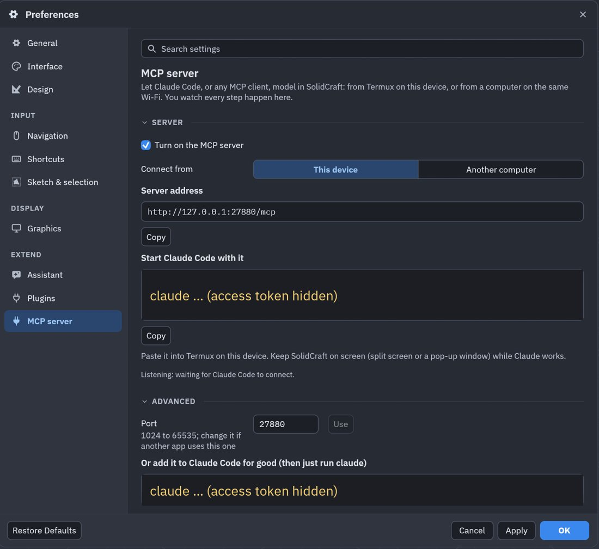
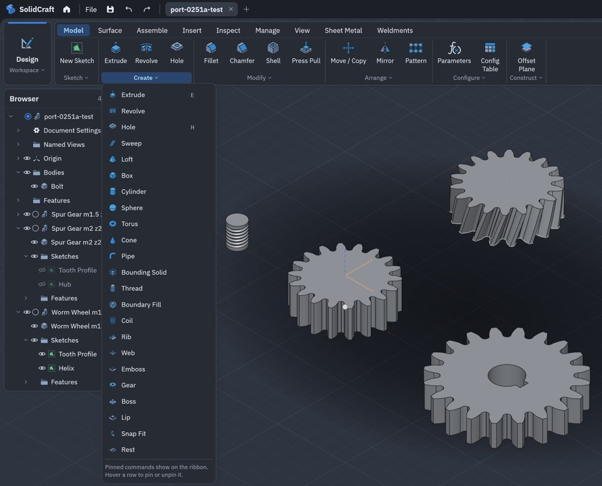
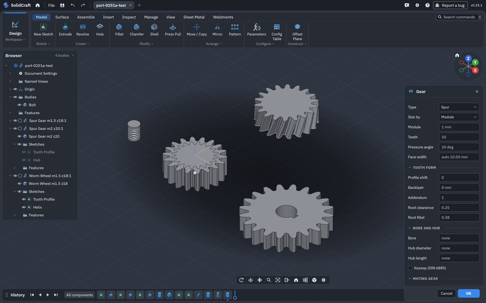
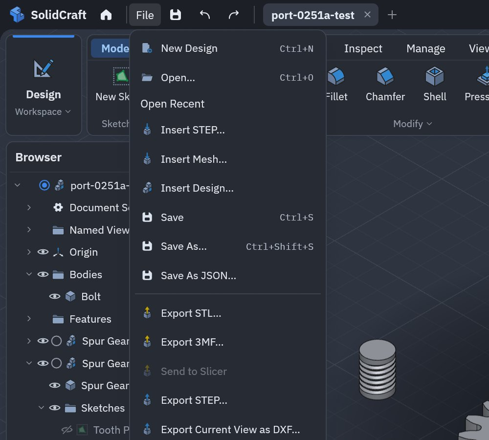
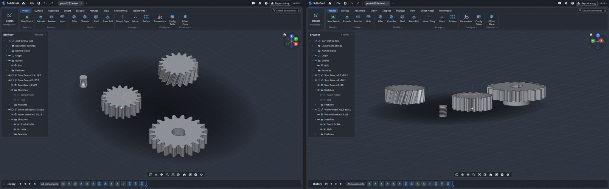

# Port report: 0.25.1a

SolidCraft 0.25.1a for Android: upstream SolidCraft 0.25.1 merged into the port, checked, and tested
on a Galaxy Tab. The merge was also used to make following upstream sturdier. This report covers
what came in, what the merge needed, every check run and its result, the device test with
screenshots, and what was found.

- [In short](#in-short)
- [What came from upstream](#what-came-from-upstream)
- [The merge](#the-merge)
- [Checks](#checks)
- [On the Galaxy Tab](#on-the-galaxy-tab)
- [Found](#found)
- [Following upstream, made sturdier](#following-upstream-made-sturdier)

## In short

| | |
|---|---|
| Upstream | v0.24.1, v0.25.0 and v0.25.1, released in one night: 168 commits, 479 files |
| Port files upstream also changed | 32 of the 45 upstream files the port changes |
| Conflicts | 3, each resolved keeping both sides |
| Build fixes | 2 (a crate the app now needs; a new struct field in a port test) |
| Port strings upstream added | 1, with the same text (dropped from the port) |
| Design files | Port writes format 42 (upstream's 41 + helical threads); designs saved by 0.24.0b open |
| Port area tests | 214 in 7 areas, all pass |
| Device | Galaxy Tab SM-X840 (Android 17, Mali-G1-Ultra): installs over 0.24.0b with settings kept, every port feature works |
| Found | 1 new Android gap (*Reopen designs*), 1 port naming gap (a helical groove's ends), 1 docs error, all recorded |

## What came from upstream

The highlights, from upstream's release notes ([what's new](android-whats-new.md#0251a) has more):

- **0.24.1**: copy and paste of bodies and components (also between designs), Send to Slicer, a Cone
  primitive, Sketch Transform, Canvas to Sketch, placing an SVG or DXF before inserting it, reopening
  the designs open at the last quit, Arabic; a faster viewport on big assemblies; design format 40.
- **0.25.0**: define parameters by typing `name = value`, better sketch dimensions, adding points to a
  spline, Repeat Last Command, Cylinder and Box placed by reference edges, the Render stage bar, new
  themes, Turkish and French complete; a new desktop app id; design format 41.
- **0.25.1**: a fix (an Extrude to Object Join could merge bodies of different components), and new
  designs save as `.sc` (`.solidcraft` keeps working).

## The merge

**Preview first.** `scripts/android-sync.sh --preview`, new in this release, tries the merge in a
scratch worktree and changes nothing. Run against the port as it was before this merge, it reported:

```
Upstream 5965439a → v0.25.1
  168 upstream commits; releases: v0.24.1, v0.25.0, v0.25.1
  design format: upstream now folds to 41 (the port was on 39); the port will write 42 with its pending changes
  479 files changed upstream; 32 of them carry port changes:
    Agents and the MCP server: agent_chat/mod.rs, control.rs, prefs.rs  CONFLICT
    Gears: …, browser.rs  CONFLICT, …, dialogs.rs  CONFLICT, …
    Helical B-rep threads: document.rs, eval.rs, lib.rs, features.rs, …
    The Android build: AGENTS.md, ATTRIBUTION.md, Cargo.toml, README.md, …
    Touch input: canvas.rs, navigation.rs, toolbar.rs, viewport.rs
  check: files the Android app builds from or depends on changed: …, apps/solidcraft/src/control_server.rs, …
  strings after the merge:
  upstream has it too, the same: de 'Thread depth'
  3 conflict(s) to resolve
```

That is everything the merge then needed, before it was done.

**Conflicts**, each resolved keeping upstream's change and the port's hook:

| File | Upstream | Port | Resolved |
|---|---|---|---|
| `crates/ui-egui/src/browser.rs` | A click on a component offers its bodies | A double-click on a gear component opens Edit Gear | Both |
| `crates/ui-egui/src/dialogs.rs` | Insert Drawing previews off the window thread | The Gear dialog previews off the window thread (not on the web) | Both |
| `crates/ui-egui/src/prefs.rs` | Settings gains a search box | Settings shows the MCP server page where the host runs one | The port's pages, through upstream's new searchable window |

**Build fixes**: the Android app builds the desktop app's control server from its source, which now
uses `serde` directly, so `apps/solidcraft-android/Cargo.toml` names it too; a port touch test builds a
`GpuTarget`, which gained an `oit` field.

**Strings**: upstream added the German "Thread depth" the port had pending, with the same text; the
port's copy was dropped.

**Design files**: upstream 0.24.1 gave format 40, which the port already wrote (39 plus its pending
helical changes), to other changes. A file records the pending changes it has (`format_pending`), so a
port design saved as 40 gets upstream's real format-40 changes as it opens, and keeps its helical
threads. The port now writes 42. This is now proved on every merge by a design saved by 0.24.0b in the
design corpus ([below](#following-upstream-made-sturdier)).

## Checks

`scripts/android-sync.sh --check-only`, end to end, on the merged tree:

| Step | Result |
|---|---|
| The patched winit is the one in use | ok |
| `cargo fmt --check` | ok |
| Clippy for Android (arm64), `-D warnings` | ok |
| Clippy on the desktop (UI crate, Android crate, desktop app), `-D warnings` | ok |
| The UI crate's wasm build | ok |
| `cargo xtask layers`, `assets`, `lists`, `skills` | ok |
| Every upstream file the port changes is registered (47) | ok |
| The marked fixes are in place (bspsurface ×6, coplanar, `agent_off_thread`) | ok |
| Port strings against upstream's | ok |

The port's areas, each with the tests that prove it:

| Area | Tests | Result |
|---|---|---|
| Touch input | 7 (orbit, pan and pinch, tap, a finger on a dialog arrow, a finger scrolling a drop-down) | ok |
| Helical B-rep threads | 8 kernel, 43 engine, 16 Thread dialog | ok |
| Gears | 27 engine, 5 UI | ok |
| Design files | 60 format, 5 design corpus (the port's 0.24.0b design among them) | ok |
| Agents and the MCP server | 10 Android (the HTTP endpoint), 7 UI (off the window thread, the MCP page), 7 MCP (handshake, still running → `pending`, no resend) | ok |
| Kernel speed | 17 kernel (coplanar, sweeps), 2 engine (one face a flank, a quick bore) | ok |

**Upstream's own failures.** Two of upstream's Thread dialog tests fail in the port
(`contribution_metric_designation_rendering_preserves_authored_legacy_and_custom_text`,
`contribution_thread_catalogue_is_parseable_and_rendering_keeps_custom_designations`, tripping egui's
debug assertion in the test harness). Built from a clean upstream v0.25.1 checkout, the same two fail the
same way, so they are listed as upstream's and skipped by the area run, not hidden.

## On the Galaxy Tab

The 0.25.1a release APK (versionCode 250101), installed over 0.24.0b on a Galaxy Tab SM-X840 (Android 17).
Calls over MCP from a Mac through `adb forward`, as Termux on the tablet would make them; the rest by
finger.

| Check | Result | Time |
|---|---|---|
| Install over 0.24.0b | Settings kept (the MCP token too); the app starts on v0.25.1 | |
| Settings | Upstream's new search box, and the port's MCP server page under Extend | |
| MCP server on | Answers at once | |
| Open the worm gearbox saved by 0.24.0b (format 40 + helical pending) | Opens: every body, gears still in their components | 121 s (first open after an update rebuilds the design) |
| `gear.edit` on that design's worm | Rebuilt with the new backlash | 96 s (the worm and every feature after it) |
| `gear.create` spur, 18 teeth | 110 faces (the 0.24.0b flanks) | 1.3 s |
| `gear.create` with bore, keyway and hub | Built | 4.4 s |
| `gear.create` worm wheel | Built | 1.3 s |
| Helical thread M6 × 1 on a bolt | Built | 0.7 s |
| Timed batch: a cut through a gear | Timed off the window thread (256 ms) | 0.3 s |
| Save in the agent's folder as `.sc` | Format 42 with `format_pending` [`helical-thread-handedness`, `helical-threads`] | 0.2 s |
| Reopen that `.sc` | Opens from its saved model | 0.4 s |
| Model › Create by finger | Gear listed, beside upstream's new Cone | |
| The Gear dialog by finger | Opens with every row; on the right, as upstream's dialogs do | |
| File › Save As | Android's picker offers `port-0251a-test.sc` | |
| File › Send to Slicer | Greyed out (no slicer on Android) | |
| One finger drags | Orbits, with upstream's reworked navigation | |
| Restart with a design open | Not reopened ([Found](#found)) | |
| Crashes, "not responding" | None | |

| Settings: search, and the MCP server page (token hidden) | Model › Create: Gear beside upstream's Cone |
|---|---|
|  |  |



*The Gear dialog, opened by finger, over what the MCP test built: an 18-tooth spur gear, a gear with
bore, keyway and hub, a worm wheel and a bolt with a helical thread.*

| File: Save As, and Send to Slicer greyed out | One finger orbits (before, after) |
|---|---|
|  |  |

## Found

| What | Cause | Done |
|---|---|---|
| **Upstream's *Reopen designs* does nothing on Android.** A restart with a design open starts on an empty design. | Upstream records the open designs when the app quits; Android never quits an app, it stops it. | In [known issues](android-known-issues.md), planned: record them when the app goes to the background |
| **A sketch can't attach to the ends of a helical thread's groove.** Found by the design corpus on its first run with a port design. | Both small faces closing the groove are named as made from the threaded face, so neither can be told from the other. | Listed in the corpus test with an ignored test waiting for the fix; in known issues |
| **`timings_measured` never reaches an MCP client.** The 0.24.0b docs said the reply says so. | Upstream's MCP `batch` passes on only `timings` and `total_ms`. | Docs corrected; the batch is still timed off the window thread (a UI test proves it) |
| **The first open of a big design after an update takes minutes** (the gearbox: 2 minutes). | A design's saved model belongs to the build that computed it, on every platform; the next save makes it quick again (0.4 s). | Explained in known issues, *By design* |

## Following upstream, made sturdier

Upstream released three versions in one night. The port now follows it without asking it to slow down,
and proves after each merge that nothing of its own broke
([android-sync.md](android-sync.md#how-the-port-stays-mergeable)):

- **Every upstream file the port changes is registered** in `scripts/android-port-areas.json`, in seven
  areas, each with the tests that prove it. An unregistered change, a missing marked fix, or a test filter
  matching no test stops the sync with the fix to make. A renamed test can't silently stop guarding.
- **`--preview`** shows what the next upstream release will conflict with and touch, before anything
  changes; **`--latest`** merges it.
- **Designs saved by port releases are tests**: 0.24.0b's gear and helical thread are in upstream's
  design corpus, saved by 0.24.0b's own CLI, so each merge proves they still open and evaluate as saved.
- **Upstream's own failures are listed, not hidden**, and re-checked against a clean upstream build
  (`scripts/android-port.py upstream-failures`), so a skip never outlives the bug.
- Port strings upstream adds with the same text are dropped automatically; the sync also runs
  upstream's `lists` and `skills` checks (the port's line in a skill had pushed it past upstream's cap).
- Agents get the same rules in [`skills/solidcraft-android-port/SKILL.md`](../skills/solidcraft-android-port/SKILL.md).
