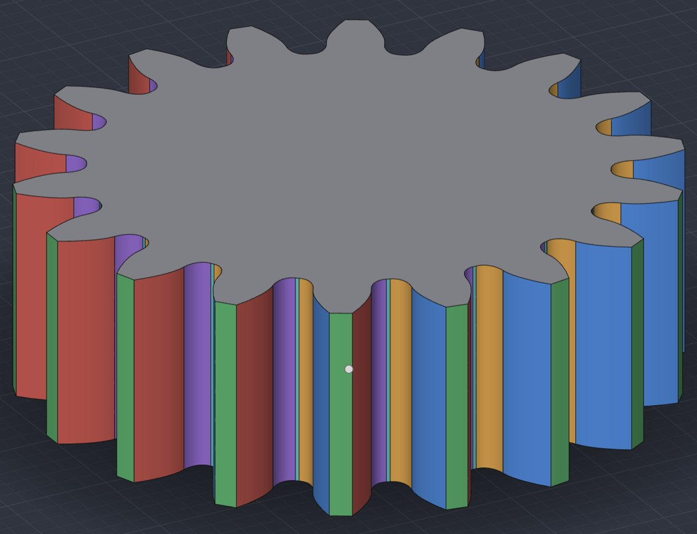
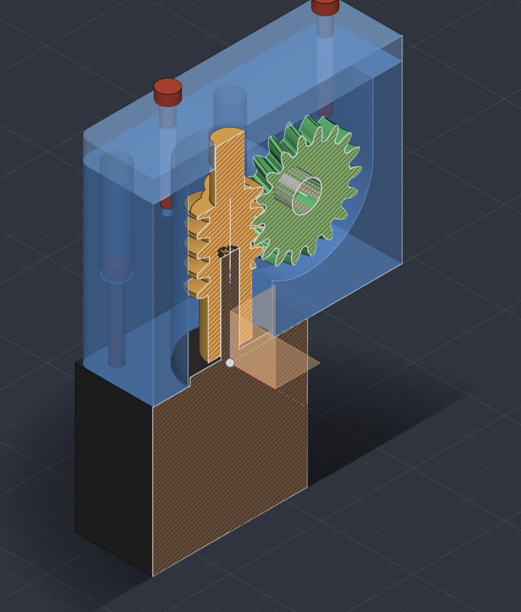

# Faster gears and a steadier MCP server (0.24.0b)

Port release 0.24.0b is about one session that went wrong. Someone asked Claude Code, running in
Termux on a Galaxy Tab, to design a NEMA17 worm gearbox (a 1:6 worm and worm wheel, a clamping hub,
a housing and lid, a rod, the motor and eight M3 screws) through SolidCraft's
[MCP server](android-mcp.md). It didn't go well:

- the MCP calls timed out at about 30 s, and Claude Code sent them again;
- joining the hub to the worm wheel ran for more than 25 minutes without finishing;
- Android closed SolidCraft as "not responding", and the app was gone.

This page explains what was wrong and how 0.24.0b fixes each part, with the numbers measured
before and after. The same gearbox now builds on the Galaxy Tab in one go, every call answered,
nothing lost:

*81 MCP calls from a Mac through `adb forward` (as Termux on the tablet would), recorded on the
tablet and sped up about 12×. The caption is the call running and the time it took. The chip
over the navigation bar (`Box · Computing… 19 s · Stop`) is the app computing an agent's command
while it keeps drawing.*

- [In short](#in-short)
- [1. The app stays responsive](#1-the-app-stays-responsive)
- [2. Gears are simple B-rep](#2-gears-are-simple-b-rep)
- [3. Joins that touch a gear's flat face](#3-joins-that-touch-a-gears-flat-face)
- [4. B-spline surfaces evaluated faster](#4-b-spline-surfaces-evaluated-faster)
- [5. A gear's own hub and bore](#5-a-gears-own-hub-and-bore)
- [The gearbox, measured](#the-gearbox-measured)
- [What is still slow](#what-is-still-slow)
- [Are holes round?](#are-holes-round)
- [Keeping these fixes through upstream merges](#keeping-these-fixes-through-upstream-merges)

## In short

| | Before (0.24.0a) | 0.24.0b |
|---|---|---|
| A long agent command | Ran on the window thread: Android closed the app after 10 s | Computes off the window thread; the app draws, shows what it computes, and can stop it |
| A call still running after minutes | Timed out; the agent sent it again | Answers *"still running: call `pending`"*; the agent waits for the result |
| Two MCP sessions | One request at a time: a long call blocked everyone | Each session has its own thread |
| An 18-tooth spur gear | **326 faces** | **110 faces** |
| A gear with bore, keyway and hub (`gear.create`) | 161 s | **2.5 s** |
| A hub joined flat on a gear's face | Over 25 minutes on the tablet, never finished | **5.7 s** on the tablet (2.4 s on a Mac) |
| The engine's gear tests (27, debug build) | 759 s | **32 s** |
| Booleans on gears and helical threads | | 2–3× faster again (B-spline evaluation) |

Mac times are from a release build of `solidcraft-cli` on an Apple-silicon Mac; tablet times are
the Galaxy Tab SM-X840 (Android 17, Mali-G1-Ultra) running the 0.24.0b APK, which is 2–3× slower
than that Mac on the same geometry.

## 1. The app stays responsive

**What happened.** An MCP call is a command the app runs. Each agent command ran on the
**window thread**: the thread that draws the screen and answers touches. Android watches that
thread, and when it answers nothing for 10 seconds it shows *"SolidCraft isn't responding"* and
then ends the app. One cut into the worm took minutes, so the app was closed in the middle of it.
SolidCraft's own crash report on the tablet named the command it was running: a Ø5.2 bore
starting exactly on the worm hub's end face.

At the same time, the bridge between the MCP server and the app waited silently. It gave up after
a while, Claude Code reported a timeout, and it sent the same call again. The second copy queued
behind the first, so the work piled up.

**What changed.**

- **Agent commands compute off the window thread**: upstream's off-thread agent path
  (`agent_off_thread`), turned on by the Android app. The view goes on drawing and a chip says
  what is computing, for how long, with **Stop**. Android never sees an unresponsive window.
- **Timed batches too.** `batch` with `"timings": true` used to be held on the window thread so
  that it could time each step. It now computes off the window thread like any other batch, timing
  each step where it computes (`timings_measured` in the reply says so).
- **"Still running", then `pending`.** A call that is still computing after a few minutes answers
  *"still running: … call the `pending` tool"*. The command is not cancelled and not lost; the
  agent calls `pending` in the same session until the result arrives. Claude Code follows that
  message, so it waits instead of resending.
- **One thread per MCP session.** The port's HTTP endpoint (`apps/solidcraft-android/src/mcp_http.rs`)
  served one request at a time, so a long call in one session held up every other session and
  even a ping. Each session now has its own thread; a session's calls still run in order.

## 2. Gears are simple B-rep

**What was wrong.** A gear is drawn as a sketch of its outline and then extruded or swept. Each
tooth flank was a **spline through 9 points**. The modelling kernel builds a spline through points
as a chain of cubic pieces, one between each pair of points, and **every piece becomes a face of
the solid**. So each flank was 8 faces, and an 18-tooth gear had 326 faces where about a hundred
describe it.

Faces cost time in every operation on the gear. SolidCraft's booleans (join, cut, intersect, and
the interference and clearance checks) mesh both bodies face by face, intersect the meshes,
rebuild the faces that were cut and check the result. Three times the faces is roughly three times
the work, and many more thin faces lying next to each other where the boolean has to decide what
is inside what.

**What changed.** Each flank is now **one exact Bézier curve where one fits, and two or three
where the shape needs it**:

- The tooth's flank is generated as before, as 241 points: the trochoid the cutter's rounded tip
  leaves at the root, then the involute.
- The port fits a Bézier of degree 3 to 9 to those points by least squares, ends fixed, refining
  each point's parameter until the fit settles. A fit is accepted when no point is farther from it
  than **a thousandth of the tooth's height** (3.4 µm on a module 1.5 gear), far finer than any
  printer or mill holds.
- The root fillet and the involute meet with a jump in curvature that no single Bézier follows to
  that accuracy (the best single Bézier misses by 5 µm on 18 teeth, 28 µm on 8). So the flank is split in two, at the point where
  the two pieces need the lowest degrees together, which is where the fillet ends. An undercut
  tooth (fewer than 17 teeth without profile shift) has a corner there and takes three pieces.
- The split is worked out once, on tooth 0; every tooth has the same shape, so the others reuse
  it.

A flank is now 2 faces, a tooth 6 (two flanks of two, the tip, the root), and the 18-tooth gear
110. The new build, each face its own colour:

The teeth are the same shape: the generated points lie within 1 µm of the exact involute
(`generated_flanks_are_involutes`), and the new curves follow those points within 3.4 µm.

Where it is: `crates/engine/src/gear_profile.rs` (`flank_plan`, `flank_curves`, `fit_bezier`).
Every gear type built from that outline benefits (spur, helical, herringbone, internal, bevel,
miter, worm wheel, crossed helical); the worm's Archimedean flanks became one Bézier each too.

## 3. Joins that touch a gear's flat face

**What hung.** The hub was a cylinder standing on the worm wheel's flat end face: the two bodies
touch over an area, face to face. A mesh-based boolean can't handle faces lying in the same plane,
so the kernel first **imprints** the outline of each body's contact on the other's face, then
glues the two together along it.

To imprint, it took every side face of the gear next to its end face (each of the 80 flank faces
before 0.24.0b) and traced where it crosses the hub's end face. For every point of a fine grid on
that face, the tracer found the nearest point on the flank's curved surface, with a full search of
that surface. That is tens of thousands of surface searches per flank, for flanks that are nowhere
near the hub: the hub sits inside the root circle.

**What changed.** A side face whose bounding box is clear of the faces it would split is skipped:
it can't cross them. The same test was already applied the other way round (only the faces near
the contact are split). `crates/kernel/src/coplanar.rs`, `imprinted`.

A spur gear, a hub cylinder joined flat on its face, and a bore cut through both now take
**0.9 s** together on a Mac, and the hub join that never finished on the tablet takes 5.7 s.

## 4. B-spline surfaces evaluated faster

A gear flank, swept or extruded, is a B-spline surface: a grid of control points (52 × 12 for a
helical flank) blended by basis functions. At any point of the surface only **degree + 1** basis
functions in each direction are not zero, so only 16 of the 624 control points matter. The kernel's
geometry library summed all 624 anyway, multiplying the rest by exactly zero.

The port's copy of that library (`vendor/truck-geometry`, `nurbs/bspsurface.rs`) now skips the
terms that are zero in the point and in its first and second derivatives. The sums are the same
to the last bit: skipping a term that adds exactly 0.0 changes nothing. Meshing, intersecting and
projecting onto surfaces call these millions of times in a boolean.

Measured on a Mac: joining the worm's hub 10.6 → 4.2 s, a cut starting on a gear's end face
199 → 87 s, `gear.create` of a worm 349 → 137 ms.

## 5. A gear's own hub and bore

`gear.create` can add a bore, a DIN 6885 keyway and a hub. On a straight gear it made the hub as a
ring with its own bore and keyway, and joined it under the gear, whose outline already had the
same bore. The two bores then lay exactly on each other: the same cylinder and the same keyway
walls in both bodies. The kernel handles faces that coincide by pushing them apart and retrying,
many times, each try remeshing the teeth. That cost **161 s**.

Now the hub is a plain disc joined under the gear (a flat join, quick since point 3), and the bore
and keyway are cut **once**, through the teeth and the hub together: **2.5 s**. The finished gear is
the same shape. (`crates/engine/src/cmd/gears.rs`.)

The same advice holds for designs of your own, and [android-mcp.md](android-mcp.md#long-operations)
gives it to agents: start a cut a little outside the body rather than exactly on its face, and
bore through joined parts once rather than boring the same axis twice.

## The gearbox, measured

The whole gearbox as Claude Code would build it, every call over MCP, on the Galaxy Tab with
0.24.0b: **81 calls, all succeeded, no "not responding", 349 s**. A Mac running the same calls
headless takes 315 s; most of both is the checks.

| Stage | Galaxy Tab | Mac |
|---|---|---|
| Worm and wheel, worm hub, journal, bore and key | 17 s | 11 s |
| Wheel clamp hub, joined and bored | 32 s | 15 s |
| Housing (block, fillets, cavities, 11 holes) | 94 s | 44 s |
| Lid, rod, motor, eight screws | 3 s | 0.6 s |
| Interference of the 12 simple bodies | 11 s | 3.5 s |
| Clearance, gears against everything else | 75 s | 160 s* |
| Interference, worm against wheel | 115 s | 77 s |
| Save | 0.3 s | 4 s |

\* The one check that was slower on the Mac than on the tablet; not looked into yet.

The full log, the recipe and what the checks found in the design are in
[android-mcp-live-test.md](android-mcp-live-test.md#a-worm-gearbox-on-a-galaxy-tab).

## What is still slow

Everything above made gears quick to build. Two things in upstream's kernel are still slow, and
are listed in [known issues](android-known-issues.md):

- **Checks between two gears.** Interference between the worm and the wheel intersects two
  helical bodies exactly. The time goes into meshing the curves where their flanks meet, which the
  kernel samples very finely: 77 s on a Mac, 115 s on the tablet.
- **Some holes in a plain box.** A Ø6.5 hole in the housing took 38 s on the tablet (18 s on a
  Mac). The first boolean's result failed the kernel's plausibility check, and the kernel retried
  at finer tolerances with the bodies nudged apart. Each try is a whole new boolean.

Both are upstream's general boolean machinery rather than anything gear- or Android-specific.

## Are holes round?

Yes. A hole is an **exact cylinder**: `model.faces` reports the housing's Ø6.5 hole as a cylinder of
radius 3.25 mm, `exact: true`, stored as two half-cylinders (how the kernel represents a full
circle). The same goes for a gear's tip and root, which are exact cylinders, and the flanks, which
are exact Bézier surfaces.

What looks segmented is the **display mesh**, the triangles drawn on screen: at upstream's default
display quality (Normal), a facet of a curved face turns at most 20°, so a hole is drawn with 18
sides. **Settings › Graphics › Display quality** at Fine or Ultra draws curves rounder, at some
cost in drawing speed. Measurements, exports to STEP and every modelling operation use the exact
geometry, whatever the display quality.

## Keeping these fixes through upstream merges

Upstream releases often, and a merge could quietly undo a fix: re-vendoring truck, or reworking
the agent's control path, wouldn't break the build. So
[`scripts/android-sync.sh`](android-sync.md#the-ports-speed-fixes) checks each fix after every
merge and stops, naming the one that went missing:

| Fix | Checked by |
|---|---|
| Zero basis terms skipped | The six places in `vendor/truck-geometry/src/nurbs/bspsurface.rs` marked `SolidCraft:` |
| A gear flank is one to three Béziers | `gear_profile` tests; `a_flank_is_one_face_a_curve` (no more than 6 faces a tooth for spur, helical, worm wheel and internal gears) |
| Agent commands off the window thread | `agent_off_thread = true` in the Android app; `a_timed_batch_computes_off_the_window_thread`, `an_agent_design_change_computes_off_the_window_thread` |
| Sessions don't block each other | `a_long_call_holds_up_only_its_own_session` |

Upstream's version wins only when it does the same job at least as well: the tests pass and the
times are no worse.
