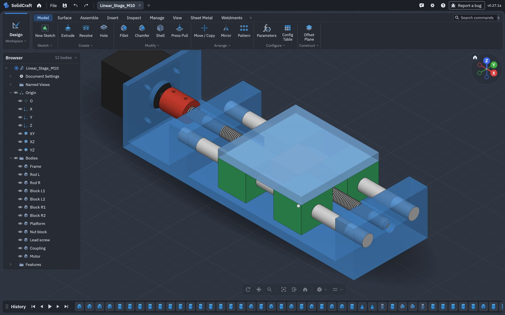
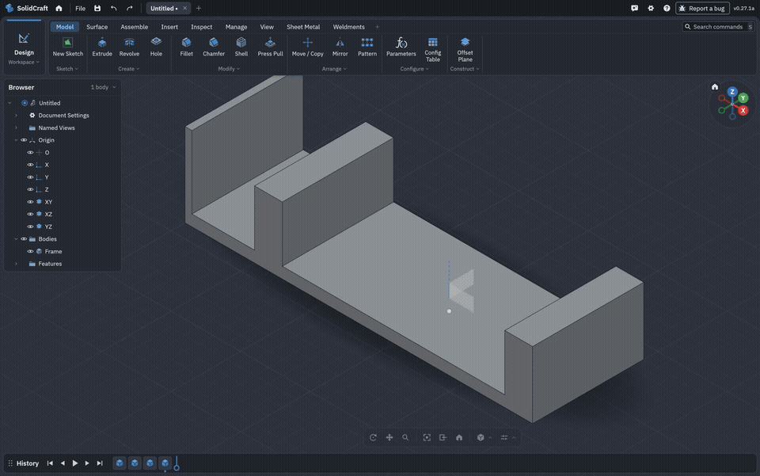
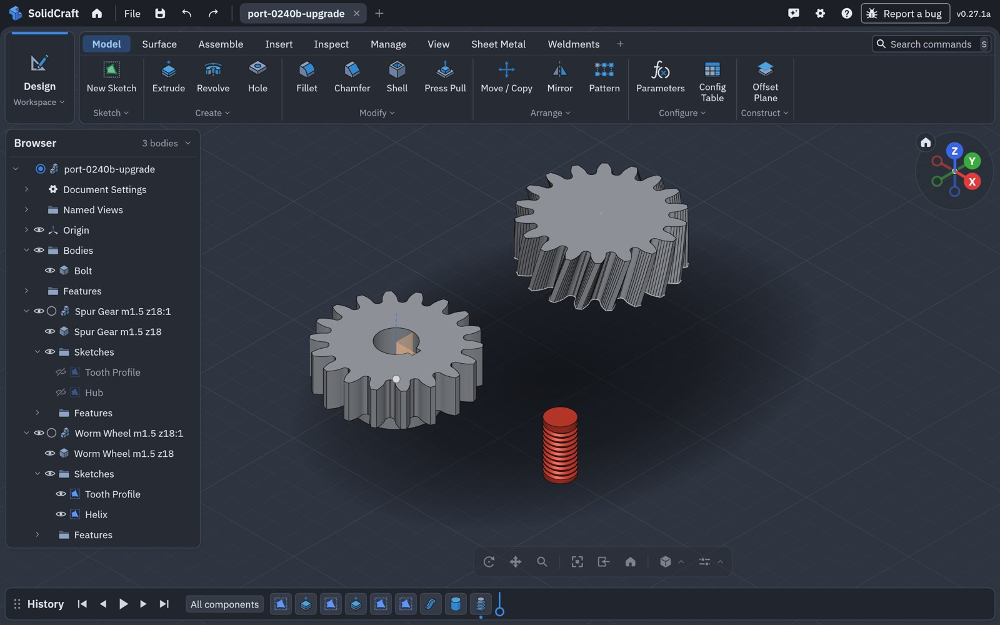
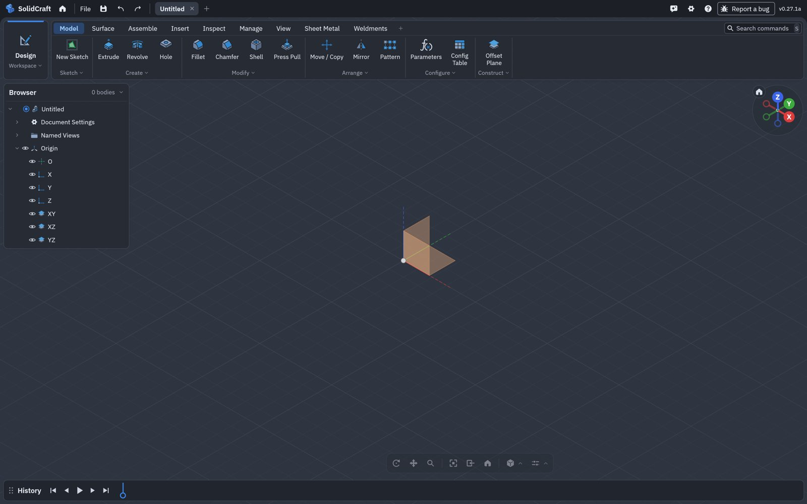

# A modelled screw in a modelled nut

Why a helical M10 lead screw through a helical M10 nut shows an interference, what port 0.27.1a
does about it, and what is still to come. Found modelling a linear stage over MCP on 30 October
2026: two Ø12 guide rods with bearing blocks, a platform, an M10 lead screw with tapered ends
driving a nut block with 60° entry and exit tapers, and a coupling to a motor's 6 mm shaft.



- [In short](#in-short)
- [1. Threads have a phase](#1-threads-have-a-phase)
- [2. The start angle (0.27.1a)](#2-the-start-angle-0271a)
- [3. Still in the way: the ends of the nut's thread](#3-still-in-the-way-the-ends-of-the-nuts-thread)
- [4. Checking such a pair](#4-checking-such-a-pair)
- [5. The test run](#5-the-test-run)
- [6. What's next](#6-whats-next)

## In short

| | |
|---|---|
| **Symptom** | `inspect.interference` or `inspect.clearance` between a modelled screw and the modelled nut it runs through doesn't answer: the time budget runs out (240 s), or clearance runs for many minutes. |
| **Why** | The two threads really do overlap. First, each thread starts at its own angle, so they are out of phase. Second, a SolidCraft helical thread stops just short of the ends of its face, so the nut keeps a thin unthreaded ring at each end that the screw's teeth pass through. Measuring that overlap exactly means intersecting two long helical bodies, which the kernel can't do quickly. |
| **Fixed in 0.27.1a** | Threads can be phased: **Start angle** (`start_angle`). Checks are fast for every pair that really is apart (a screw in a bore 0.2 mm wider: 4 s, was 551 s). |
| **Not yet** | A thread that runs out through the end of its face (into a countersink or off the end of a screw). Until then, a screw passing right through a modelled nut always touches it at the nut's two ends. |
| **Work-around** | Leave the screw–nut pair out of interference and clearance (`bodies` / `against`). Check every other pair, and the screw against everything except its nut. |

## 1. Threads have a phase

A thread is a profile swept along a helix. ISO 261 fixes its pitch, profile and diameters, but
not *where around the axis* the helix starts. Turning a thread about its axis and sliding it
along the axis are the same move:

```
turn by Δθ  ≡  slide by Δz = pitch × Δθ / 360°
```

So a thread has one more number than its size: its **phase**. A screw fits a nut only when their
phases put the screw's crests in the nut's grooves:

```
in phase                                        out of phase (crest on crest)

nut    ▔▔╲    ╱▔▔▔▔╲    ╱▔▔▔▔╲    ╱▔▔           ▔▔╲    ╱▔▔▔▔╲    ╱▔▔▔▔╲    ╱▔▔
          ╲  ╱      ╲  ╱      ╲  ╱                 ╲██╱      ╲██╱      ╲██╱
           ╲╱  gap   ╲╱        ╲╱                  ╱██╲      ╱██╲      ╱██╲    ██ shared
          ╱  ╲      ╱  ╲      ╱  ╲                ╱    ╲    ╱    ╲    ╱    ╲
screw  ▁▁╱    ╲▁▁▁▁╱    ╲▁▁▁▁╱    ╲▁▁           ▁╱      ╲▁▁╱      ╲▁▁╱      ╲▁
```

A clearance `c` on the flanks (60° threads) absorbs a phase error of about ±1.155·c along the axis.
For M10×1.5 with 0.1 mm clearance, that is ±28°, so about 15 % of phases fit. A real nut finds
its phase by being turned onto the screw. Parts placed in a CAD model can't turn, so each keeps
the phase it was built with.

In SolidCraft a helical thread starts on a fixed direction around its face's axis, at the start
of its face. A screw and a nut threaded separately are therefore in an arbitrary phase, and
usually clash.

## 2. The start angle (0.27.1a)

**Thread › Helical B-rep › Start angle** (or `start_angle` on `solid.thread`, an angle, default
0°) turns the groove about the face's axis. A turn of θ moves the crests θ/360 of a pitch along the
axis, and 360° is the same thread again.

```json
{"command": "solid.thread", "params": {"face": [0, 0, 34.375], "designation": "M10",
  "helical": true, "clearance": 0.1, "start_angle": "75 deg"}}
```

Measured on the linear stage's nut (M10 with 0.1 mm clearance, on the 0 mm-clearance screw):
the gap between them across the engaged length, with the nut's start angle swept in 15° steps.

```
start angle   0°  15°  30°   45°    60°    75°    90°   105°  120° … 345°
gap (mm)      0    0    0   0.038  0.092  0.098  0.090  0.036   0  …   0
                             └──────── fits: 60° wide ─────────┘
```

At 75° the threads sit 0.098 mm apart: the clearance asked for. The window is 60° wide, as
expected. The start angle is saved with the design. It is a pending design-format change
(`helical-thread-start-angle`), so releases without it ask for an update rather than open the
thread at 0°.

## 3. Still in the way: the ends of the nut's thread

Phased, the threads clear each other along the nut, but not at its two ends. A SolidCraft
helical thread has to start after its face's start and finish before its end (by default half a
pitch in from each). That leaves a ring of plain bore, at the nut's minor diameter, at each end:

```
section through the nut wall, along the axis →

 countersink │ ring at │╲╱ ╲╱ ╲╱ ╲╱  threaded  ╲╱ ╲╱ ╲╱│ ring at │ countersink
             │  Ø8.75  │                                │  Ø8.75  │
                  ▲
                  the screw's teeth (out to Ø10) pass through here at any phase
```

The 60° countersinks don't help. The thread stops short of the *bore* face, and the bore now
ends where the countersink begins. A real tap cuts its thread on into the countersink, and a
rolled screw thread runs off the end. In SolidCraft the groove would have to **run out** through
the end of its face, with its end cut by the neighbouring face instead of closed by a small flat
cap. That is the next step (see [What's next](#6-whats-next)).

Until then, **a screw that passes right through a modelled nut always overlaps it** by a thin
sliver at each of the nut's ends. A screw that stops inside a blind threaded hole (a set screw, a
bolt into a tapped plate), phased with Start angle, need not.

## 4. Checking such a pair

To measure an overlap between two bodies, interference and clearance intersect them exactly.
For two helical bodies (here 18 turns against 145), that intersection takes longer than any
budget. Tried and set aside: clipping the screw to the nut's box (the kernel refuses that cut)
and a mesh boolean (more than 10 minutes).

What 0.27.1a fixes is every pair that is **apart** but closer than the display meshes can show:
a screw in a 0.2 mm wider bearing bore, in a coupling's bore 0.05 mm wider, or a thread phased
against a blind tapped hole. Display meshes are coarse (0.2 mm on a 220 mm screw), so such a pair
used to go straight to the exact intersection. Now both bodies are meshed 8× and then 64× finer
first, and a pair whose finer meshes stay apart is answered from them:

| Lead screw against coupling and frame (Mac) | 0.27.1 merge | 0.27.1a |
|---|---|---|
| Clearance | 551 s, and 0 mm to the frame (wrong) | 4.0 s, 0.200 mm (right) |
| Interference | the 240 s budget ran out | 2.7 s, both pairs clear |

**Work-around for the screw and its nut**: give `inspect.interference` a `bodies` list without
one of them, and check the screw against the rest separately:

```json
{"command": "inspect.interference", "params": {"bodies": ["Lead screw", "Coupling", "Frame", "Motor"]}}
```

## 5. The test run

The linear stage was built over MCP with the 0.27.1a APK, first on the emulator, then on a Galaxy
Tab. Every call was timed. The screw–nut pair was left out of the checks (above). The
recordings start once the MCP server is on; the part where its access token is on screen is cut.



| | Galaxy Tab (SM-X840, 8 cores) | Emulator (4 cores, software GPU) |
|---|---|---|
| Whole stage, start to saved | **68 s** | 544 s |
| Modelling (52 operations) | 10.8 s | 106 s |
| 220 mm M10 lead-screw thread | **1.2 s** | 10.3 s |
| Measure all 12 bodies | 5.6 s | 48.6 s |
| Interference, all but the lead screw | 25.8 s, none | 182 s, none |
| Interference, screw vs coupling, frame, motor | 16.9 s, none | 119 s, none |
| Clearance, screw vs coupling, frame | 8.2 s (0.022 mm, 0.200 mm) | 80 s |
| Clearance, bearing blocks vs rods | 0.5 s (0.025 mm) | 5.4 s |

The emulator draws in software on the same four cores that model, so its times are a worst
case. Before 0.27.1a, on a Mac: the 220 mm thread hung (more than 10 minutes), measuring took 67 s
and gave the screw a volume larger than the bare rod, interference ran out its budget, and
clearance ran for more than 15 minutes.

What changed for this:

- **Long threads.** A helix of more than 85 turns had more control points than the
  tessellation planner evaluates, and the fallback mesh came out inside out. Threads now use 16
  stations a turn (0.3 µm off the true helix on M10). Every M10 length from 15 to 220 mm now
  builds in 0.03–0.8 s on a Mac.
- **Measuring threaded bodies.** A 144-turn helix sampled 16 times read as a fifth of a turn
  and went to the reference mesher. A mesh finer than the planner allows now fails at once and
  is retried coarser, instead of after 30 s.
- **Checks.** Pairs too close for their display meshes are meshed finer before any boolean
  (above).

The emulator also opened a design saved by 0.24.0b: both gears' volumes are unchanged, and the
threaded bolt is 0.005 % smaller (its helix now has 16 stations a turn).



The title bar now shows the port's own version, with its letter:



## 6. What's next

1. **Thread run-out**: a groove that leaves through the end of its face, its end cut by the
   neighbouring face (a countersink, a chamfer, the open end of a hole), as a tap or a die cuts
   it. With that, a phased screw and nut clear each other, and the checks above answer in seconds.
2. **Phase to a mating thread**: pick the other thread, and the start angle is worked out (and
   kept as either part moves) instead of typed.
3. **Thread tapers and edge threading**: the thread's own start and end tapers.

Items 1 and 3 are on hold for now.

See also: [android-threads.md](android-threads.md) (helical threads),
[android-known-issues.md](android-known-issues.md).
