# Threads on Android: helical B-rep, custom threads and clearance

A guide to the **Thread** command in the Android port: the ISO metric threads it always had, and
what this port adds:

- **Helical B-rep threads**: a modelled thread made of a few smooth helical faces instead of
  thousands of flat facets.
- **Custom threads**: any pitch on any shaft or hole, as it is, whatever its diameter.
- **Clearance**: the thread's flanks and root moved into the material, so printed or machined parts
  fit together.
- **Start and end offsets**, a **thread length**, **depth** and **flank angle**. Left-handed
  helical threads use upstream's **Thread direction** (since 0.24.0a; before, the port had its own
  Left-handed box).

The classic ISO metric thread, cosmetic or faceted, works exactly as before and is still the
default. The new geometry is an option next to it.

Screenshots are from the Pixel Tablet emulator (Android 16, 2560 × 1600) running SolidCraft
0.21.0 with these changes; the same dialog is in the 0.22.0 and 0.23.0 ports. Using the app in general: [android-touch.md](android-touch.md).

- [What changed](#what-changed)
- [Faceted and helical threads](#faceted-and-helical-threads)
- [Opening Thread](#opening-thread)
- [ISO metric threads](#iso-metric-threads)
- [Custom threads](#custom-threads)
- [The Helical B-rep options](#the-helical-b-rep-options)
- [How the groove is shaped](#how-the-groove-is-shaped)
- [Clearance for printed parts](#clearance-for-printed-parts)
- [Several threads, editing, parameters](#several-threads-editing-parameters)
- [When a thread won't fit](#when-a-thread-wont-fit)
- [Scripts and the command](#scripts-and-the-command)
- [Limits](#limits)
- [For developers: what changed in the code](#for-developers-what-changed-in-the-code)

## What changed

| | Before | Now |
|---|---|---|
| Modelled thread geometry | Faceted only: a triangle-mesh groove cut with a faceted boolean | **Faceted** (unchanged, still the default) or **Helical B-rep** |
| Faces on a threaded M8 × 20 shaft | 5,337 flat facets | **8 faces** (helical) |
| Time to build that M8 (desktop) | 1.9 s | **0.6–0.8 s** (helical) |
| Sizes | ISO metric only (`M8`, `M8x1`); the face must be close to the size | ISO metric, or **Custom**: any pitch on the face as it is |
| A hole drilled at the nominal size (Ø8 for M8) | Refused (it is too wide for an M8) | A Custom thread takes it as it is |
| Clearance for the mating part | Not possible (facets can't be offset) | **Clearance** field moves flanks and root into the material |
| A second thread on the same body | Fails once the body is faceted ("no cylindrical face there to thread") | Works: the rest of the body stays exact |
| Where the thread starts and ends | The whole face, or a length from one end | Also **start and end offsets**; helical threads always end a little in from the face's ends |
| Hand, depth, flank angle | Right- or left-handed (**Thread direction**, upstream since 0.24.0) | Upstream's **Thread direction** for helical threads too, plus **Thread depth**, **Thread angle** |
| Dialog | Profile, Modeled, Full Length, Automatic size, Size, Pitch, Designation | **Type**, **Geometry**, a **Helical B-rep** section, and live **Turns / Groove / Crest** readouts |

These answer reports on the upstream project: threads that can't be offset for printing
(tangency-labs/solidcraft#519, #3145, #4684), the second thread on a threaded body
(#2038), holes at the nominal size (#5994, #5238), non-standard diameters (#4577, #5055) and
slow modelled threads (#4799).

## Faceted and helical threads

A **cosmetic** thread (Modeled off) doesn't change the model: it is drawn and exported as an
annotation. A **modelled** thread cuts the groove into the part, and there are now two ways to
build it:

- **Faceted** (the original method): the groove is a mesh of flat triangles, cut out with a
  faceted boolean. The threaded body becomes thousands of flat faces, including its other curved
  faces. It follows the ISO profile closely and runs the full face (out past free ends), and it
  can turn a shaft that is too thick down to the thread's size first.
- **Helical B-rep** (new): the groove is three smooth helical walls (a ruled surface between two
  helices for each flank and the root) and two small flat end faces. The cylinder keeps its own
  round surface, trimmed along the groove's helical edges. Nothing else in the body changes, so
  later features see exact cylinders and planes everywhere else.

Left: the faceted M8 (you can see the triangles). Right of it: the helical M8, a nut with a
custom internal thread, and a Ø33.25 shaft with a custom thread.

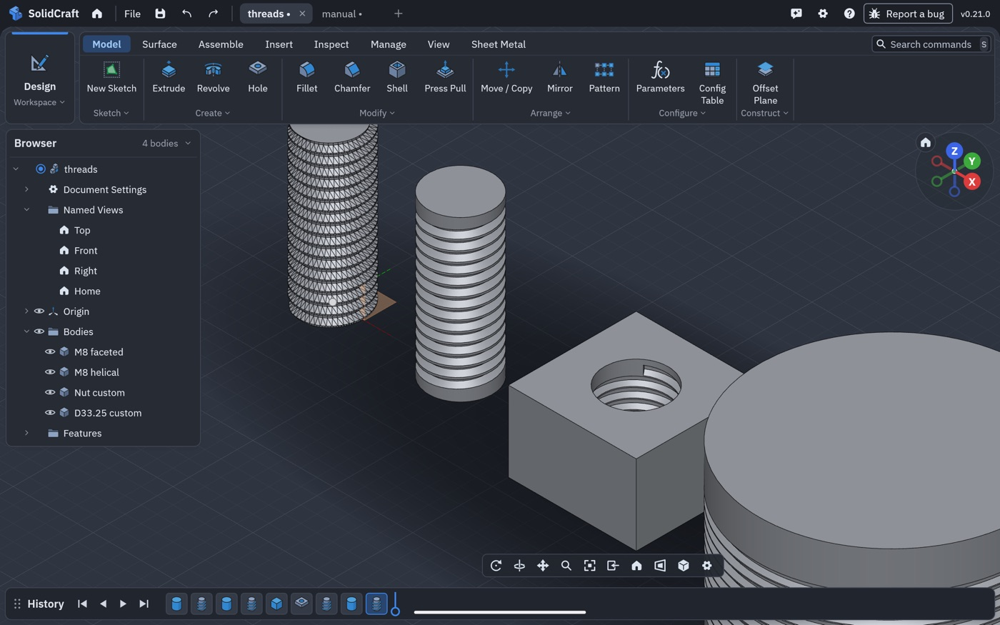

## Opening Thread

**Create ▾ › Thread** (or **Search commands** and type *thread*), then tap the cylindrical face:
the side of a shaft, or the wall inside a hole. Tapping the hole's far wall, the part you can see
from above, works well.

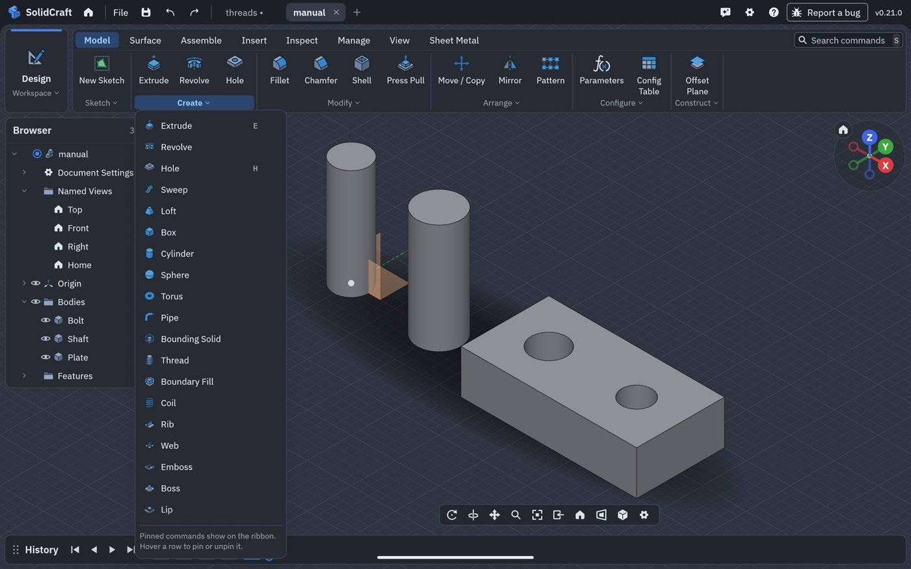

The dialog opens on **Type: ISO metric** with the size that fits the face, as before. With
**Modeled** off this is the cosmetic thread.

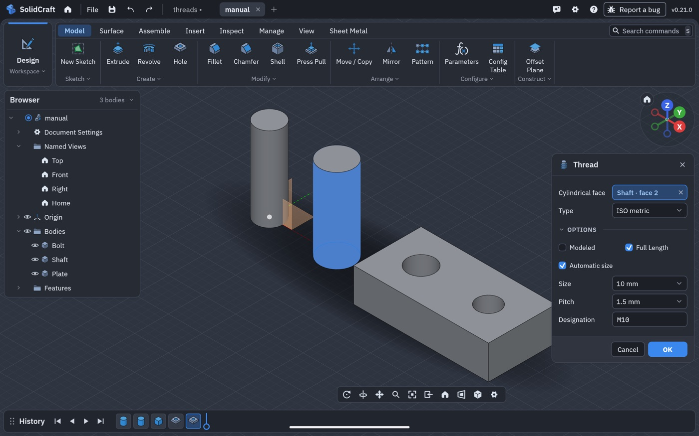

**Where the helical thread is.** The dialog opens as upstream's does, so the port's options are
one step in: tick **Modeled**, then set **Geometry** to **Helical B-rep**. The **Helical B-rep**
section (depth, clearance, offsets, and the Turns / Groove / Crest readouts) appears
below; drag the dialog up with a finger to reach it on a shorter screen. **Type** lists
**Custom** next to ISO metric. On a Galaxy Z Fold (0.23.0b), an M20 on a 20 mm cylinder:

| | | |
|---|---|---|
| 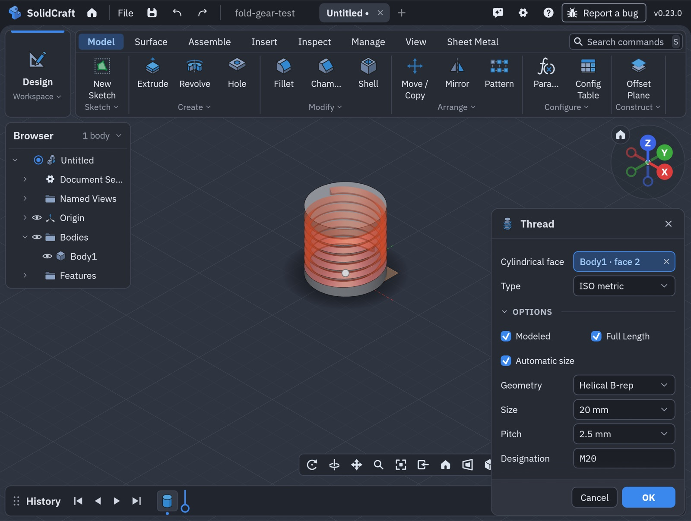 | 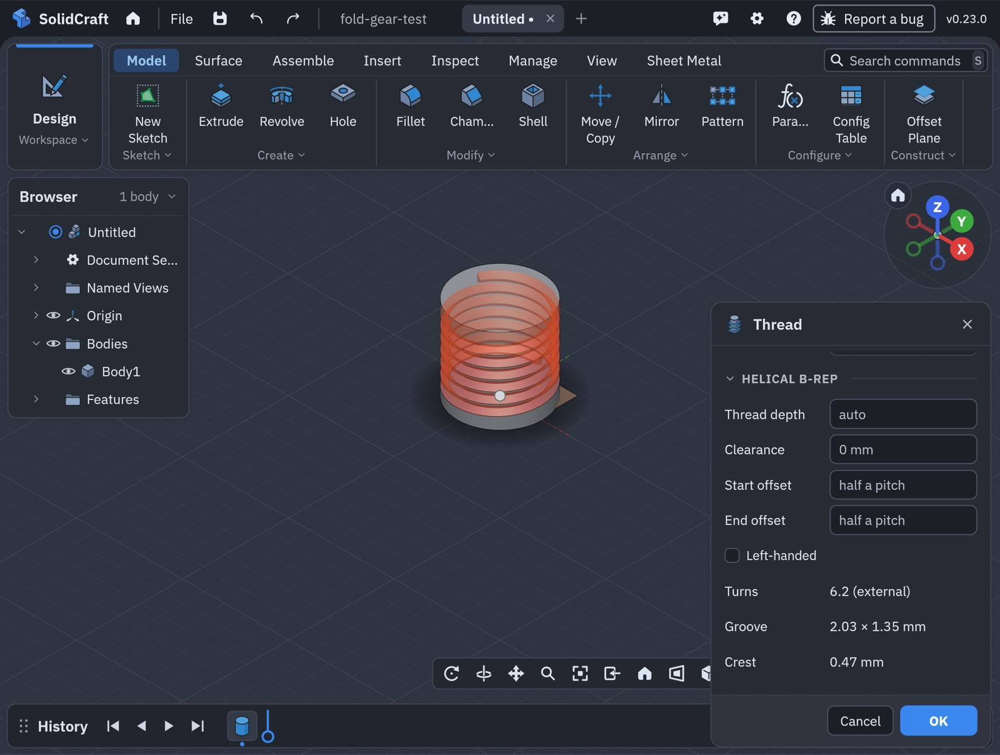 | 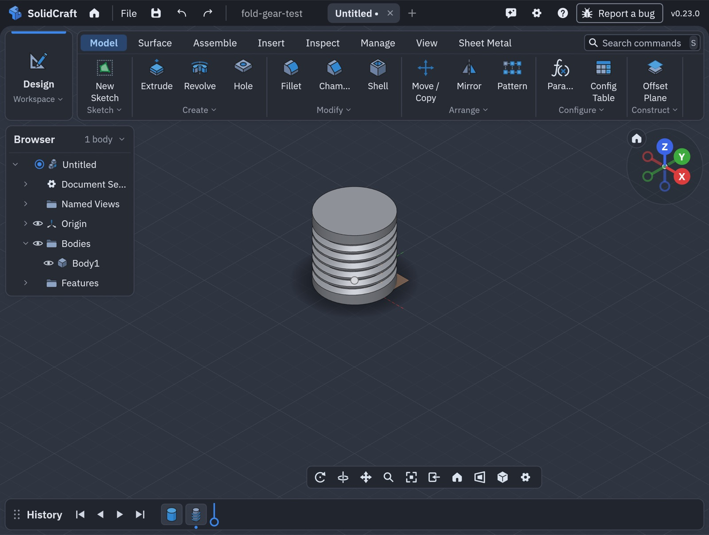 |

Exported as STEP, that M20 is one exact solid of 8 faces, its helical flanks B-spline surfaces,
with no triangles.

## ISO metric threads

1. Tick **Modeled**. A **Geometry** row appears: **Faceted** (the original method) or
   **Helical B-rep**. The view previews whichever is chosen; here the faceted groove's triangles
   show through the selection colour.

   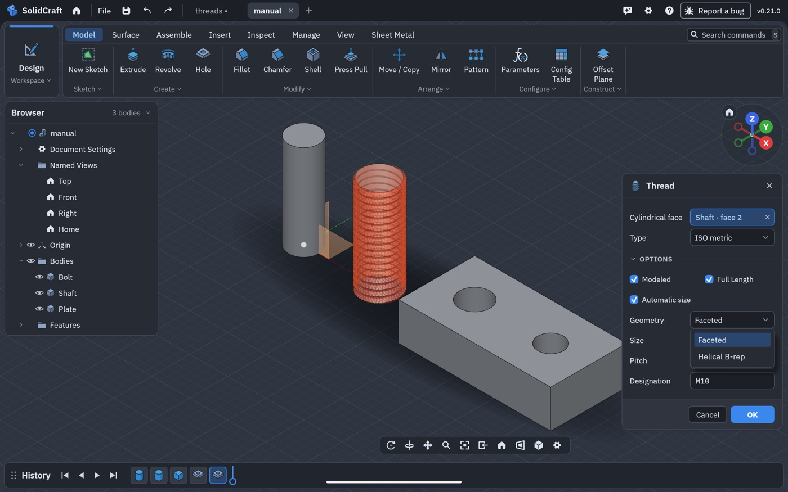

2. Pick **Helical B-rep**. The preview turns into smooth helices with a plain band (a *land*) at
   each end, and the **Helical B-rep** section opens under Size, Pitch and Designation.

   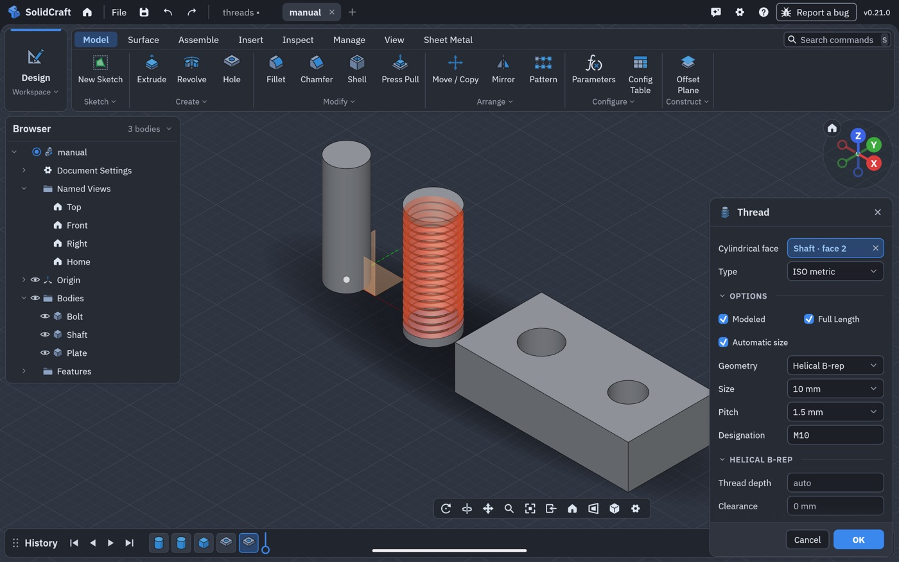

3. Scroll the dialog (drag inside it, or the mouse wheel) for the rest of the section: depth,
   clearance, offsets, hand, and the readouts of what the thread comes to: **Turns** (and
   whether it is external or internal), the **Groove** at the face (width × depth) and the
   **Crest** left between turns.

   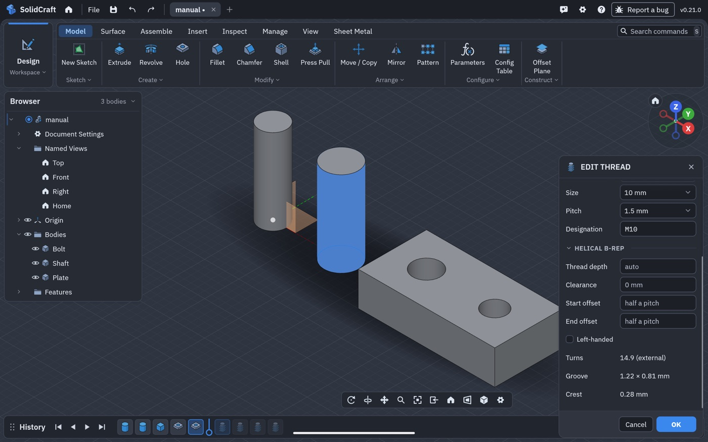

4. **OK**. The thread is one feature in the History bar, like any other.

   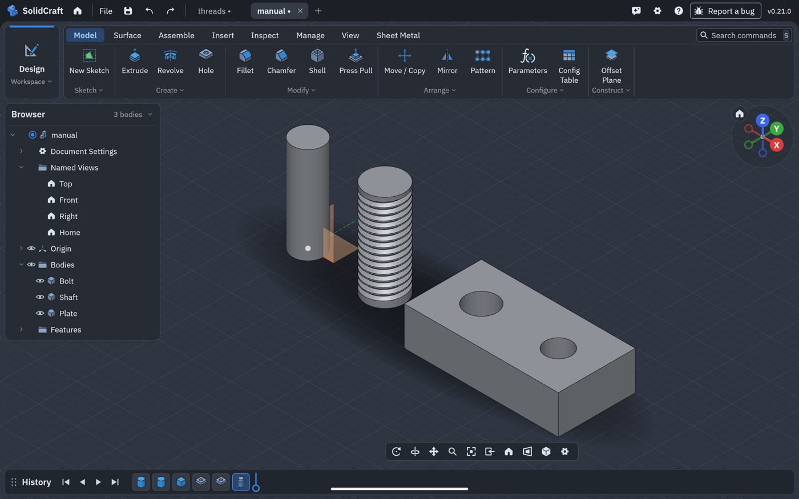

Size, Pitch, Designation and Automatic size work as before (see
[thread-designations.md](thread-designations.md)). For a helical ISO thread:

- **On a shaft**, the shaft should be the thread's major diameter (within 2%): an M10 on a Ø10
  shaft. The groove goes down to the basic root, 5/8 of the thread's fundamental triangle
  (0.541 × pitch). A thicker shaft is refused with the way out: the Faceted method turns it down
  first, or a Custom thread threads it as it is.
- **In a hole**, the groove goes out to the major diameter, where the bolt's crests sit: in an M8
  tap-drill hole (Ø6.75) it is 0.625 mm deep. A hole as wide as the thread or wider is refused
  (drill it at the tap size, or use Custom).
- The helical groove is the symmetric basic profile described below. It is close to the ISO 68-1
  basic profile but not identical; when the exact ISO flats matter, use Faceted.

## Custom threads

**Type › Custom** threads the face as it is, whatever its diameter, with your pitch. A custom
thread is always modelled, and always helical B-rep.

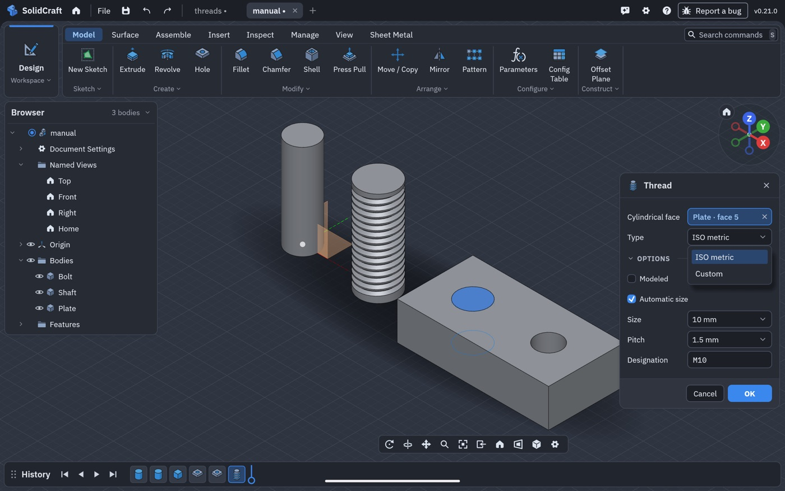

The dialog changes to the custom fields. Empty fields show their defaults as grey hints; until a
pitch is typed, an orange *enter a pitch* stands under the fields and OK is greyed out. (Here the
face is the Bolt's, which already has a short thread at its top: a threaded body's other
cylinders can still be picked and threaded.)

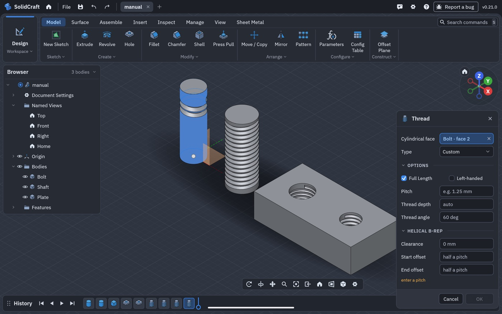

| Field | Meaning | Empty means |
|---|---|---|
| **Pitch** | Axial distance from one turn to the next | Required |
| **Thread depth** | How deep the groove goes into the material, measured radially | *auto*: the basic depth for the pitch and angle (see below) |
| **Thread angle** | Included angle between the two flanks | 60° (metric and unified threads) |
| **Full Length / Length** | Thread the whole face, or this length from the end nearest where you tapped | Full length |
| **Thread direction** | Right-hand or Left-hand (upstream's row, under the dialog's sizes) | Right-hand |

All fields take expressions with units, like the rest of the app: `1.25 mm`, `0.05 in`,
`p / 2`, `30 deg`.

Here a Ø8 hole, drilled at the nominal size (which ISO would refuse as too wide for an M8),
gets a 1.25 mm pitch and a 0.15 mm clearance. The preview shows the internal thread; the readout
says 6.1 turns, internal.

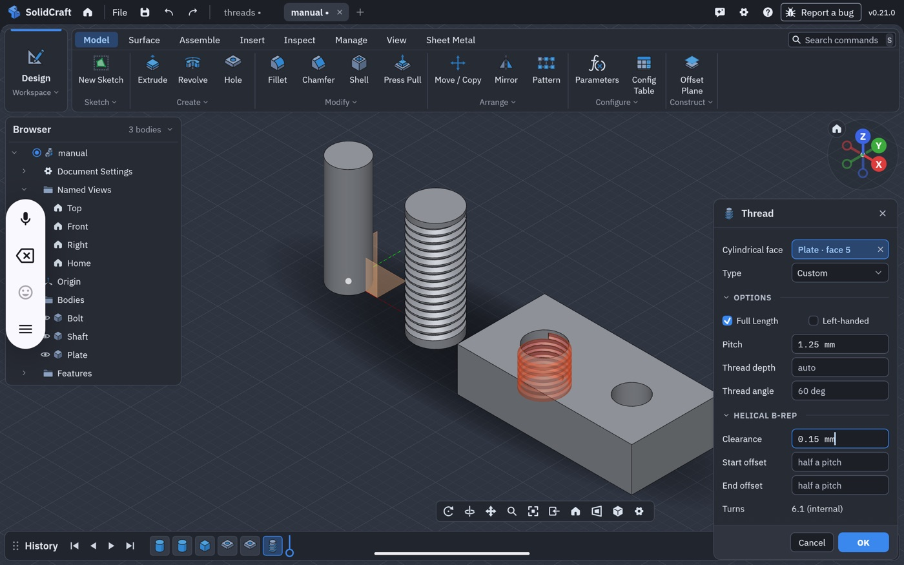

## The Helical B-rep options

These appear for any helical thread, ISO or custom:

| Field | Meaning | Default |
|---|---|---|
| **Thread depth** (ISO) | Overrides the ISO depth | From the ISO size (see above) |
| **Clearance** | How far both flanks and the root move into the material (square to each surface) | 0 mm |
| **Start offset** | Plain band left at the threaded length's start (the end nearest where you tapped the face) | Half a pitch |
| **End offset** | Plain band left at the other end | Half a pitch |

Readouts, worked out as you type:

| Readout | Meaning |
|---|---|
| **Turns** | How many turns the groove makes, and whether the thread is external (a shaft) or internal (a hole) |
| **Groove** | Its width where it meets the face × its depth (clearance included) |
| **Crest** | The flat left on the face between neighbouring turns |
| *(orange text)* | Shown instead of the readouts when the thread can't be made: the whole reason, wrapped (see [When a thread won't fit](#when-a-thread-wont-fit)) |

**Why offsets?** A helical thread is built by replacing only the threaded part of the cylinder.
Its groove has to start after one end of the face and finish before the other, so a helical
thread always leaves a land at each end; the offsets set how wide. They must be more than zero.
Use a small offset (0.2 mm, say) to run the thread almost to the end.

**Thread direction** (upstream's, since 0.24.0) turns any thread the other way: cosmetic,
faceted or helical, ISO or custom. Port releases before 0.24.0a had their own Left-handed box
instead; designs saved with it open as Left-hand.

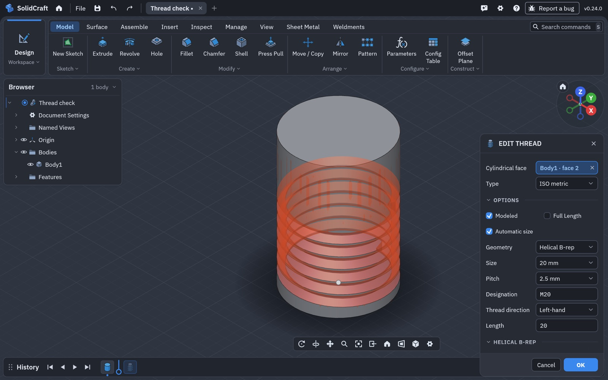

A left-handed custom thread, 2 mm pitch, 10 mm long, starting 3 mm in from the bolt's top
(screenshot from 0.22.0a, when Left-handed was the port's own box):

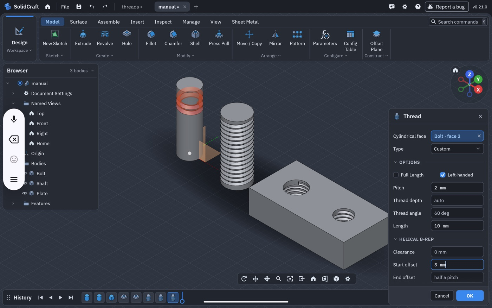

Close up, the left-handed bolt and the right-handed shaft beside it slope opposite ways. Each
thread starts and ends with a small flat face across the groove:

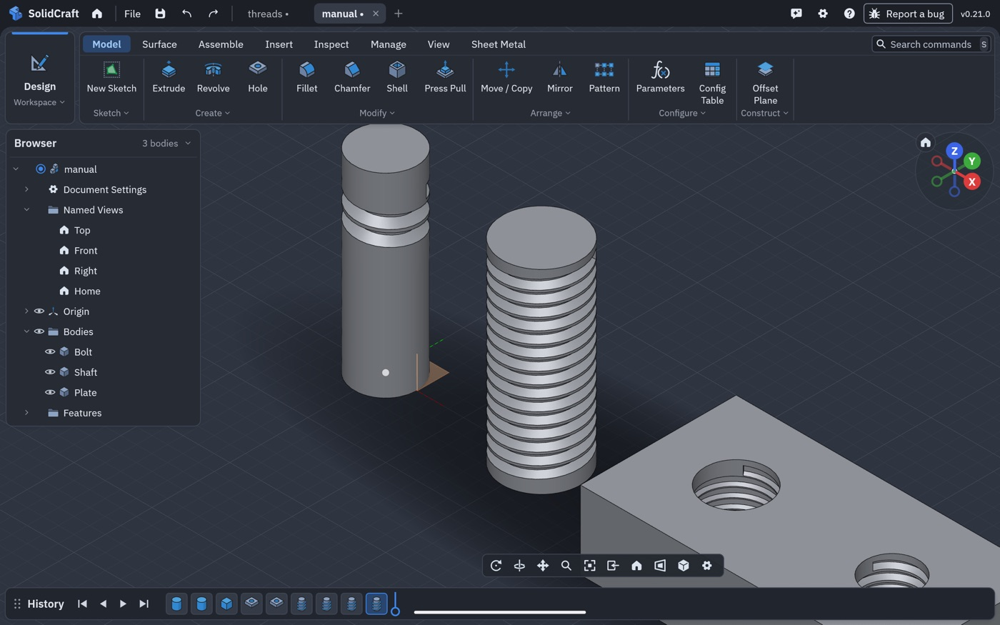

## How the groove is shaped

The groove is cut in the axial plane as a symmetric trapezoid, wide where it meets the face and
narrow at the root, and screwed along the helix:

```text
              mouth = P/2 + d·tan(α/2) + 2c / cos(α/2)
        face ─────┐                          ┌───── face        crest = P − mouth
                   \                        /
           flank →  \  α/2                 /  ← flank
                     \                    /
                      └──────────────────┘   depth = d + c
                       root = mouth − 2(d + c)·tan(α/2)

   P: pitch   d: thread depth   α: thread angle   c: clearance
```

- With no clearance, groove and tooth are equally wide halfway down the depth, as in the basic
  profile of the metric and unified threads.
- **Auto depth** is 5/16 × P / tan(α/2): 0.541 × P at 60°, the ISO basic depth. With a
  clearance, auto depth gets shallower where needed so that at least a tenth of the pitch is
  left as crest.
- A typed depth or clearance that leaves almost no crest (less than 2% of the pitch) or no root
  (less than 1%) is refused, naming the largest depth that fits. With the symmetric profile the
  crest always runs out first.

Examples (60°):

| Thread | Turns | Groove (width × depth) | Crest |
|---|---|---|---|
| ISO M10 helical on a Ø10 × 25 shaft | 14.9 | 1.22 × 0.81 mm | 0.28 mm |
| Custom 1.25 mm pitch, 0.15 mm clearance, auto depth, Ø8 × 10 hole | 6.1 | 1.12 × 0.42 mm | 0.12 mm |

In the second example auto depth has made the groove shallower (0.27 mm plus the 0.15 mm
clearance) so that a tenth of the pitch is still left as crest.

## Clearance for printed parts

Printed parts come out slightly fat: a bolt and a nut modelled to the same size usually won't
screw together. **Clearance** takes material off the threaded surfaces of each part:

- Model both parts at the same nominal size and pitch, and give each a clearance: typically
  0.1–0.2 mm per part is a common starting point for FDM printing, less for resin; print a
  test pair to tune it for your printer.
- Clearance deepens the root by its amount and moves each flank square to itself, so the groove
  widens by 2c / cos(α/2) at the face. The crest stays on the face: to shrink a bolt's major
  diameter too, make the shaft smaller.
- On fine pitches clearance quickly uses up the crest. Leave Thread depth on auto and it adjusts;
  if you type a depth, the readouts show what is left.

Inside the Ø8 hole with 0.15 mm clearance (top) and an ISO M8 helical thread in the tap-drill
hole beside it:

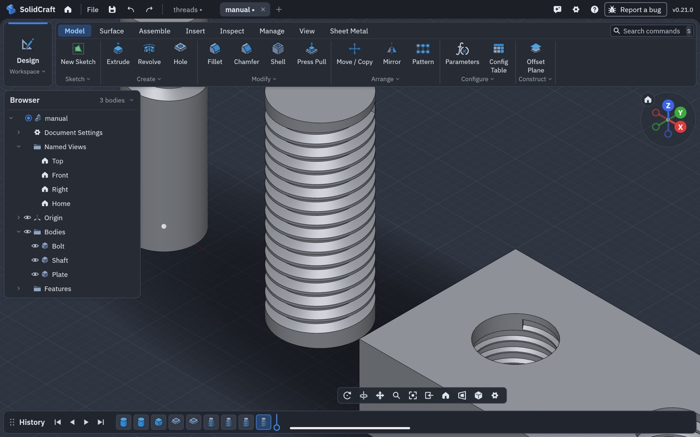

## Several threads, editing, parameters

- **Several threads on one body**: every helical thread leaves the rest of the body exact, so a
  second (or tenth) thread on the same part works. Here the plate has a custom thread in one hole
  and an ISO M8 in the other.

  

- **Editing**: double-tap the thread in the History bar. The dialog reopens with everything as
  you set it (here the custom thread in the Ø8 hole, its readouts worked out again); change
  anything and the preview follows. Faceted and cosmetic threads reopen as they were.

  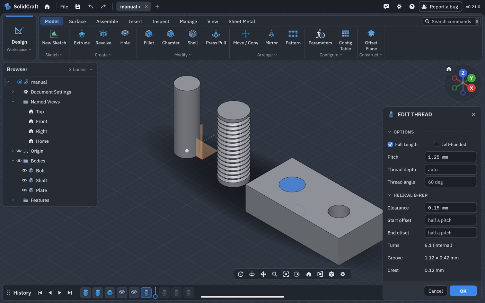

- **Parameters**: any field can name a parameter (**Parameters** on the ribbon). A pitch of `p`
  rebuilds the thread when `p` changes.
- **Saving**: the new settings are saved in the design. A design without them opens exactly as
  before, and a thread made the old way is unchanged.

## When a thread won't fit

The dialog says why, in orange under the fields, and OK stays greyed out until it fits. Here a
1.5 mm depth on a 1.25 mm pitch with 0.15 mm clearance: the message names the deepest groove that
fits, about 0.44 mm here. The same reason also appears at the foot of the dialog, as for any
feature whose preview fails.

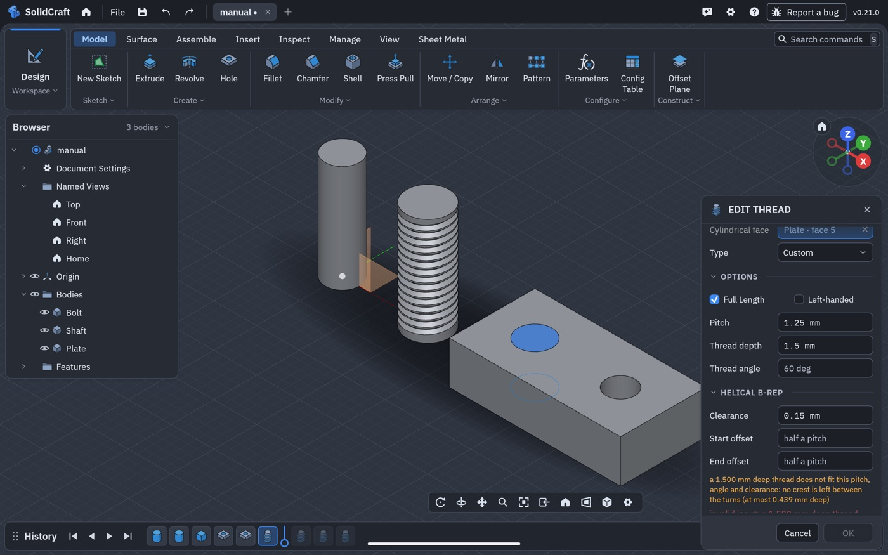

| Message | What to do |
|---|---|
| *enter a pitch* | A Custom thread needs a pitch |
| *a … mm deep thread does not fit this pitch, angle and clearance: no crest is left between the turns (at most … mm deep)* | Use at most the depth it names (or leave depth on auto), less clearance, or a coarser pitch |
| *a … mm clearance leaves no thread at a … mm pitch* | Less clearance, or a coarser pitch |
| *the threaded length is too short for a … mm pitch: it needs at least … mm* | Smaller offsets, a longer length, or a finer pitch |
| *the start and end offsets leave nothing of the face to thread* | Smaller offsets |
| *a helical thread's start and end offsets must be positive* | Offsets must be more than 0 |
| *the thread must start after the face's start and finish before its end* | As above: offsets more than 0 |
| *something else of the body meets the thread: it must run on the face alone* | A cross hole, flat or other feature crosses the threaded part: shorten the thread or move the offsets past it |
| *the shaft is hollow under this thread* / *the wall around the hole is too thin for this thread* | The groove would break through: less depth, or a thicker wall |
| *a helical M8 thread needs a 8 mm shaft (this one is 10 mm)…* | Use Faceted (turns the shaft down), or Custom on the shaft as it is |
| *this … mm hole is too wide for an M8 thread…* | Drill the tap size, or use Custom |
| *not supported yet: a helical thread on a body of several shells* | The body has an inside void or is in several pieces: use Faceted |
| *a thread is limited to 400 turns* | Shorter, or a coarser pitch |

## Scripts and the command

Everything in the dialog is the `solid.thread` command, so scripts, the command palette and the
desktop control channel can do the same. New parameters (all optional):

| Parameter | Meaning |
|---|---|
| `helical: true` | Model as helical B-rep (implies `modeled`) |
| `pitch` | A custom thread of this pitch (implies `helical`; no `designation`) |
| `depth` | Thread depth (default: auto, as above) |
| `angle` | Thread angle (default 60 deg) |
| `clearance` | Clearance (default 0) |
| `start_offset`, `end_offset` | Lands at the start (nearest `face`) and end (default half a pitch; more than 0) |
| `handedness: "left"` | Left-handed (upstream's parameter; any thread). The port's older `left_handed: true` still means the same |

`depth`, `angle`, `clearance` and the offsets are refused without `helical` or `pitch`, so they
can't silently do nothing on a faceted thread.

```json
{"command": "solid.thread", "params": {"face": [4, 0, 10], "designation": "M8", "helical": true}}
{"command": "solid.thread", "params": {"face": [34, 0, 5], "pitch": "1.25 mm", "clearance": "0.1 mm"}}
{"command": "solid.thread", "params": {"face": [86.6, 0, 10], "pitch": "p", "start_offset": "2 mm",
                                        "end_offset": "4 mm", "handedness": "left"}}
```

The design files store these as new optional fields of the Thread feature (`helical`, `pitch`,
`depth`, `angle`, `clearance`, `start_offset`, `end_offset`), written only when used; the hand is
upstream's `handedness`. A design saved by a port release before 0.24.0a with `left_handed: true`
is rewritten as it opens (`format/pending/helical-thread-handedness.rs`).

## Limits

- A helical thread can't run off the end of its face: it always leaves a land at each end (at
  least the offsets). Use Faceted for a thread that runs out of a free end.
- A helical ISO thread doesn't turn an oversized shaft down; Faceted still does.
- Only single-shell bodies (no inside voids, one piece).
- The helical profile is the symmetric basic trapezoid, close to ISO 68-1 but not identical to its
  crest and root flats. The faceted method keeps the ISO profile.
- Features after a helical thread that cut through the threaded part itself (a boolean through
  the helical faces) are slow or may fail: the kernel's B-rep boolean is slow on helical surfaces.
  Features elsewhere on the body work as usual.
- Readouts and messages are in English for now (other languages fall back to English).

## For developers: what changed in the code

**Why not a boolean.** The kernel's B-rep boolean takes about 6 s to cut a 2-turn smooth helical
groove and didn't finish a 6-turn one in 3 minutes, which is why modelled threads used a faceted
boolean. The helical thread avoids booleans altogether.

**How it is built** (`crates/kernel/src/thread_brep.rs`, `helical_thread`):

1. The faces of the body on the picked cylinder, and their neighbours on the same cylinder (a
   cylinder is often two half faces), are joined into one face bounded by the end circles.
2. Four helices, the groove's two edges on the face and its two root corners, are interpolated
   as cubic B-splines (48 stations a turn, within about 1e-6 of the radius; solved as a banded
   system, so long threads stay linear in time).
3. Each wall (two flanks and the root) is the ruled B-spline surface between two helices. The
   screw motion of a straight segment is ruled exactly so.
4. Two planar caps close the groove's ends, and the joined cylinder face (on a full revolved
   surface, so the helices can wind round it) gets the groove's mouth as an inner loop.
5. The shell is closed and oriented edge by edge. The likely orientation is predicted from the
   face normal and the start cap, so one build is usually enough. The result is accepted only if
   it is valid and removes the groove's volume (Pappus: section area × centroid path) to within
   5%.

Before building, it checks that the mouth lies on the face alone (nothing else of the body meets
it) and that the groove is in material (no hollow shaft or thin wall). The display tessellator
already supported cylinder faces trimmed by multi-turn helices (for STEP-imported threads), so no
renderer change was needed.

**Files:**

| File | Change |
|---|---|
| `crates/kernel/src/thread_brep.rs` | New: `HelicalThread` (section, turns, basic depth), `helical_thread` |
| `crates/kernel/src/lib.rs` | Exports |
| `crates/doc/src/document.rs` | `FeatureKind::Thread` gains `helical`, `pitch`, `depth`, `angle`, `clearance`, `start_offset`, `end_offset` (all optional; old files unchanged); the hand is upstream's `handedness` |
| `crates/doc/src/format/pending/helical-threads.rs`, `helical-thread-handedness.rs` | The format changes: the helical fields, and older port designs' `left_handed` rewritten as `handedness` |
| `crates/doc/src/eval.rs` | `helical_thread_on` (ISO or custom dimensions, offsets) and the helical evaluation; shared `thread_face` / `thread_span` |
| `crates/engine/src/cmd/features.rs` | `solid.thread` parameters and checks |
| `crates/ui-egui/src/dialogs_thread.rs` | `HelixDraft`, Type and Geometry switches, the Helical B-rep section, readouts |
| `crates/ui-egui/src/dialogs.rs`, `dialogs_dense.rs` | Dialog state, apply, restore, preview |

**Tests:** `crates/kernel/src/thread_tests.rs` (shaft, bore with clearance and left-hand,
refusals, clearance on a large shaft), `crates/engine/src/thread_tests.rs` (Ø33.25 custom shaft,
two threads with clearance on one body, save and reopen, parameter-driven pitch, ISO helical and
its refusals), `crates/ui-egui/src/dialogs_thread.rs` (the Custom dialog end to end, its refusal,
reopening from the timeline) and the dialog layout test in `dialogs_all_tests.rs`.
