# Using SolidCraft on Android and Googlebook OS

A guide to the Android app with touch, a mouse and keyboard, and files. The app is the full
desktop SolidCraft; this covers what is different on a phone or tablet. Building and how the port
works: [android.md](android.md).

Screenshots are from a Galaxy Z Fold (inner screen, landscape, unless noted) running
SolidCraft 0.21.0a; the Render screenshots are from 0.22.0a. Everything here applies to a
Googlebook too (Googlebook OS is Android-based): there the app runs in a desktop window, with a
trackpad, mouse and keyboard as on a computer.

- [Touch](#touch)
- [Modelling by touch](#modelling-by-touch)
- [Threads](#threads)
- [Plugins (gears)](#plugins-gears)
- [Rendering](#rendering)
- [Claude Code (MCP server)](#claude-code-mcp-server)
- [Mouse and keyboard](#mouse-and-keyboard)
- [Typing values](#typing-values)
- [Files](#files)
- [Back, Home and rotation](#back-home-and-rotation)
- [Phones and foldables](#phones-and-foldables)
- [Limits](#limits)

## Touch

| Gesture | Does |
|---------|------|
| Tap | Select what is under the finger (a face, an edge, a body, a profile); press any button or menu |
| One-finger drag on the model | Orbit the view (over bodies too; a tap still selects) |
| Crosshair button (end of the view bar) | Turns crosshair picking on: one finger on the model then aims a crosshair above it, and lifting selects what it is on ([below](#picking-with-a-crosshair)) |
| Two-finger drag | Pan the view with the fingers |
| Pinch | Zoom about the point between the fingers |
| Drag a dialog's arrow | Change its value (Extrude distance, Fillet radius…) |
| Drag a menu or dialog up or down | Scroll it: a ribbon menu taller than the screen (Model › Create runs past the bottom on a foldable) or a tall dialog. A mouse drags a menu row onto the ribbon to pin it instead |
| Home button by the axis triad | Return to the home view |

Once two fingers are down the touch stays a pan or pinch until every finger lifts, so lifting
one finger first does not start an orbit. While a sketch is being edited or a sketch tool is on,
a one-finger drag draws or drags geometry as the mouse does, not orbit; the view bar at the bottom
(orbit, pan, zoom buttons) still moves the view then.

| One finger: orbit | Pinch: zoom | Two fingers: pan |
|---|---|---|
| 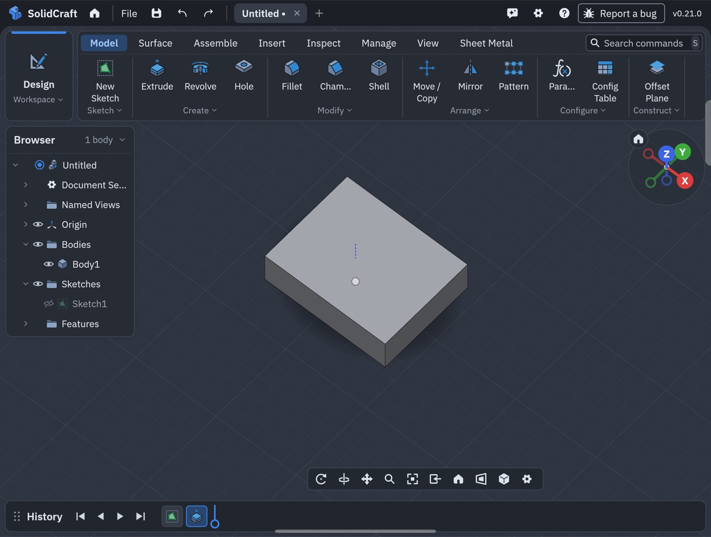 | 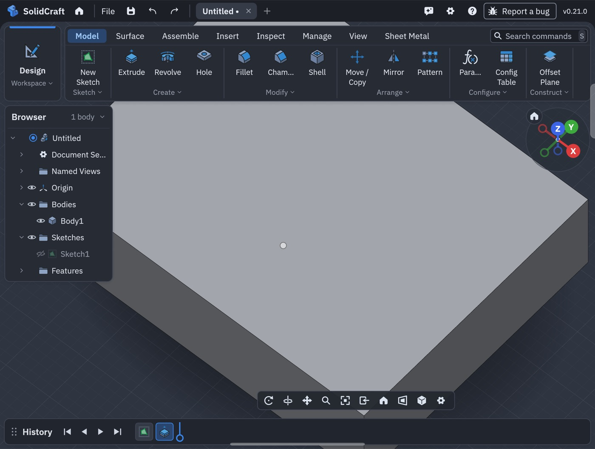 | 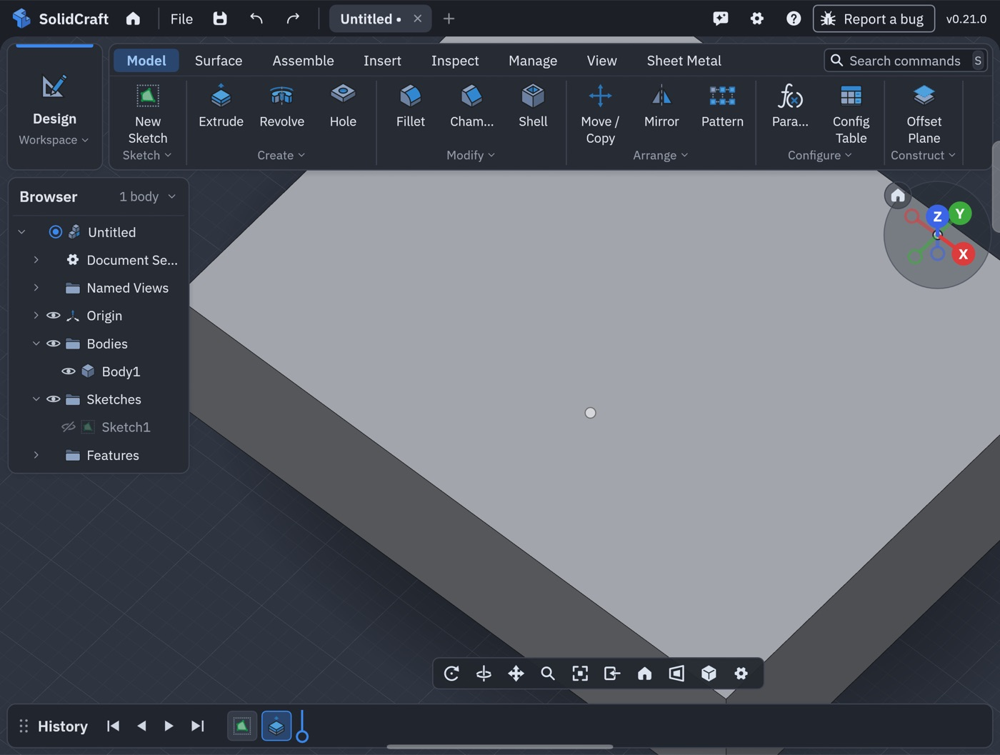 |

### Picking with a crosshair

A fingertip covers whatever it is on, so a small edge, a vertex or a thin face is hard to tap.
The **crosshair button**, at the right-hand end of the view bar (or the left-hand end when the
bar has no room on its right), turns on picking with a crosshair:

1. **Tap the button.** It lights up.
2. **Put a finger on the model.** A crosshair appears 60 points above it at once, with a faint
   line down to the finger. The view doesn't orbit.
3. **Move the finger.** The crosshair follows, and whatever is under it lights up, as under a
   mouse pointer.
4. **Lift the finger.** What the crosshair is on is selected, or picked into the open dialog
   (Fillet's edges, Extrude's profile). Over nothing, it clears the selection.

Tap the button again to turn it off; one finger orbits again. Two fingers pan and pinch either
way. The button answers only a finger, and only a finger brings up the crosshair: a mouse
clicks, drags and box-selects as it always does, with the button on or off. While a sketch is
being edited or a sketch tool is on, a finger draws and drags as before.

| Aiming | Lifted: the face is selected |
|---|---|
| 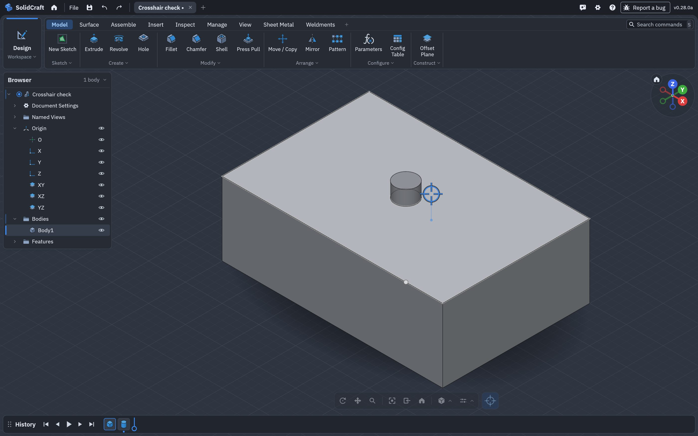 | 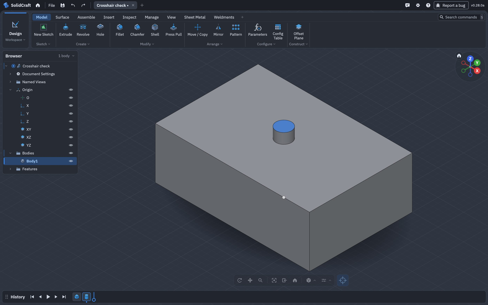 |

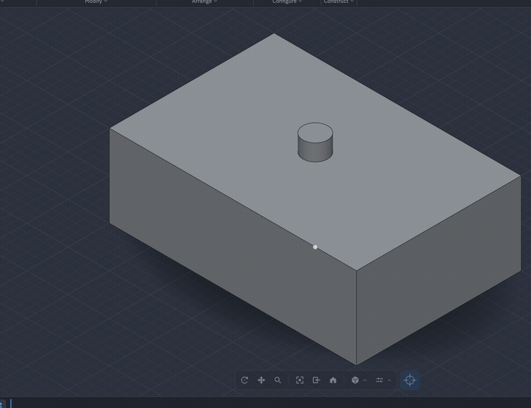

Asked for by [a2nr](https://github.com/a2nr) in
[port issue #2](https://github.com/deveshrai/Solidcraft-Android-Port/issues/2). Added in port 0.28.0a.

## Modelling by touch

A block with a rounded edge, by finger only:

1. **New Sketch**, then tap a plane (here XY at the origin). The view turns to look straight at it.

   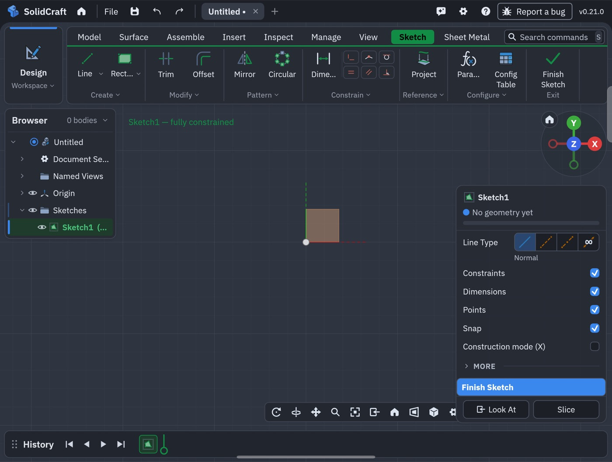

2. **Rectangle**, then tap two opposite corners. Horizontal and vertical constraints are added
   as you go. **Finish Sketch** (bottom right) when done.

   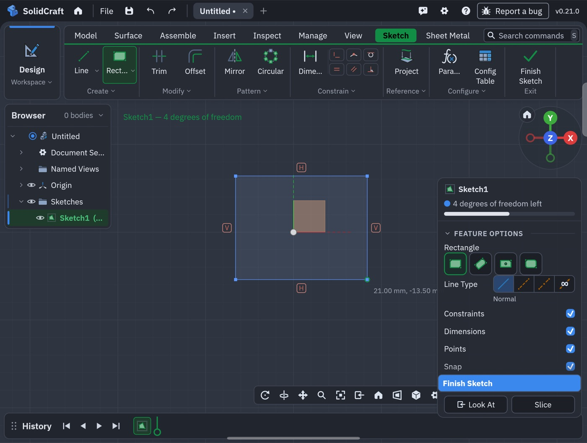

3. **Extrude**. The profile you just drew is already picked ("1 selected"); tapping it again would
   unpick it. Drag the arrow, or type a distance, and **OK**.

   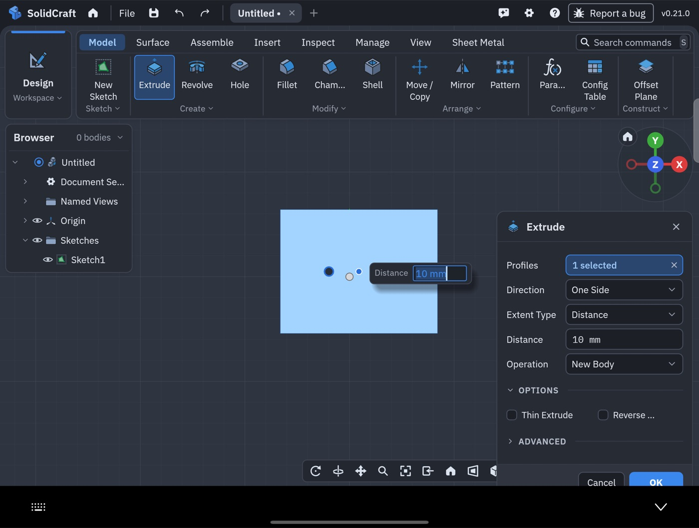

   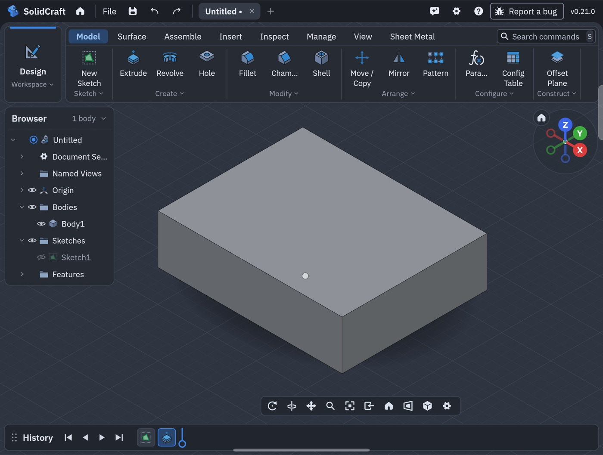

4. **Fillet**, tap an edge, and drag the radius arrow with your finger (anywhere along it, not
   just the tip). **OK**.

   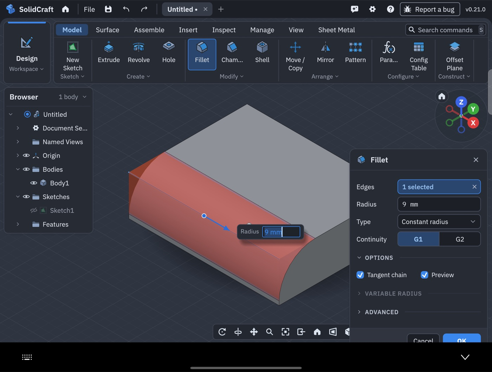

   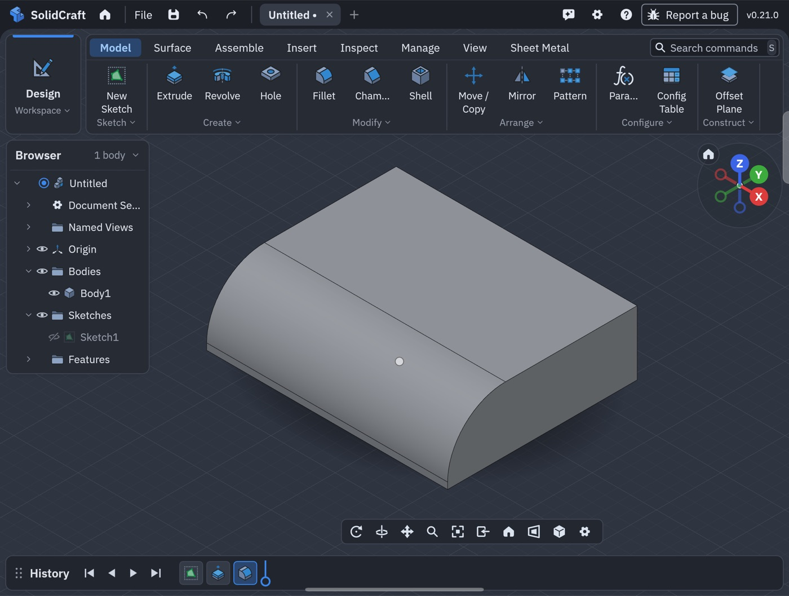

Commands not on the ribbon are a search away: tap **Search commands** (top right) and type.

## Threads

**Create ▾ › Thread**, then tap the cylindrical face (a shaft, or the inside of a hole). The size
that fits is filled in (M20 on a 20 mm shaft). Off **Modeled** it is a cosmetic thread, drawn
but not cut; with **Modeled** on it is upstream's exact helical thread: ISO metric, trapezoidal,
Acme, buttress or pipe forms, any `M<diameter>x<pitch>` designation, several starts, either hand,
a runout and a chamfered tip. To change a thread later, double-tap it in the **History** bar.

The port's own helical B-rep threads (a custom pitch on any diameter, print clearance, a start
angle) were retired in 0.41.0a for upstream's modelled threads; designs that have them open with
upstream's thread on the same face, the old values kept in the design's metadata
([android-whats-new.md](android-whats-new.md#0410a)).

## Plugins (gears)

Upstream SolidCraft runs plugins since 0.41.0 (an experimental first version), and the port
builds them in. The first is [SolidCraft Gears](https://github.com/bherbruck/solidcraft-gears),
an involute spur gear generator: download its `.zip` from its releases page, then **Settings ›
Plugins › Install plugin…** and pick the file in Android's file picker. Installed plugins run from
the **Plugins** menu, each with a dialog built from its parameters. Plugins haven't been tried on
an Android device yet ([known issues](android-known-issues.md)). The port's own Gear command was
retired in 0.41.0a; gears made with it stay in their designs as ordinary sketches and features.

## Rendering

**Workspace ▾ › Render** (top left) opens SolidCraft's Render workspace: studio lighting,
materials and image export, with a live preview. **Start Render** makes the image and **Export
completed image** saves it through the file picker. **Return to Design** goes back.

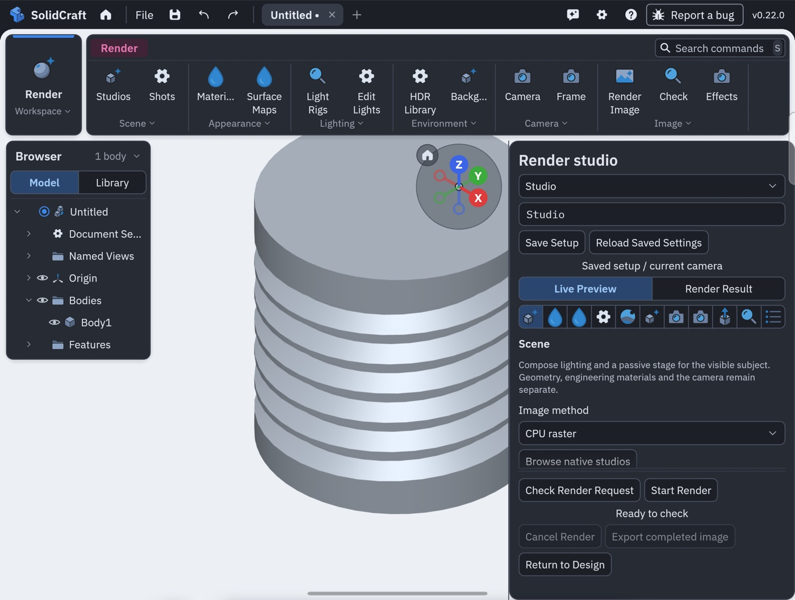

## Claude Code (MCP server)

**Settings** (the gear, top right) › **MCP server** lets Claude Code drive the app, from Termux on
this device or from a computer on the same Wi-Fi. Tick **Turn on the MCP server**, choose **This
device** or **Another computer**, tap **Copy** under **Start Claude Code with it** and paste the
command into the terminal. On one device, keep SolidCraft on screen next to Termux (split screen or
a pop-up window): Android pauses it in the background.

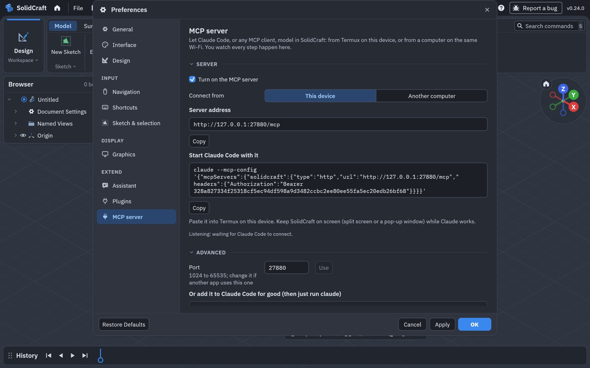

Everything about it (the settings, files, security, troubleshooting): [android-mcp.md](android-mcp.md).

## Mouse and keyboard

A USB or Bluetooth mouse and keyboard work as on the desktop: hover highlights what a click will
pick, the navigation preset's buttons move the view (default: right drag orbits, middle drag pans,
Shift+middle orbits), the wheel zooms to the cursor, right-click opens the context menu, and
keyboard shortcuts work as on the desktop (tested: Ctrl+Z, Ctrl+Y, Ctrl+S, Ctrl+O, E for Extrude,
S for search, Esc).

| Mouse: an edge selected | Keyboard: command search |
|---|---|
| 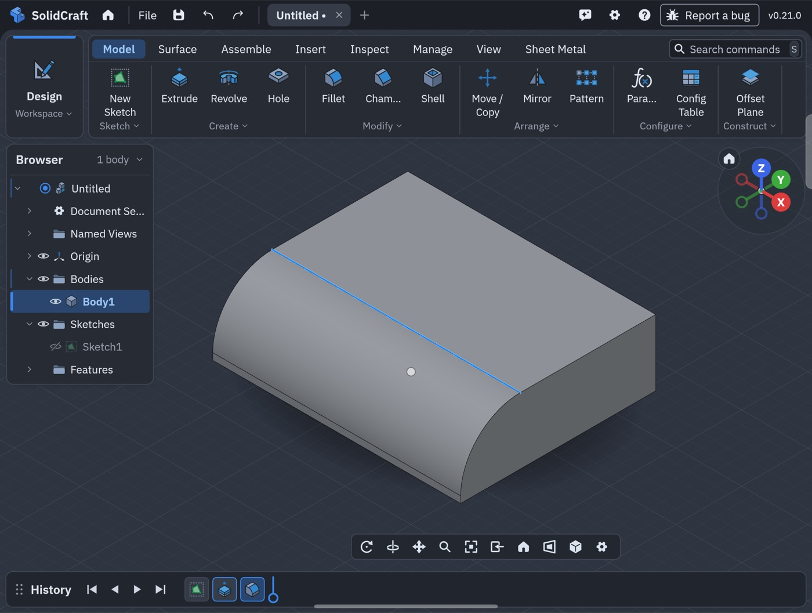 | 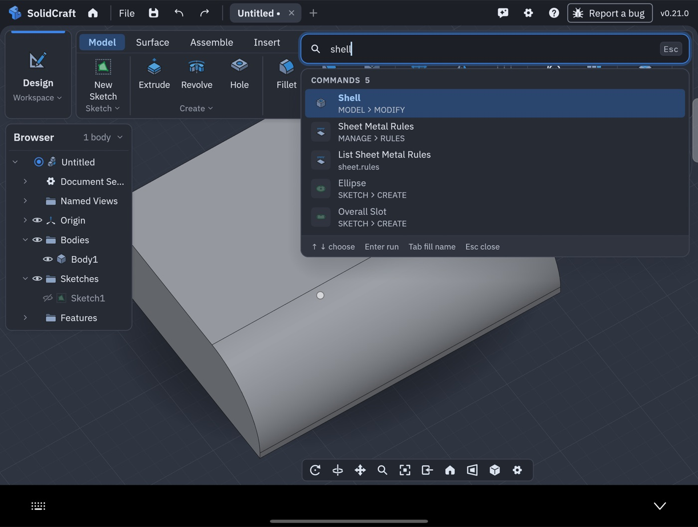 |

## Typing values

Tap a field (a dialog's value, command search, a rename) and Android's on-screen keyboard comes
up; type, and tap outside or press Back to put it away. It covers the lower part of the screen,
so a dialog low on the screen may sit under it; a hardware keyboard avoids that.

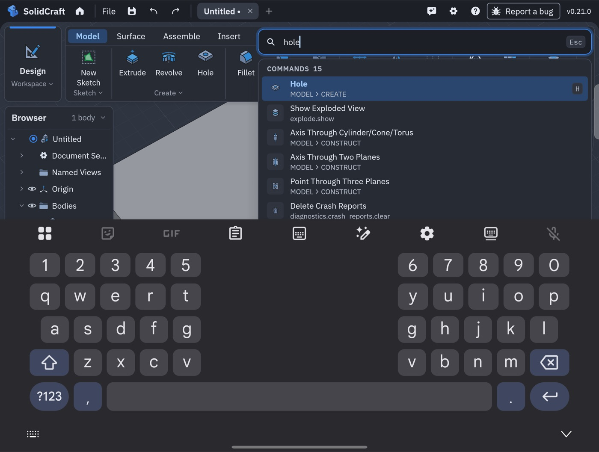

## Files

**File** opens the menu: Open, Insert (STEP, mesh, design), Save, Save As, and Export (STL, 3MF,
STEP, OBJ, DXF of the view, URDF, JSON). Each opens Android's file picker, so files can come from
and go to the device, an SD card, Google Drive or any storage app.

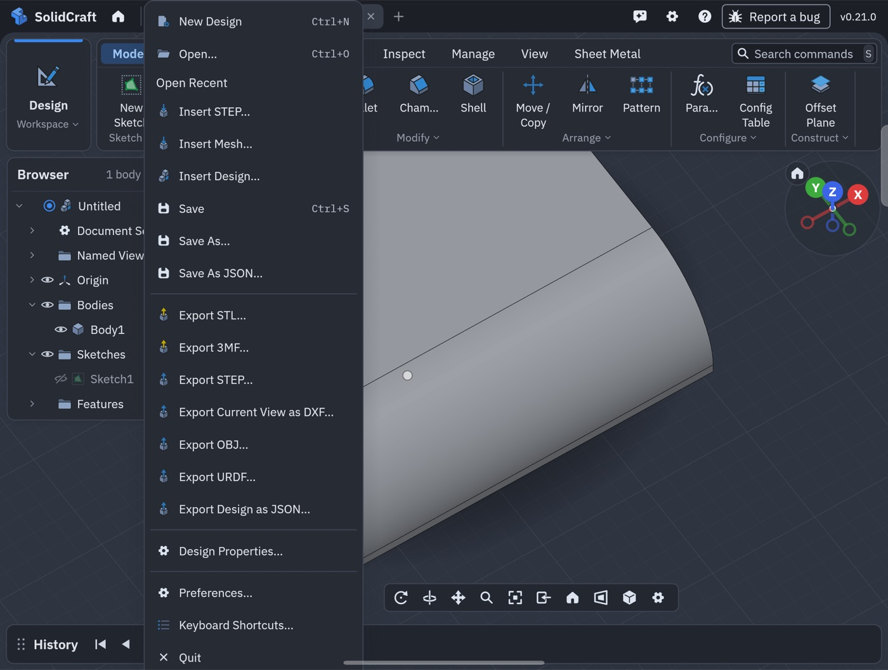

- **Save** (the disk icon, or Ctrl+S) on a design opened from a file writes back to that file,
  wherever it is. The app remembers this across restarts.
- **Export STL / 3MF** asks which bodies first (tap them in the view or the Browser).
- **Insert STEP / Insert Mesh** brings a part in as a component next to what is there.

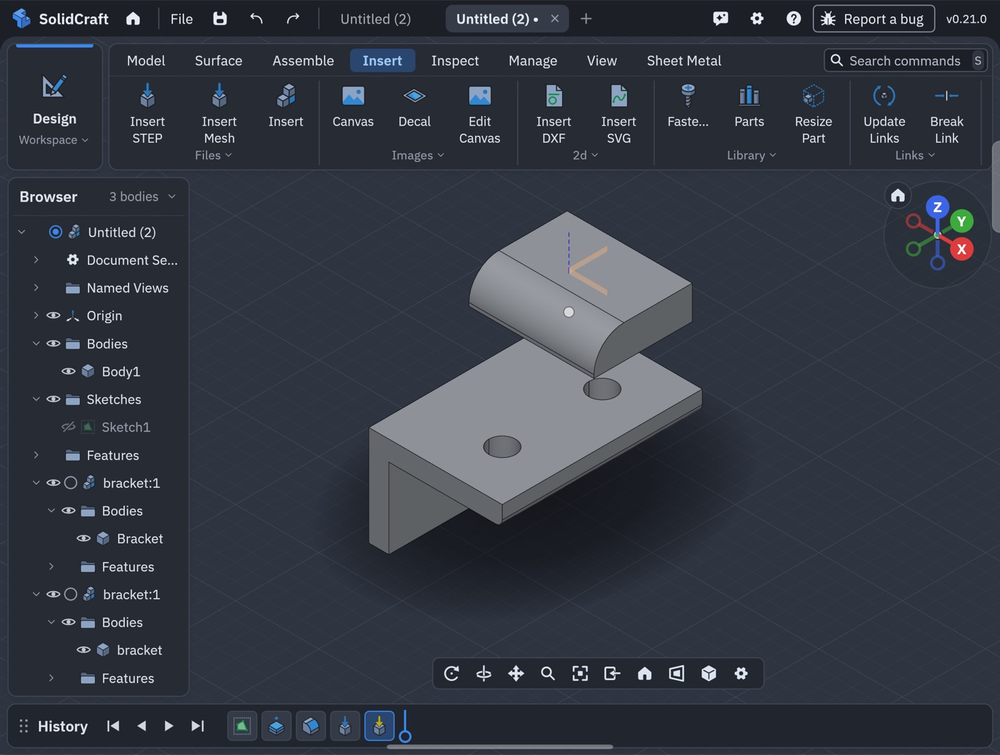

- **Open** names the tab after the design's own name, the one it was saved under. A design saved by
  0.22.0a may carry "Untitled (n)" from that release's Save As; **Save As** it once to rename it.
- On Samsung devices the window handle sits at the top centre, over the tab strip, and a tap there
  can open Samsung's window menu instead of the **+** tab button. **Ctrl+N** or **File › New
  Design** always opens a new tab.

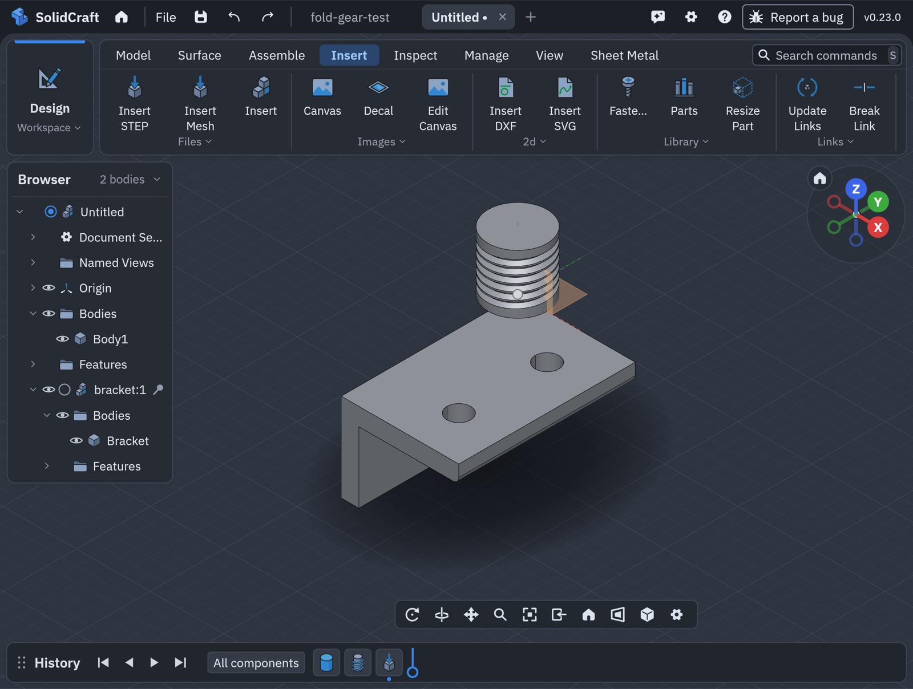

## Back, Home and rotation

- **Back** (the gesture or button) closes what is open: Settings, a dialog, a menu, a sketch tool,
  command search, the on-screen keyboard. With nothing open it leaves the app as Home does; your designs
  stay open.
- **Home** and coming back: the app is as you left it.
- **Rotation**: the layout follows; portrait works, with a narrower ribbon.

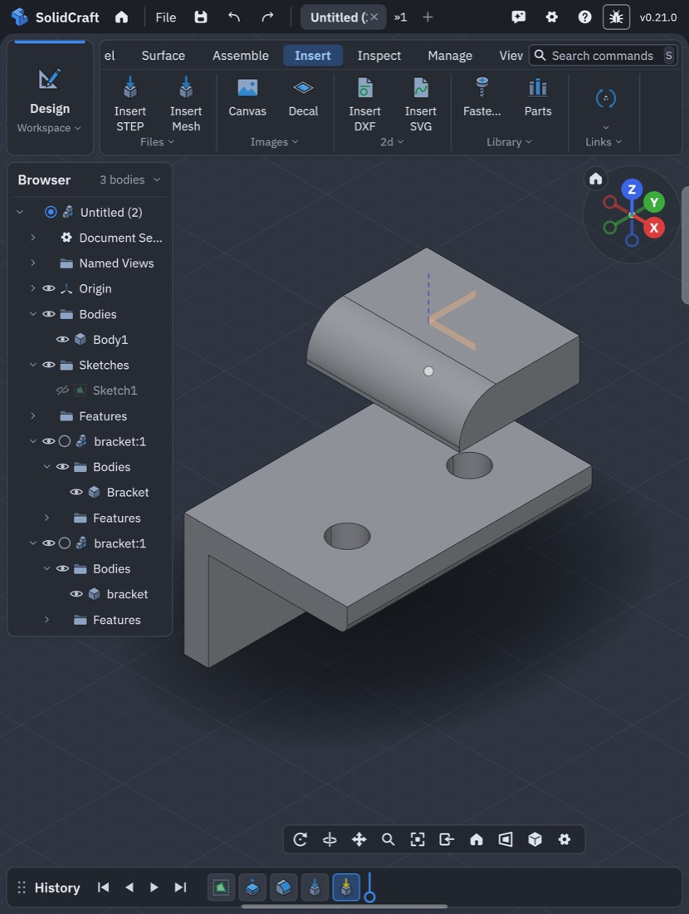

## Phones and foldables

On a narrow screen (a phone, a foldable's cover screen) the ribbon folds its panels into menus:
**Create ▾**, **Modify ▾**, **Arrange ▾**, with the full list of commands in each. Folding or
unfolding keeps the app and the design.

| Cover screen | Create menu |
|---|---|
| 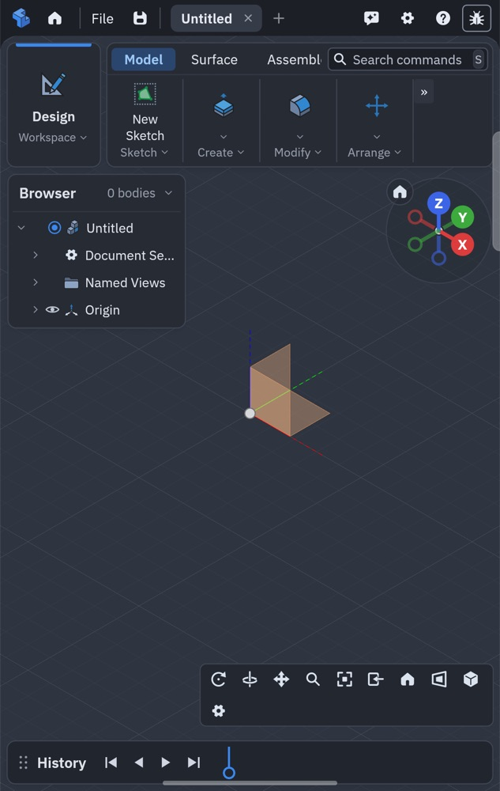 | 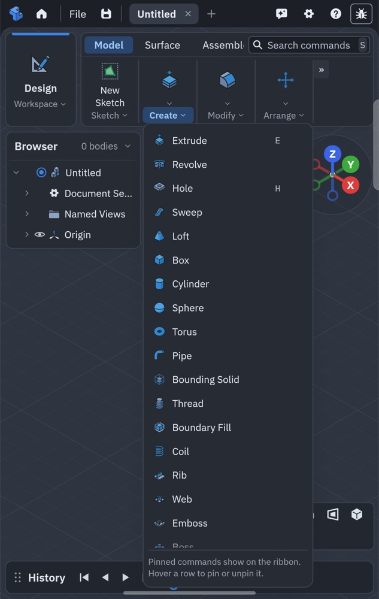 |

## Limits

- Autosave recovery is not available on Android yet: save your work.
- Ribbon labels are shortened at high screen densities ("Cham…" for Chamfer); the tooltip and
  command search have the full names.
- Other apps can't open files in SolidCraft ("Open with") yet: use File › Open.
