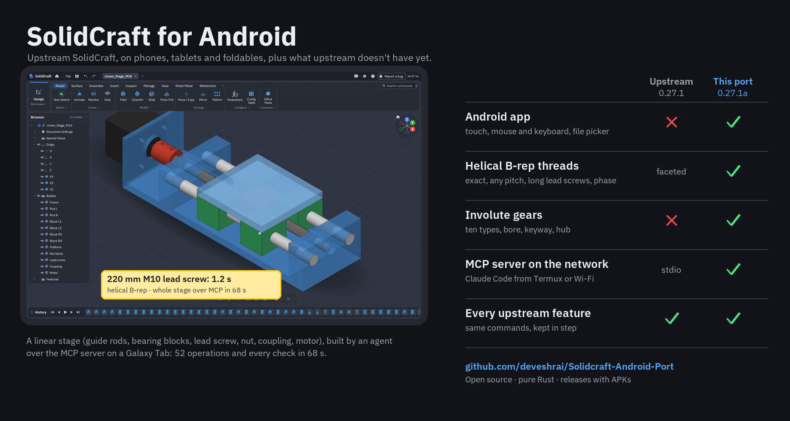

# The Android port and upstream SolidCraft

How this port differs from upstream [tangency-labs/solidcraft](https://github.com/tangency-labs/solidcraft).
The port is upstream plus an Android app, **plus modelling features upstream doesn't have yet**,
built here first and kept up to date with every upstream release.

Current: **port 0.27.1a**, against **upstream 0.27.1** ([what's new](android-whats-new.md)). This page is kept up to date with each
port release ([keeping this page current](#keeping-this-page-current)).

- [At a glance](#at-a-glance)
- [Port-only features](#port-only-features)
- [The Android app](#the-android-app)
- [Design files and compatibility](#design-files-and-compatibility)
- [Where upstream is still ahead](#where-upstream-is-still-ahead)
- [Pipeline](#pipeline)
- [Keeping this page current](#keeping-this-page-current)

## At a glance

| | Upstream 0.27.1 | Port 0.27.1a |
|---|---|---|
| Platforms | Windows, macOS, Linux, web | All of upstream's, **plus Android** (phones, tablets, foldables) |
| Modelled threads | Cut as a faceted groove; the threaded body's curved faces become facets | Faceted as upstream, **or exact helical B-rep**: smooth helical faces, the rest of the body stays exact |
| Thread sizes | Thread: ISO metric, coarse or fine (M8, M8x1), only on a face that size fits; tapped holes also UNC/UNF, G and Rp | Upstream's, **or any pitch on any diameter** (Type: Custom) |
| Thread fit for printing | Left- or right-handed (since 0.24.0) | **Clearance**, thread depth, flank angle, start and end offsets, a **start angle** to phase mating threads; long lead screws (hundreds of turns); upstream's left- or right-handed for every kind of thread |
| Gears | None (requested upstream: [#6796](https://github.com/tangency-labs/solidcraft/issues/6796), [#4684](https://github.com/tangency-labs/solidcraft/issues/4684)) | **Ten involute types**: spur, helical, herringbone, internal, rack, bevel, miter, worm, worm wheel, crossed helical; bore, DIN 6885 keyway and hub; editable after |
| Booleans on gears and helical threads | (no gears) | Gear flanks are exact Béziers, one to three faces each; B-spline surfaces skip zero basis terms; flat joins skip faces that can't reach the contact ([android-speed.md](android-speed.md)) |
| Twisted or scaled straight sweeps | One ruled strip per segment past 64 segments or with a hole | **One smooth wall per profile segment**, holes included |
| AI agents | MCP over stdio on the same computer (`solidcraft-cli mcp`), and the agent chat | Upstream's, **plus an MCP server on the network** (Settings › MCP server): Claude Code in Termux on the device, or on a computer on the same Wi-Fi, models in the app; long calls answer "still running" and wait through `pending`, each session on its own thread |
| Touch | None | Orbit, pan, pinch, tap to select, finger-dragged dialog arrows |
| Files | Native file dialogs | Android's file picker: device, SD card, Google Drive, any storage app |
| Design file format | 44 | 45 (44 plus the helical threads) |

Everything else (sketching, the solver, every feature and workspace, Render, sheet metal,
assemblies, import and export) is upstream's, unchanged, at the same version.

## Port-only features

These are in the shared crates, not just in the Android app, so a desktop build made from this
repository has them too.

### Helical B-rep threads

Upstream models a thread by cutting a groove of flat triangles into the face. That works, but the
body is no longer exact: its curved faces become facets, and later fillets, a second thread or a
clean STEP export suffer. The port adds **Geometry: Helical B-rep**, a groove made of a few exact
ruled helicoid faces with planar end caps, checked against Pappus' volume. The body stays exact.

On top of that, **Type: Custom** threads any shaft or hole with any pitch, and **Clearance** moves
the flanks and root into the material so printed parts screw together, the "surface offset" asked
for in upstream's [#4684](https://github.com/tangency-labs/solidcraft/issues/4684). Depth, angle,
start and end offsets are there too, and a helical thread is left- or right-handed through
upstream's own **Thread direction** (since 0.24.0, which replaced the port's Left-handed box). An
M20 × 20 mm builds in under two seconds on a Galaxy Z Fold.

Guide: [android-threads.md](android-threads.md). Code: `crates/kernel/src/thread_brep.rs`.

### Gears

**Create › Gear** makes an involute gear as its own component, from the rack generating the ISO 53
profile (involute flanks, trochoid root, undercut, profile shift, backlash): spur, helical,
herringbone, internal (ring), rack, bevel, miter, worm, worm wheel and crossed helical. It
previews every change, shows the diameters and the mate's centre distance and contact ratio,
warns about undercut, and adds a bore, a DIN 6885 keyway and a hub. **Edit Gear** rebuilds it in
place in one undo step. Upstream has no gear generator; its users have asked for one
([#6796](https://github.com/tangency-labs/solidcraft/issues/6796),
[#4684](https://github.com/tangency-labs/solidcraft/issues/4684)).

Guide: [android-gears.md](android-gears.md). Code: `crates/engine/src/gear_profile.rs`,
`crates/engine/src/cmd/gears.rs`.

### The MCP server on the network

**Settings › MCP server** lets Claude Code, or any MCP client, drive the app from Termux on the same
device or from a computer on the same Wi-Fi: one switch, the server's address, and one command to
paste that starts Claude Code connected. Every tool is upstream's own MCP server, bridged to the
running app as `solidcraft-cli mcp` bridges to the desktop app; the port adds the network
transport (MCP Streamable HTTP with a bearer token), the page, and what Android needs (the app
must be on screen, so a call made while it is in the background says so instead of hanging).
Upstream's MCP server runs over stdio on the same computer, which an Android app's sandbox can't
offer.

Tested live on a Galaxy Z Fold over Wi-Fi, building a cassette housing with five threaded screws:
[android-mcp-live-test.md](android-mcp-live-test.md).

Guide: [android-mcp.md](android-mcp.md). Code: `apps/solidcraft-android/src/mcp_http.rs`,
`apps/solidcraft-android/src/mcp_host.rs`, `crates/ui-egui/src/prefs/mcp_server.rs`.

### Smooth twisted and scaled sweeps

Made for the helical gears, useful everywhere: a straight sweep that twists or scales now gets one
smooth wall per profile segment, holes included. Before, a 24-tooth helical gear was over 16,000
ruled strips, too many for a later boolean. Code: `crates/kernel/src/sweep_path.rs`.

## The Android app

What it takes to run upstream's desktop app on Android
([android.md, "How it works"](android.md#how-it-works)):

- **Touch:** one finger orbits, two fingers pan, a pinch zooms about the fingers, a tap selects,
  and a finger drags a dialog's arrows. All of it goes through upstream's single camera-input path
  (`navigation::handle`).
- **Mouse and keyboard as on the desktop:** a patched winit (`vendor/winit`) reports a mouse as a
  mouse, with hover, every button, the wheel and the right-click menu, and reports the modifier keys.
- **Files** through Android's file picker, mirrored to local copies, so Ctrl+S on a design opened
  from Drive saves back to Drive.
- **Android behaviour:** Back closes what is open; the on-screen keyboard for fields; the layout
  follows rotation, folding and phone screens; the system bars are hidden so a tablet's taskbar
  doesn't cover the app; OK runs long features off the window thread, so Android doesn't show
  "not responding".

## Design files and compatibility

- **The port opens every upstream design**, from any version.
- **Upstream releases don't open port designs.** The helical thread fields are a design-format
  change that upstream hasn't adopted, so the port saves format 45 where upstream 0.27.1 saves 44,
  and upstream asks to be updated rather than silently rebuilding helical threads as faceted ones.
  This applies to every design the port saves, with or without threads.
- **To share with upstream, export STEP.** Gears and threads arrive as exact solids.
- Designs saved by earlier port releases with a left-handed helical thread (`left_handed`) open
  with upstream's `handedness: left`, the same thread.
- Gears need no format change of their own: their parameters are in the component's metadata, and
  the gear itself is ordinary sketches and features.

Details: [android.md, "Design files"](android.md#changes-to-upstream-code).

## Where upstream is still ahead

Kept honest, so nobody is surprised (the full list, with work-arounds and plans:
[android-known-issues.md](android-known-issues.md)):

- **Autosave recovery** isn't on Android yet: save your work.
- **"Open with"** from other apps isn't there yet: use File › Open.
- The **on-screen keyboard** covers the lower part of the screen, and the app doesn't move above
  it. A hardware keyboard avoids this.
- On a **phone**, the layout works but is cramped; a tablet or a foldable's inner screen is best.
- Upstream's desktop app gets its fixes first. The port takes them at each upstream release,
  usually within a day ([android-sync.md](android-sync.md)).

## Pipeline

New modelling features are built in the port first, on a branch, then merged with docs and device
screenshots and released as the next letter (0.23.0a, b, c…).

| Next | Where it stands |
|---|---|
| Autosave recovery on Android | Planned |
| "Open with" from other apps | Planned |
| The app moving above the on-screen keyboard | Planned |

### Candidates from upstream's requests

Open, unclaimed feature requests on upstream that would most help the port's users, chosen from
the ~390 open requests on 2026-10-26 (all ten still open on 2026-10-27). These are candidates, not commitments; one that gets picked
moves to the table above.

| | Candidate | Upstream request | Why |
|---|---|---|---|
| 1 | **Pen support**: hover highlights, the barrel button right-clicks, the palm is ignored | [#2828](https://github.com/tangency-labs/solidcraft/issues/2828), [#4271](https://github.com/tangency-labs/solidcraft/issues/4271) | Most tablet users have a pen, and today it acts as a finger |
| 2 | **ViewCube**: tap a face, edge or corner to turn the view | [#2124](https://github.com/tangency-labs/solidcraft/issues/2124), [#2198](https://github.com/tangency-labs/solidcraft/issues/2198), [#6064](https://github.com/tangency-labs/solidcraft/issues/6064) | The axis triad is a small target for a finger; asked for three times. Upstream already offers a cube navigator (Settings › Interface); see what the requests still miss before starting |
| 3 | **Drag a value to change it** | [#6477](https://github.com/tangency-labs/solidcraft/issues/6477) | Changes numbers without the on-screen keyboard |
| 4 | **Edit sizes on the model**: tap a hole or round, change its size in place | [#6642](https://github.com/tangency-labs/solidcraft/issues/6642) | Saves finding and opening the sketch on a small screen |
| 5 | **Inch threads** (UNC/UNF) for the helical threads | [#6112](https://github.com/tangency-labs/solidcraft/issues/6112) | Upstream's tapped holes already have the catalogue; a small step for our threads |
| 6 | **Clearance on Combine Cut**: a fit gap for mating parts | [#3774](https://github.com/tangency-labs/solidcraft/issues/3774) | The thread clearance idea for any two parts; the commonest reason prints don't fit |
| 7 | **Bolts and nuts with real threads** (and print clearance) | [#2071](https://github.com/tangency-labs/solidcraft/issues/2071), [#787](https://github.com/tangency-labs/solidcraft/issues/787) | With the gears, a mechanical-parts kit no other mobile CAD has |
| 8 | **Fillet that fits**: the largest radius the shape allows instead of a refusal | [#293](https://github.com/tangency-labs/solidcraft/issues/293) | Ends guessing smaller radii by trial and error |
| 9 | **Hexagonal pattern** | [#2574](https://github.com/tangency-labs/solidcraft/issues/2574) | Vents, grilles and lightweighting in printed parts |
| 10 | **Skip instances in a rectangular pattern** | [#3247](https://github.com/tangency-labs/solidcraft/issues/3247) | A grid with gaps without several patterns |

Before starting one, check upstream again: someone may have claimed it since
(`gh pr list -R tangency-labs/solidcraft --state open --search "#N"`).

## Keeping this page current

On every port release:

1. Set the versions in the opening lines and the [At a glance](#at-a-glance) header.
2. A new port-only feature gets a row in the table, a section under
   [Port-only features](#port-only-features), and leaves [Pipeline](#pipeline).
3. When upstream adds something the port had first, say so in its row (for example "upstream
   since 0.24.0"), or remove the row if the two are now the same.
4. Check the format numbers in [Design files and compatibility](#design-files-and-compatibility).
