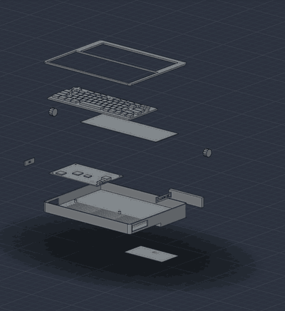
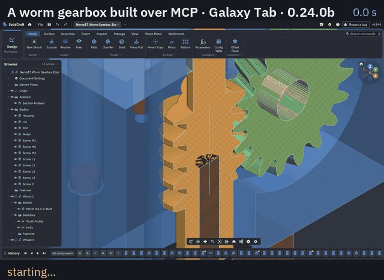
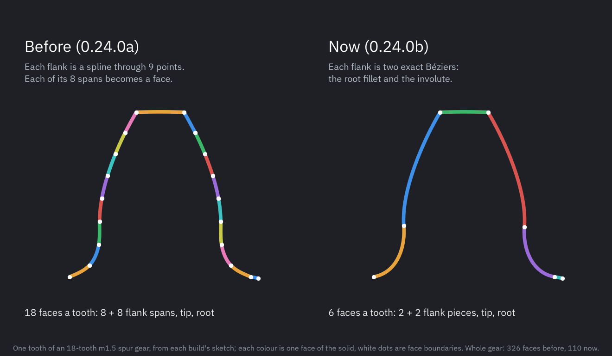
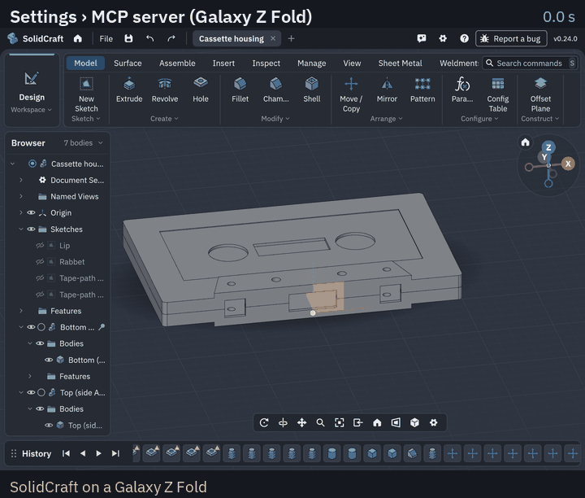

# What's new in the Android port

Each port release is an upstream SolidCraft release plus the port's own changes, named with a letter
until the next upstream release (0.24.0a, then 0.24.0b…). APKs:
[releases](https://github.com/deveshrai/Solidcraft-Android-Port/releases). What is still wrong or
missing: [android-known-issues.md](android-known-issues.md).

- [0.28.0a](#0280a): upstream 0.28.0, a crosshair for picking by finger
- [0.27.1a](#0271a): upstream 0.26 and 0.27, long threads, a thread start angle, faster checks
- [0.25.1a](#0251a): upstream 0.24.1, 0.25.0 and 0.25.1; a sturdier way to follow upstream
- [0.24.0b](#0240b): faster gears, a steadier MCP server
- [0.24.0a](#0240a): upstream 0.24.0, the MCP server, thread fixes
- [0.23.0b](#0230b): finger-scrolled menus
- [0.23.0a](#0230a): gears, upstream 0.23.0
- [0.22.0a](#0220a): helical B-rep threads, upstream 0.22.0
- [0.21.0a](#0210a): the first lettered release, upstream 0.21.0

## 0.28.0a

**Upstream 0.28.0** merged (206 commits). Among much else: drag rows in History to reorder features;
nested Browser groups, and groups and components reordered by dragging; personal Sheet Metal Rules;
the Hole type list previews each hole; Parameters can apply several edits together and sort by name;
whole bodies light up for body inputs; the 3D mouse may orbit an open sketch; Finnish, and more of
German, Danish, Polish, Ukrainian and others; DXF export strict readers accept.

**The port's own changes:**

- **Pick with a crosshair** ([port issue #2](https://github.com/deveshrai/Solidcraft-Android-Port/issues/2),
  asked for by [a2nr](https://github.com/a2nr)): a button at the end of the view bar. While it is on,
  a finger on the model aims a crosshair above the fingertip instead of orbiting, and lifting it selects
  what the crosshair is on: a thin edge, a small face. Only a finger presses the button and brings up the
  crosshair; a mouse works as before. [How to use it](android-touch.md#picking-with-a-crosshair).

  

- **Tested on a Galaxy Tab** with a DevTerm-like handheld (11 parts, exploded and orbited) and a2nr's
  drafted fixture, both over MCP: [android-devterm-test.md](android-devterm-test.md). Joins into drafted
  faces can fail first and need a retry, or stall; that is upstream's kernel, measured the same on
  upstream builds.

  

## 0.27.1a

**Upstream 0.26.0 to 0.27.1** merged (429 commits). Among much else:

- **Sketching:** an equation-driven curve (x(t), y(t)); a dimension can measure a model edge; snap where
  two guides meet; hold horizontal or vertical and line up with other points at once; press and drag
  draws one line; Sketch Intersect with faces and bodies; 3D sketch Line, Spline and Point.
- **Modelling and assemblies:** feature windows choose Join, New Body or Cut from what the material
  touches; Align places components; cut and paste features between components; Insert Design picks
  another open design; ISO 7380-1 button head cap screws in the parts library.
- **Working:** settings profiles (save, switch, export, import); a right-click menu in text fields;
  History playback on the Inspect ribbon; command search shows where a command lives in the ribbon;
  Perspective field of view and wheel zoom speed in Preferences.

**The port's own changes:**

- **Long threads.** A helical thread of more than about 85 turns (an M10 longer than about 128 mm)
  hung or failed. Threads now use 16 stations a turn (0.3 µm off the true helix on M10), and are checked
  without a second full mesh: every M10 from 15 to 220 mm builds in 0.03–0.8 s on a Mac, and a 220 mm
  lead screw in 1.2 s on a Galaxy Tab.
- **Measuring threaded parts** gives the right volume (a long screw used to measure larger than the
  bare rod) and takes seconds: Measure on the linear stage below went from 67 s to 2 s on a Mac.
- **Checks between parts a hair apart** (a screw in a bore 0.2 mm wider) mesh the two parts finer
  instead of intersecting them: clearance 551 s → 4 s, and the right distance (it said 0 mm).
- **Start angle** on a helical thread (Thread › Helical B-rep, or `start_angle`): turns the groove to
  phase it against a mating thread. A modelled screw through a modelled nut still meets it at the nut's
  ends; why, and what's next: [android-thread-mating.md](android-thread-mating.md). Saved as a pending
  design-format change (`helical-thread-start-angle`): the port now writes format 45.
- **The title bar shows the port's version**, with its letter: *v0.27.1a*.
- **Android:** upstream's new clipboard reads (theme paste, the text-field Paste) are left out on
  Android, like on the web; upstream now vendors winit 0.30.13 too, and the port's input patch is applied
  on top of it.

Tested on the emulator and a Galaxy Tab: a linear stage (guide rods, bearing blocks, lead screw, nut,
coupling, motor) built over MCP in 68 s on the tablet; a design saved by 0.24.0b opens with the same
volumes ([the run](android-thread-mating.md#5-the-test-run)).

## 0.25.1a

**Upstream 0.24.1, 0.25.0 and 0.25.1**, released in one night, merged. Among much else:

- **Modelling:** a Cone primitive; Cylinder and Box placed by reference edges, a corner or the centre;
  Sketch Transform (one box with handles to scale, move and turn a selection); add points to an existing
  spline; define a parameter as you go by typing `name = value` in a value box; better sketch dimensions
  (switch a circle between radius and diameter, delete from the right-click menu); Press Pull on a
  fillet's round face edits the fillet.
- **Working:** copy and paste bodies and components, also between designs; Send to Slicer; Canvas to
  Sketch; Insert SVG/DXF lets you place, size and turn the drawing first; reopen the designs open at the
  last quit; Repeat Last Command; dialogs open in the left column in place of the Browser and History,
  with OK and Cancel at the top.
- **Faster on big models**, new themes (CGA, 1-bit), Arabic, and Turkish and French complete.
- **Fixed in 0.25.1:** an Extrude to Object set to Join could merge bodies of different components.
- **New designs save as `.sc`**; `.solidcraft` files keep opening, and saving one keeps its name.

**Design files:** format 42 (upstream's 41 plus the helical threads). Designs saved by every earlier port
release open, gears and helical threads included; upstream's releases still ask to be updated rather
than open a port design (export STEP to share).

**Following upstream, made sturdier.** Upstream moves fast (three releases in one night), and the port now
follows it without holding it back ([android-sync.md](android-sync.md#how-the-port-stays-mergeable)):

- **Every upstream file the port changes is registered**, by area (touch input, helical threads, gears,
  design files, agents and the MCP server, kernel speed, the Android build), with the tests that prove
  each area still works; a merge that adds an unregistered change, drops a marked fix, or leaves a test
  filter matching nothing stops with the fix to make.
- **`scripts/android-sync.sh --preview`** tries the newest upstream release in a scratch worktree and
  says what it would conflict with and which port areas it touches, before anything changes; it
  predicted every conflict and fix this merge needed. `--latest` merges it.
- **Designs saved by the port are kept as tests**: a gear and a helical thread saved by 0.24.0b are now
  in upstream's design corpus, so each merge proves port designs still open and evaluate as saved.
- Port strings upstream adds with the same text are dropped automatically.

**Tested on a Galaxy Tab** ([the port report](android-port-report-0.25.1a.md), with every check and screenshot) (SM-X840): installs over 0.24.0b with settings kept; the MCP server, gears (an
18-tooth spur gear still 110 faces), helical threads and timed batches over MCP; the worm gearbox saved by
0.24.0b opens with its gears still editable; Save As offers `.sc`; touch navigation; Send to Slicer is
greyed out, as Android has no slicer to send to. Upstream's *Reopen designs* doesn't work on Android yet
([known issues](android-known-issues.md)).

## 0.24.0b

Still upstream 0.24.0. This release fixes a live session that went wrong: Claude Code in Termux on a
Galaxy Tab, designing a worm gearbox, saw its calls time out, a hub join run for over 25 minutes, and the
app closed as "not responding". The whole story, with before and after numbers:
[android-speed.md](android-speed.md).

- **The app stays responsive during an agent's long command.** Agent commands, timed batches included,
  compute off the window thread, with a chip saying what is computing and a **Stop** button; Android no
  longer closes the app.
- **Long MCP calls wait instead of timing out.** A call still running after a few minutes answers
  *"still running: call `pending`"*, and the agent waits for the result through `pending` instead of
  sending the command again. Each MCP session has its own thread, so one long call holds up no other.
- **Gears are simple B-rep.** A tooth flank is one to three exact Béziers (root fillet and involute)
  instead of a spline whose every span was a face: an 18-tooth spur gear has 110 faces instead of 326,
  the same shape to within 3.4 µm. Every boolean on a gear does less work.

  

- **Joins flat on a gear's face are quick.** The hub join that never finished on the tablet takes 5.7 s:
  the kernel no longer traces flank faces that can't reach the contact.
- **`gear.create` with bore, keyway and hub: 161 s → 2.5 s.** The hub is a disc and the bore is cut once
  through both, instead of two bores lying on each other.
- **Booleans on gears and helical threads 2–3× faster**: B-spline surfaces skip the basis functions
  that are zero, with the same results.
- **`scripts/android-sync.sh` keeps these fixes through upstream merges**: it stops when one of them goes
  missing ([android-sync.md](android-sync.md#the-ports-speed-fixes)).

Still slow, in upstream's kernel: interference and clearance between two gears (a minute or two), and a
few holes whose first boolean is retried ([known issues](android-known-issues.md)).

## 0.24.0a

**Upstream 0.24.0** (and 0.23.1), merged: among much else, a Weldments tab, the 3D sketch arc, personal Hole
presets, the navigation bar's view commands, the Clay themes, left- and right-handed threads and holes,
perspective while orbiting, and design format 39.

**New in the port:**

- **Settings › MCP server.** One switch, and Claude Code (or any MCP client) in Termux on the device, or on
  a computer on the same Wi-Fi, models in the app while you watch: the page shows the server's address and
  one command to paste, each with Copy; Advanced has the port, a `claude mcp add` command, the access
  token and starting with the app. Every request needs the token; **This device** can't be reached from
  the network. All of upstream's MCP tools work, the port's gears and helical threads too
  ([android-mcp.md](android-mcp.md)).

  

- **Tested live on a Galaxy Z Fold over Wi-Fi**: a cassette housing with five threaded M2 screws, built and
  checked to fit through the server, 121 operations in 105 s, no failures
  ([android-mcp-live-test.md](android-mcp-live-test.md)).
- **Helical threads take upstream's Thread direction.** Upstream 0.24.0 added right- and left-handed
  threads; the port's helical B-rep threads now use that row instead of their own Left-handed box. Designs
  saved by earlier port releases with a left-handed helical thread open unchanged; `left_handed: true`
  in scripts still means left.
- **Copy reaches Android's clipboard**, everywhere in the app.

**Fixed:**

- A helical thread tapped into a boss under a hollow shell was refused ("the groove removes … mm³, not
  …"), although it was right.
- An internal ISO thread with a clearance in too small a hole was made too shallow for its bolt, silently;
  it now says which drill works ("drill 1.85 mm, or make the clearance smaller").
- Back with Settings open sent the app to the background instead of closing Settings.

**Design files:** format 40 (upstream's 39 plus the helical threads). Upstream releases still can't open
port designs; export STEP to share.

## 0.23.0b

- **Ribbon menus scroll with a finger.** Upstream 0.23.0 made menu rows draggable onto the ribbon, so a
  finger could no longer scroll a long menu, and on a foldable **Model › Create** stopped at Web: Gear and
  the rest were out of reach. A finger now scrolls; a mouse still pins.
- Tested on a Galaxy Z Fold: gears, helical threads, STEP and STL, Open and Save As; a known-issues page.

## 0.23.0a

- **Gears**: ten involute types with bore, DIN 6885 keyway and hub, previewed and editable after
  ([android-gears.md](android-gears.md)); smooth twisted and scaled sweeps.
- **Upstream 0.23.0**, merged.
- **Save As** names the tab after what was typed in the picker.

## 0.22.0a

- **Helical B-rep threads**: exact threads, custom pitch on any diameter, clearance, offsets
  ([android-threads.md](android-threads.md)).
- **Upstream 0.22.0**, merged, with its Render workspace working on the device.

## 0.21.0a

- **Upstream 0.21.0**, merged; the first release named with a letter.
- Back closes what is open; a user guide for touch, mouse and keyboard, files and foldables
  ([android-touch.md](android-touch.md)).
