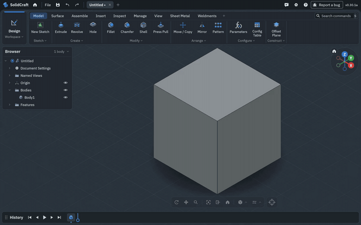
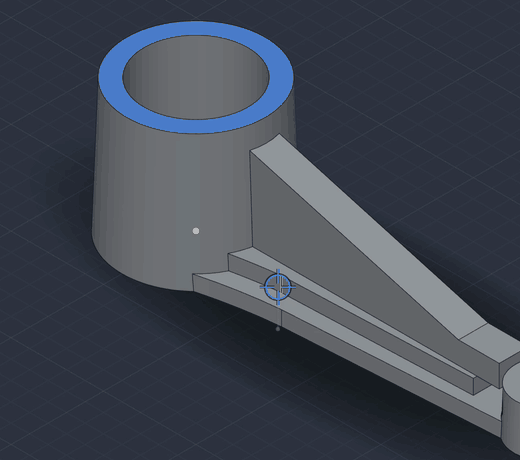
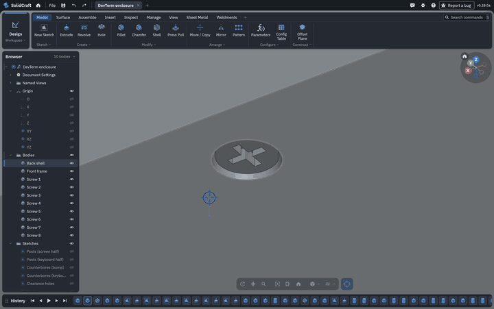
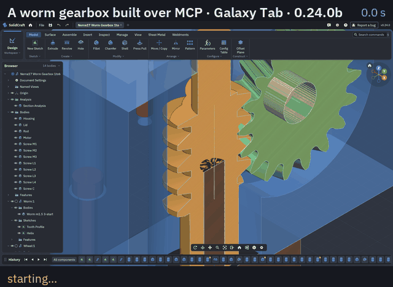
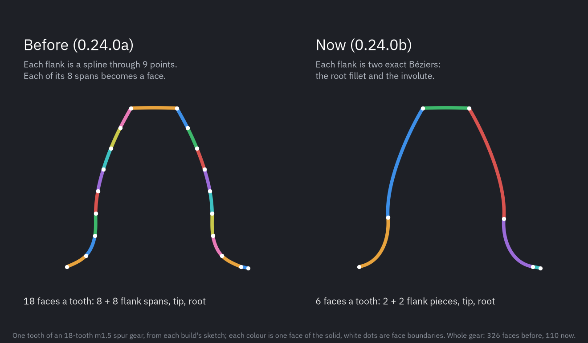
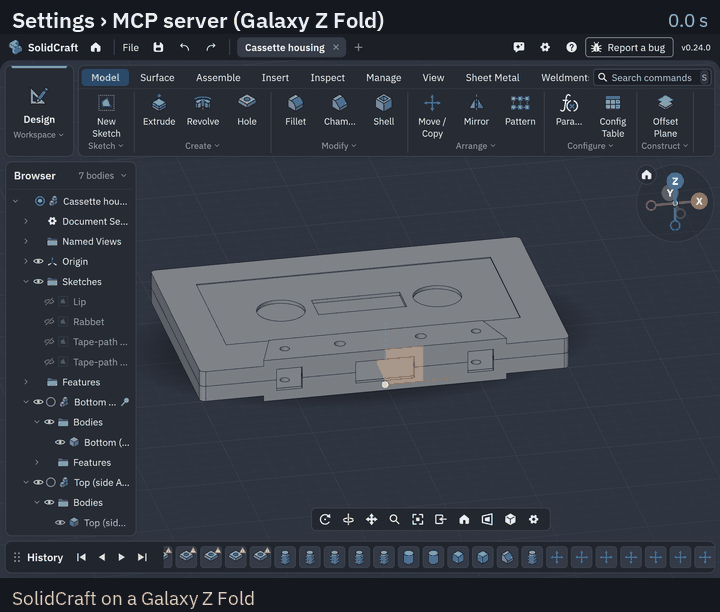

# What's new in the Android port

Each port release is an upstream SolidCraft release plus the port's own changes, named with a letter
until the next upstream release (0.24.0a, then 0.24.0b…). APKs:
[releases](https://github.com/deveshrai/Solidcraft-Android-Port/releases). What is still wrong or
missing: [android-known-issues.md](android-known-issues.md).

- [0.41.0a](#0410a): upstream 0.41.0 with plugins; SolidCraft for Android and Googlebook OS; the port's gears and helical threads retired
- [0.40.0-rc.3b](#0400-rc3b): the app's top bar below a DeX window's title bar
- [0.40.0-rc.3a](#0400-rc3a): upstream's 0.40.0-rc.3 pre-release; a model locomotive built over MCP
- [0.40.0-rc.2a](#0400-rc2a): upstream's 0.40.0-rc.2 pre-release and its new kernel, solidcore
- [0.30.1a](#0301a): upstream 0.29.0 to 0.30.1, an OpenGL ES fallback, crash reports you can save
- [0.28.0a](#0280a): upstream 0.28.0, a crosshair for picking by finger
- [0.27.1a](#0271a): upstream 0.26 and 0.27, long threads, a thread start angle, faster checks
- [0.25.1a](#0251a): upstream 0.24.1, 0.25.0 and 0.25.1; a sturdier way to follow upstream
- [0.24.0b](#0240b): faster gears, a steadier MCP server
- [0.24.0a](#0240a): upstream 0.24.0, the MCP server, thread fixes
- [0.23.0b](#0230b): finger-scrolled menus
- [0.23.0a](#0230a): gears, upstream 0.23.0
- [0.22.0a](#0220a): helical B-rep threads, upstream 0.22.0
- [0.21.0a](#0210a): the first lettered release, upstream 0.21.0

## 0.41.0a

**SolidCraft for Android and Googlebook OS.** The port is now named for both: Googlebook OS, on
Google's Googlebook laptops, is Android-based, and the app runs there in a desktop window as it
does in Samsung DeX. Two APKs: **arm64** for phones, tablets and Googlebooks with a Snapdragon
chip, and **x86_64** for Googlebooks with an Intel chip (which would otherwise translate the arm64
code). Neither has been tried on a Googlebook yet.

**Upstream 0.41.0** merged (a stable release, after the 0.40 pre-releases). Its headline:
**plugins**, sandboxed WebAssembly that works through SolidCraft's own commands, installed from a
`.zip` in Settings › Plugins; the first is [SolidCraft Gears](https://github.com/bherbruck/solidcraft-gears),
an involute spur gear generator. Also: a Constrain dialog for assemblies, fillets and chamfers that
hold up on real parts, STEP import that keeps faces it used to drop, sheet-metal folds that no
longer shatter into strips, snap points everywhere, and much more
([upstream's notes](https://github.com/tangency-labs/solidcraft/releases/tag/v0.41.0)).

**The port's gears and helical threads are retired.** With plugins upstream (gears among them)
and upstream's exact modelled threads, the port's own Gear command and helical B-rep threads were
taken out; they may come back as plugins. What it means for your designs:

- **Designs saved by earlier port releases open.** Each helical thread becomes upstream's modelled
  thread on the same face: an ISO designation (M10) keeps its size and pitch; a custom pitch gives
  way to the size the face takes. Clearance, offsets and the start angle are gone from the model,
  but every value is kept in the design's metadata (`io.github.deveshrai.solidcraft-android`), so
  nothing saved is lost. For the exact old geometry, export STEP from 0.40.0-rc.3b first.
- **Gears stay** as ordinary sketches and features; only Edit Gear is gone.
- **Designs are upstream's own format now** (55): what you save on Android opens in upstream
  SolidCraft 0.41.0 on a computer, and the reverse.

**Kept:** touch (orbit, pan, pinch, the crosshair picker, finger-scrolled menus), the MCP server on
the network, desktop windows in DeX, crash reports you can save, and the OpenGL ES and Adreno
fallbacks, all carried over to upstream's reorganised code (its new `ui-kit` and `viewport-gpu`
crates).

**Tested** on the Android emulator: the locomotive and track built over MCP, and designs from every
earlier port release opened ([the test](android-0410a-test.md)). **Not tested yet:** a phone,
tablet or Googlebook, and plugins on a device ([known issues](android-known-issues.md)).

## 0.40.0-rc.3b

A pre-release, like 0.40.0-rc.3a, with one fix: **in a Samsung DeX window the app's top bar (File,
Settings, the design tabs, Report a bug) was hidden under the window's title bar**, so Settings
couldn't be reached without going full screen. The app now keeps below a desktop window's title
bar; full screen, phones and tablets out of DeX look as before
([before and after](android-0400rc3a-test.md#4-0400-rc3b-settings-in-a-dex-window)).

## 0.40.0-rc.3a

**A pre-release, like upstream's** [0.40.0-rc.3](https://github.com/tangency-labs/solidcraft/releases/tag/v0.40.0-rc.3).
Designs saved in it are format 52 (upstream's 51 plus the port's helical threads), which 0.30.1a and
0.40.0-rc.2a can't open. It installs over 0.40.0-rc.2a and 0.30.1a; for work, stay on
[0.30.1a](https://github.com/deveshrai/Solidcraft-Android-Port/releases/tag/v0.30.1a-android).

**Upstream 0.40.0-rc.3** merged (395 commits). For threads: an external modelled thread now runs
down to a shoulder and is trimmed at its face, so a nut seats on a bolt's head (it stopped up to a
turn short), and a modelled thread on one hole no longer stops the next one taking a thread. Also:
interference checks run in the background, Edit in Place for linked designs, an opt-in setting to
remember dialog values, faster mesh export, and many fixes and translations.

**The port's own changes:** none to its features. The merge keeps every port hook (touch, the
crosshair, gears, helical threads, crash reports, the MCP server) beside upstream's changes; port
strings upstream now has use upstream's text.

**Tested** on a Galaxy Tab (Android 17, Mali-G1-Ultra, in DeX): an agent built a 3D-printable
G-scale locomotive mechanism and 400 mm of track, 51 parts in 95 MCP calls, in 9.0 s, with no two
parts overlapping ([the test](android-0400rc3a-test.md)). GPU tessellation works on the Mali GPU.

## 0.40.0-rc.2a

**A pre-release, like upstream's.** Upstream's [0.40.0-rc.2](https://github.com/tangency-labs/solidcraft/releases/tag/v0.40.0-rc.2)
is for people who choose to test it, and so is this. Designs saved in it are format 51 (upstream's 50
plus the port's helical threads), which 0.30.1a can't open: keep a copy of anything you care about.
Stay on [0.30.1a](https://github.com/deveshrai/Solidcraft-Android-Port/releases/tag/v0.30.1a-android) for
work. Android installs it over 0.30.1a, and 0.40.0a will install over it; going back to 0.30.1a means
uninstalling first, which deletes the app's own settings and crash reports (save designs elsewhere first).

**Upstream 0.40.0-rc.2** merged (696 commits). Its headline: **solidcore**, a new pure-Rust geometry
kernel, replaces truck for every boolean, fillet, shell and thread. Modelled threads are exact
helical sweeps with many more forms (trapezoidal, Acme, buttress, pipe), several starts, both hands,
runouts and chamfered tips. Also new: Align follows frames, Find Limits on joints, new Preferences
layouts, and many fixes. Upstream lists its own known problems with solidcore (variable fillets,
some shells, planar faces with more triangles) in [its release notes](https://github.com/tangency-labs/solidcraft/releases/tag/v0.40.0-rc.2).

**The port's own changes:**

- **Helical threads on solidcore.** The port's thread (any pitch, depth, flank angle, clearance,
  offsets, start angle) is now an exact screw sweep cut by one boolean, as upstream's threads are; its
  old truck code is gone. In the Thread dialog, **Custom** ends upstream's **Form** list, and a
  modelled ISO metric thread has a **Helical B-rep** box. `hand: both` works for helical threads too.
- **Helical threads run off a free end** with a negative start or end offset (to one pitch), so a nut
  with countersinks fits its bolt; before, the partial turn where the groove began stood across the
  mating thread ([the bolt and nut](android-0400rc2a-test.md#4-a-bolt-and-its-nut)).
- **Gears** work on solidcore unchanged.
- **No more crash at every launch on Adreno GPUs.** Upstream 0.40's GPU tessellation shader crashes
  Qualcomm's compiler (Galaxy Z Fold, Adreno 840), and a driver crash can't be caught. Bodies are built
  on the CPU on Adreno under Android, and a launch that dies compiling that shader on any other GPU sends
  the next ones to the CPU.
- **Designs from every earlier port release still open**, threads included.
- **Tested on a Galaxy Z Fold** (Android 17) over MCP: five gear types and five threads, port and
  upstream, all built ([the test](android-0400rc2a-test.md)).

## 0.30.1a

**Upstream 0.29.0, 0.30.0 and 0.30.1** merged (442 commits). Among much else: Preferences in twelve
pages under four headings, saved as soon as they change; lasso selection; Measure starts with your
selection and takes construction geometry; Sketch Offset with several copies; Plane through an axis
and a point; keep and compare renders; a Render workspace with one editor per selection; inch
fasteners; security fixes for agent chat, lock files and API keys. Designs are now format 49 (upstream's
48 plus the port's helical threads).

**The port's own changes:**

- **A phone whose graphics can't start no longer just closes**
  ([port issue #4](https://github.com/deveshrai/Solidcraft-Android-Port/issues/4), a Galaxy A04): the app
  leaves cleanly instead of being aborted, and the next launch starts on OpenGL ES; a launch that can't
  start writes `startup-error.txt` where a computer can reach it over USB.
- **The 3D view draws on OpenGL ES.** Upstream 0.30.1's viewport shader doesn't compile there (an
  `invariant` OpenGL ES refuses), which left the view empty on any GPU without working Vulkan; the port
  compiles it without that on OpenGL.
- **Crash reports you can save:** they're announced at the next start, and Help › Crash Reports has
  **Save a copy** on each, through Android's picker. **Report…** and **Report a bug** draft the issue on
  this port's tracker.
- **Tested on a Pixel Tablet emulator** on both Vulkan and OpenGL ES, with the DevTerm enclosure, a
  helical gear and a helical thread over MCP: [android-0301a-test.md](android-0301a-test.md).

## 0.28.0a

**Upstream 0.28.0** merged (206 commits). Among much else: drag rows in History to reorder features;
nested Browser groups, and groups and components reordered by dragging; personal Sheet Metal Rules;
the Hole type list previews each hole; Parameters can apply several edits together and sort by name;
whole bodies light up for body inputs; the 3D mouse may orbit an open sketch; Finnish, and more of
German, Danish, Polish, Ukrainian and others; DXF export strict readers accept.

**The port's own changes:**

- **Pick with a crosshair** ([port issue #2](https://github.com/deveshrai/Solidcraft-Android-Port/issues/2),
  asked for by [a2nr](https://github.com/a2nr)): a button at the end of the view bar. While it is on,
  a finger on the model aims a crosshair above the fingertip instead of orbiting, and lifting it selects
  what the crosshair is on: a thin edge, a small face. Only a finger presses the button and brings up the
  crosshair; a mouse works as before. [How to use it](android-touch.md#picking-with-a-crosshair).

  

- **Tested on a Galaxy Tab** with a DevTerm-like handheld and its screwed enclosure, and a2nr's
  drafted fixture, both over MCP: [android-devterm-test.md](android-devterm-test.md). Joins into drafted
  faces can fail first and need a retry, or stall; that is upstream's kernel, measured the same on
  upstream builds.

  

## 0.27.1a

**Upstream 0.26.0 to 0.27.1** merged (429 commits). Among much else:

- **Sketching:** an equation-driven curve (x(t), y(t)); a dimension can measure a model edge; snap where
  two guides meet; hold horizontal or vertical and line up with other points at once; press and drag
  draws one line; Sketch Intersect with faces and bodies; 3D sketch Line, Spline and Point.
- **Modelling and assemblies:** feature windows choose Join, New Body or Cut from what the material
  touches; Align places components; cut and paste features between components; Insert Design picks
  another open design; ISO 7380-1 button head cap screws in the parts library.
- **Working:** settings profiles (save, switch, export, import); a right-click menu in text fields;
  History playback on the Inspect ribbon; command search shows where a command lives in the ribbon;
  Perspective field of view and wheel zoom speed in Preferences.

**The port's own changes:**

- **Long threads.** A helical thread of more than about 85 turns (an M10 longer than about 128 mm)
  hung or failed. Threads now use 16 stations a turn (0.3 µm off the true helix on M10), and are checked
  without a second full mesh: every M10 from 15 to 220 mm builds in 0.03–0.8 s on a Mac, and a 220 mm
  lead screw in 1.2 s on a Galaxy Tab.
- **Measuring threaded parts** gives the right volume (a long screw used to measure larger than the
  bare rod) and takes seconds: Measure on the linear stage below went from 67 s to 2 s on a Mac.
- **Checks between parts a hair apart** (a screw in a bore 0.2 mm wider) mesh the two parts finer
  instead of intersecting them: clearance 551 s → 4 s, and the right distance (it said 0 mm).
- **Start angle** on a helical thread (Thread › Helical B-rep, or `start_angle`): turns the groove to
  phase it against a mating thread. A modelled screw through a modelled nut still meets it at the nut's
  ends; why, and what's next: [android-thread-mating.md](https://github.com/deveshrai/Solidcraft-Android-Port/blob/v0.40.0-rc.3b-android/docs/android-thread-mating.md). Saved as a pending
  design-format change (`helical-thread-start-angle`): the port now writes format 45.
- **The title bar shows the port's version**, with its letter: *v0.27.1a*.
- **Android:** upstream's new clipboard reads (theme paste, the text-field Paste) are left out on
  Android, like on the web; upstream now vendors winit 0.30.13 too, and the port's input patch is applied
  on top of it.

Tested on the emulator and a Galaxy Tab: a linear stage (guide rods, bearing blocks, lead screw, nut,
coupling, motor) built over MCP in 68 s on the tablet; a design saved by 0.24.0b opens with the same
volumes ([the run](https://github.com/deveshrai/Solidcraft-Android-Port/blob/v0.40.0-rc.3b-android/docs/android-thread-mating.md#5-the-test-run)).

## 0.25.1a

**Upstream 0.24.1, 0.25.0 and 0.25.1**, released in one night, merged. Among much else:

- **Modelling:** a Cone primitive; Cylinder and Box placed by reference edges, a corner or the centre;
  Sketch Transform (one box with handles to scale, move and turn a selection); add points to an existing
  spline; define a parameter as you go by typing `name = value` in a value box; better sketch dimensions
  (switch a circle between radius and diameter, delete from the right-click menu); Press Pull on a
  fillet's round face edits the fillet.
- **Working:** copy and paste bodies and components, also between designs; Send to Slicer; Canvas to
  Sketch; Insert SVG/DXF lets you place, size and turn the drawing first; reopen the designs open at the
  last quit; Repeat Last Command; dialogs open in the left column in place of the Browser and History,
  with OK and Cancel at the top.
- **Faster on big models**, new themes (CGA, 1-bit), Arabic, and Turkish and French complete.
- **Fixed in 0.25.1:** an Extrude to Object set to Join could merge bodies of different components.
- **New designs save as `.sc`**; `.solidcraft` files keep opening, and saving one keeps its name.

**Design files:** format 42 (upstream's 41 plus the helical threads). Designs saved by every earlier port
release open, gears and helical threads included; upstream's releases still ask to be updated rather
than open a port design (export STEP to share).

**Following upstream, made sturdier.** Upstream moves fast (three releases in one night), and the port now
follows it without holding it back ([android-sync.md](android-sync.md#how-the-port-stays-mergeable)):

- **Every upstream file the port changes is registered**, by area (touch input, helical threads, gears,
  design files, agents and the MCP server, kernel speed, the Android build), with the tests that prove
  each area still works; a merge that adds an unregistered change, drops a marked fix, or leaves a test
  filter matching nothing stops with the fix to make.
- **`scripts/android-sync.sh --preview`** tries the newest upstream release in a scratch worktree and
  says what it would conflict with and which port areas it touches, before anything changes; it
  predicted every conflict and fix this merge needed. `--latest` merges it.
- **Designs saved by the port are kept as tests**: a gear and a helical thread saved by 0.24.0b are now
  in upstream's design corpus, so each merge proves port designs still open and evaluate as saved.
- Port strings upstream adds with the same text are dropped automatically.

**Tested on a Galaxy Tab** ([the port report](android-port-report-0.25.1a.md), with every check and screenshot) (SM-X840): installs over 0.24.0b with settings kept; the MCP server, gears (an
18-tooth spur gear still 110 faces), helical threads and timed batches over MCP; the worm gearbox saved by
0.24.0b opens with its gears still editable; Save As offers `.sc`; touch navigation; Send to Slicer is
greyed out, as Android has no slicer to send to. Upstream's *Reopen designs* doesn't work on Android yet
([known issues](android-known-issues.md)).

## 0.24.0b

Still upstream 0.24.0. This release fixes a live session that went wrong: Claude Code in Termux on a
Galaxy Tab, designing a worm gearbox, saw its calls time out, a hub join run for over 25 minutes, and the
app closed as "not responding". The whole story, with before and after numbers:
[android-speed.md](https://github.com/deveshrai/Solidcraft-Android-Port/blob/v0.40.0-rc.3b-android/docs/android-speed.md).

- **The app stays responsive during an agent's long command.** Agent commands, timed batches included,
  compute off the window thread, with a chip saying what is computing and a **Stop** button; Android no
  longer closes the app.
- **Long MCP calls wait instead of timing out.** A call still running after a few minutes answers
  *"still running: call `pending`"*, and the agent waits for the result through `pending` instead of
  sending the command again. Each MCP session has its own thread, so one long call holds up no other.
- **Gears are simple B-rep.** A tooth flank is one to three exact Béziers (root fillet and involute)
  instead of a spline whose every span was a face: an 18-tooth spur gear has 110 faces instead of 326,
  the same shape to within 3.4 µm. Every boolean on a gear does less work.

  

- **Joins flat on a gear's face are quick.** The hub join that never finished on the tablet takes 5.7 s:
  the kernel no longer traces flank faces that can't reach the contact.
- **`gear.create` with bore, keyway and hub: 161 s → 2.5 s.** The hub is a disc and the bore is cut once
  through both, instead of two bores lying on each other.
- **Booleans on gears and helical threads 2–3× faster**: B-spline surfaces skip the basis functions
  that are zero, with the same results.
- **`scripts/android-sync.sh` keeps these fixes through upstream merges**: it stops when one of them goes
  missing ([android-sync.md](android-sync.md#the-ports-speed-fixes)).

Still slow, in upstream's kernel: interference and clearance between two gears (a minute or two), and a
few holes whose first boolean is retried ([known issues](android-known-issues.md)).

## 0.24.0a

**Upstream 0.24.0** (and 0.23.1), merged: among much else, a Weldments tab, the 3D sketch arc, personal Hole
presets, the navigation bar's view commands, the Clay themes, left- and right-handed threads and holes,
perspective while orbiting, and design format 39.

**New in the port:**

- **Settings › MCP server.** One switch, and Claude Code (or any MCP client) in Termux on the device, or on
  a computer on the same Wi-Fi, models in the app while you watch: the page shows the server's address and
  one command to paste, each with Copy; Advanced has the port, a `claude mcp add` command, the access
  token and starting with the app. Every request needs the token; **This device** can't be reached from
  the network. All of upstream's MCP tools work, the port's gears and helical threads too
  ([android-mcp.md](android-mcp.md)).

  

- **Tested live on a Galaxy Z Fold over Wi-Fi**: a cassette housing with five threaded M2 screws, built and
  checked to fit through the server, 121 operations in 105 s, no failures
  ([android-mcp-live-test.md](android-mcp-live-test.md)).
- **Helical threads take upstream's Thread direction.** Upstream 0.24.0 added right- and left-handed
  threads; the port's helical B-rep threads now use that row instead of their own Left-handed box. Designs
  saved by earlier port releases with a left-handed helical thread open unchanged; `left_handed: true`
  in scripts still means left.
- **Copy reaches Android's clipboard**, everywhere in the app.

**Fixed:**

- A helical thread tapped into a boss under a hollow shell was refused ("the groove removes … mm³, not
  …"), although it was right.
- An internal ISO thread with a clearance in too small a hole was made too shallow for its bolt, silently;
  it now says which drill works ("drill 1.85 mm, or make the clearance smaller").
- Back with Settings open sent the app to the background instead of closing Settings.

**Design files:** format 40 (upstream's 39 plus the helical threads). Upstream releases still can't open
port designs; export STEP to share.

## 0.23.0b

- **Ribbon menus scroll with a finger.** Upstream 0.23.0 made menu rows draggable onto the ribbon, so a
  finger could no longer scroll a long menu, and on a foldable **Model › Create** stopped at Web: Gear and
  the rest were out of reach. A finger now scrolls; a mouse still pins.
- Tested on a Galaxy Z Fold: gears, helical threads, STEP and STL, Open and Save As; a known-issues page.

## 0.23.0a

- **Gears**: ten involute types with bore, DIN 6885 keyway and hub, previewed and editable after
  ([android-gears.md](https://github.com/deveshrai/Solidcraft-Android-Port/blob/v0.40.0-rc.3b-android/docs/android-gears.md)); smooth twisted and scaled sweeps.
- **Upstream 0.23.0**, merged.
- **Save As** names the tab after what was typed in the picker.

## 0.22.0a

- **Helical B-rep threads**: exact threads, custom pitch on any diameter, clearance, offsets
  ([android-threads.md](https://github.com/deveshrai/Solidcraft-Android-Port/blob/v0.40.0-rc.3b-android/docs/android-threads.md)).
- **Upstream 0.22.0**, merged, with its Render workspace working on the device.

## 0.21.0a

- **Upstream 0.21.0**, merged; the first release named with a letter.
- Back closes what is open; a user guide for touch, mouse and keyboard, files and foldables
  ([android-touch.md](android-touch.md)).
